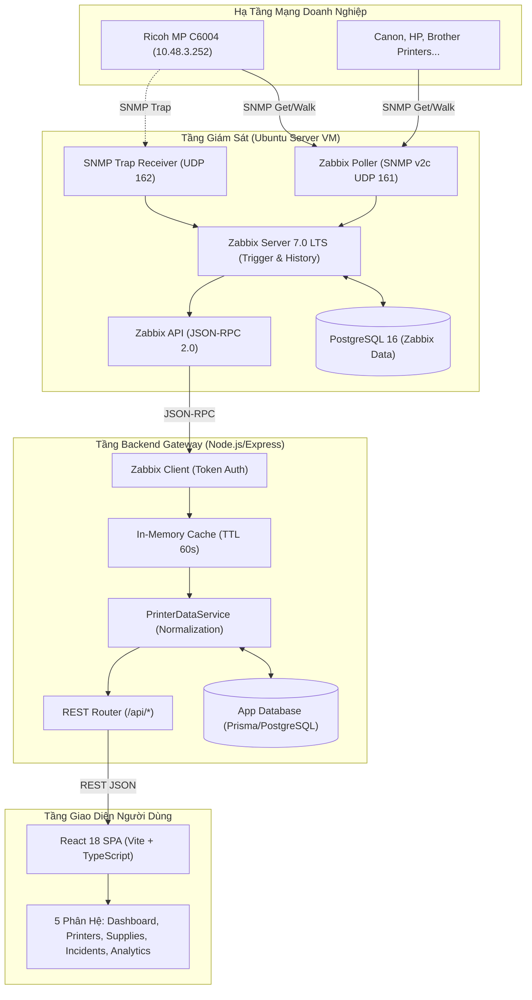

# ARCHITECTURE.md — Kiến Trúc Hệ Thống Giám Sát Máy In

> **Hệ Thống Giám Sát & Quản Lý Máy In Mạng Tập Trung (Printer Monitoring System)**  
> Bản mô tả thiết kế kiến trúc kỹ thuật, luồng dữ liệu và các quyết định cốt lõi  
> Cập nhật lần cuối: Tháng 10/2026 | Phiên bản: 1.0.0

---

## 1. Mục Đích & Phạm Vi Tài Liệu

Tài liệu này mô tả chi tiết kiến trúc tổng thể của **Hệ Thống Giám Sát & Quản Lý Máy In Mạng Tập Trung**.

Tài liệu giải thích:
- Các thành phần chính trong hệ thống và trách nhiệm của từng tầng.
- Luồng dữ liệu chuẩn từ thiết bị vật lý tới người dùng cuối.
- Các quyết định kiến trúc kỹ thuật (Architectural Decisions) định hình việc hiện thực hóa mã nguồn.
- Trạng thái kỹ thuật thực tế của từng phân hệ trong repository.

> [!NOTE]  
> - Đặc tả yêu cầu chức năng, phi chức năng và độ ưu tiên nằm tại: [docs/SPECIFICATION.md](file:///f:/Code/Github/Monitoring/docs/SPECIFICATION.md).  
> - Bảng tra cứu OID, phương pháp kiểm chứng dữ liệu SNMP nằm tại: [docs/DATA_SOURCES.md](file:///f:/Code/Github/Monitoring/docs/DATA_SOURCES.md).  
> - Danh mục chi tiết ánh xạ UI với OID nằm tại: [docs/PRINTER_DATA_REQUIREMENTS.md](file:///f:/Code/Github/Monitoring/docs/PRINTER_DATA_REQUIREMENTS.md).  
> - Bức tranh tổng quan repository, cấu trúc thư mục và checklist nằm tại: [docs/REPO_OVERVIEW.md](file:///f:/Code/Github/Monitoring/docs/REPO_OVERVIEW.md).

---

## 2. Trạng Thái Hiện Thực Kỹ Thuật (Architecture Status)

Dưới đây là ma trận phản ánh chính xác trạng thái của từng phân hệ trong kho mã nguồn:

| Phân hệ / Tầng kiến trúc | Trạng thái kỹ thuật | Mô tả chi tiết hiện trạng |
| :--- | :---: | :--- |
| **Máy in mạng vật lý (Ricoh MP C6004)** | Đang hoạt động | Thiết bị tham chiếu vật lý khả dụng tại địa chỉ IP `10.48.3.252`. |
| **Kho OID/MIB & Dữ liệu kiểm chứng** | Đã chuẩn hóa | Quản lý tập trung tại `docs/snmp-oids/` và `docs/models/`; dữ liệu đo đạc thực tế đối chiếu từ Ricoh MP C6004. |
| **Hạ tầng Zabbix 7.0 LTS & Web** | Dịch vụ độc lập bên ngoài | Triển khai độc lập trên máy ảo Ubuntu Server; quản trị viên cấu hình Hosts/Templates qua Zabbix Web UI. Backend kết nối qua JSON-RPC API. |
| **Quy cách Zabbix Templates** | Lưu trữ tại templates/ | Toàn bộ template YAML được lưu trữ sẵn trong thư mục gốc `templates/`, sẵn sàng import vào Zabbix server. |
| **Backend API Gateway** | Đã dựng khung (Skeleton) | Mã nguồn Express 4 + TypeScript + Prisma + Zabbix JSON-RPC Client trong thư mục `backend/`. |
| **Ứng dụng Web Frontend** | Hoàn thành giao diện mẫu | React 18 + Vite 5 + TypeScript trong `frontend/`; 19 unit test cases Vitest đạt 100% Pass. |

> [!IMPORTANT]  
> Frontend hiện đang ở chế độ chờ kết nối (`No Data / Pending State`) hoặc hiển thị danh bạ mẫu khi dev. Frontend chưa kết nối trực tiếp với Zabbix Server đang chạy live.

---

## 3. Luồng Dữ Liệu Xác Nhận (Confirmed Data Flow)

Hệ thống tuân thủ nghiêm ngặt mô hình luồng dữ liệu 5 bước:



### Lưu ý bãi bỏ kiến trúc cũ (Superseded Architecture)
Giai đoạn thử nghiệm sơ khai từng sử dụng Prometheus, SNMP Exporter và Grafana. Toàn bộ stack này đã bị **bãi bỏ hoàn toàn** và thay thế bằng Zabbix 7.0 LTS do Zabbix vượt trội về khả năng phát hiện lỗi tự động (LLD), quản lý trigger theo bitmask, hỗ trợ SNMP Trap và có API JSON-RPC linh hoạt. Không tham chiếu đến Prometheus metric names trong các mã nguồn mới.

---

## 4. Trách Nhiệm Của Từng Thành Phần

| Thành phần | Công nghệ | Trách nhiệm cốt lõi |
| :--- | :--- | :--- |
| **Máy in mạng** | Firmware hãng | Cung cấp dữ liệu SNMP (thông tin thiết bị, mức vật tư, bảng cảnh báo `prtAlertTable`, bộ đếm sản lượng). |
| **Zabbix Server 7.0** | C / Alpine | Thu thập định kỳ OID SNMP, bắt trap thời gian thực, lưu trữ raw history và trends, kích hoạt trigger khi có lỗi phần cứng. |
| **PostgreSQL 16** | Database Engine | Lưu trữ toàn bộ dữ liệu cấu hình, lịch sử đo đạc của Zabbix Server và bảng nghiệp vụ ứng dụng (Incident lifecycle). |
| **Backend API Gateway** | Express / Prisma | - Giữ bí mật thông tin xác thực Zabbix API ở server-side.<br/>- Đệm dữ liệu (Caching 60s) giảm tải cho Zabbix.<br/>- Chuẩn hóa dữ liệu Zabbix sang REST schema frontend.<br/>- Chịu trách nhiệm khử trùng lặp và ghi nhận xử lý sự cố. |
| **Web Frontend** | React / Vite | Hiển thị giao diện điều hành trực quan, đa chủ đề (Dark/Light), hỗ trợ lọc tìm kiếm tức thì và cảnh báo theo thời gian thực. |

---

## 5. Kiến Trúc Backend API (`backend/`)

Mã nguồn Backend được xây dựng theo mô hình **Modular Monolith** phân tách rõ ràng 3 lớp:

```
backend/
├── src/
│   ├── index.ts               # Khởi tạo Express server, CORS, mount routes
│   ├── zabbix/
│   │   └── client.ts          # ZabbixClient (JSON-RPC client kết nối Zabbix 7.0 API)
│   ├── services/
│   │   └── printerDataService.ts # Service nghiệp vụ: Caching TTL 60s, Stale-while-revalidate, Adapter mapping
│   ├── api/
│   │   └── routes/
│   │       └── printers.ts    # Express Router cung cấp REST endpoints
│   └── types/
│       ├── zabbix.ts          # Khai báo kiểu dữ liệu Zabbix JSON-RPC Response
│       └── api.ts             # Khai báo kiểu dữ liệu REST API (khớp 100% với Frontend)
└── prisma/
    └── schema.prisma          # Mô hình dữ liệu cơ sở dữ liệu ứng dụng
```

### 5.1 Caching Strategy & Khả năng kháng lỗi (Resilience)
- **TTL Cache**: Backend lưu snapshot dữ liệu Zabbix trong bộ nhớ đệm (In-memory cache) với thời gian sống 60 giây. Mọi request từ nhiều client frontend trong khoảng thời gian này đều được phục vụ ngay tức thì (< 50ms) mà không cần gọi lại Zabbix API.
- **Stale-While-Revalidate**: Khi kết nối Zabbix API bị timeout hoặc mất mạng tạm thời, Backend tự động trả về snapshot thành công gần nhất kèm thuộc tính `isStale: true`. Giao diện Frontend vẫn duy trì hiển thị thông tin kèm cảnh báo màu vàng, không gây sập màn hình người dùng.

### 5.2 Danh mục REST Endpoints chuẩn
| Phương thức | Endpoint | Chức năng | Phản hồi |
| :--- | :--- | :--- | :--- |
| `GET` | `/health` | Kiểm tra tình trạng sống của Backend Gateway | `{ status: "ok", timestamp }` |
| `GET` | `/api/printers` | Danh sách toàn bộ máy in kèm telemetry mới nhất | `PrinterResponse[]` |
| `GET` | `/api/printers/:id` | Chi tiết 1 máy in theo ID | `PrinterResponse` |
| `GET` | `/api/incidents` | Danh sách sự cố phần cứng đang phát sinh hoặc đã đóng | `IncidentResponse[]` |
| `POST` | `/api/incidents/:id/resolve` | Tiếp nhận và giải quyết một sự cố | `{ success: boolean, message }` |

---

## 6. Kiến Trúc Frontend Web (`frontend/`)

- **Nền tảng**: React 18, Vite 5, Strict TypeScript, Chart.js, Lucide Icons.
- **Chuẩn hóa kiểu dữ liệu**: Sử dụng `MetricValue = number | null` cho toàn bộ các chỉ số đo đạc (mực in, bộ đếm). Nullable fields được xử lý tường minh, loại bỏ hoàn toàn các lỗi runtime do ép kiểu chuỗi.
- **Custom Data Hook (`usePrinterData.ts`)**: Quản lý vòng đời dữ liệu, tự động polling mỗi 30 giây, tích hợp `AbortController` hủy bỏ request khi component unmount, hỗ trợ refresh thủ công và fallback dữ liệu cũ an toàn.
- **Tầng tính toán thuần khiết (`fleetService.ts`)**: Toàn bộ logic tính toán thống kê (phân bổ kết nối, phân bổ hãng sản xuất, phát hiện máy in cần chú ý) được đóng gói thành các pure functions và kiểm thử tự động bằng Vitest (19 test cases đạt 100% Pass).

---

## 7. Cơ Chế Bóc Tách & Phát Hiện Lỗi Phần Cứng (Hardware Error Flow)

Phát hiện lỗi phần cứng là tính năng ưu tiên số 1 của hệ thống:

```
1. Thiết bị gặp lỗi (Kẹt giấy, hết giấy khay 3, mực thải đầy, mở nắp).
   │
2. Máy in ghi nhận dòng lỗi mới vào bảng SNMP prtAlertTable và cập nhật bitmask lỗi của hãng.
   │
3. Cơ chế LLD (Low-Level Discovery) của Zabbix phát hiện index mới trong prtAlertTable.
   │
4. Zabbix Trigger kích hoạt: prtAlertSeverityLevel = 3 (Critical) hoặc = 4 (Warning).
   Đối với Ricoh: Bitmask ricohScannerErrorStatus > 0 hoặc ricohMfpErrorSummary > 0 kích hoạt trigger chuyên biệt.
   │
5. Backend API truy vấn problem.get từ Zabbix API:
   Trích xuất alertCode, alertDescription, severity và thời gian clock.
   │
6. Backend kiểm tra bảng IncidentRecord trong Database:
   Nếu sự cố đã tồn tại -> cập nhật lastSeen; Nếu chưa -> tạo sự cố mới (Deduplication).
   │
7. Frontend nhận dữ liệu và hiển thị ngay lập tức trên thanh thông báo, trang Incidents và Modal chi tiết máy in.
```

---

## 8. Bảo Mật Hệ Thống (Security Architecture)

1. **Phân tách ranh giới bảo mật mạng**:
   - Máy in và Zabbix Server nằm trong mạng nội bộ hoặc VLAN quản trị thiết bị.
   - Backend Gateway đóng vai trò Reverse Proxy & API Adapter, chỉ mở port HTTP ra ngoài cho Frontend.
2. **Quản lý bí mật thông tin (Secret Management)**:
   - Toàn bộ chuỗi SNMP Community, mật khẩu Database, tài khoản Zabbix API được quản lý qua biến môi trường (`.env`) trên máy chủ.
   - Tuyệt đối không hardcode bí mật trong mã nguồn hoặc gói build tĩnh của trình duyệt.
3. **CORS & Input Sanitization**:
   - Backend cấu hình whitelist domain cụ thể truy cập API.
   - Mọi payload gửi lên endpoint `/api/incidents/:id/resolve` được kiểm tra tính hợp lệ trước khi ghi nhận vào database.

---
*Tài liệu được bảo trì và tuân thủ nghiêm ngặt các quy tắc trong [docs/AGENTS.md](file:///f:/Code/Github/Monitoring/docs/AGENTS.md).*
