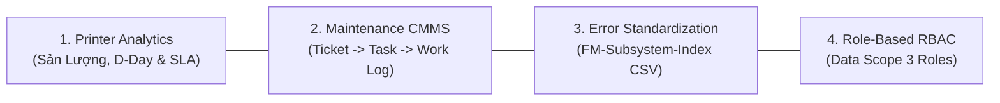

# FleetMonitor — Tổng Quan Dự Án & Sơ Đồ Hệ Thống (Project Overview & Master Index)

> **Dự án:** FleetMonitor — Hệ thống Giám sát & Quản trị Máy in Doanh nghiệp Tập trung  
> **Quy mô:** Hạm đội ~100 máy in đa thương hiệu (Ricoh, Canon, HP, Brother, Epson, Xerox) phân bổ trên 5 tầng/khu vực  
> **Phiên bản:** 2.6.0  
> **Trạng thái:** Master Architecture & Implementation Index (Mục lục tra cứu tài liệu kỹ thuật tối cao)

---

## 1. Tầm Nhìn & 4 Trọng Tâm Chiến Lược Nghiệp Vụ

FleetMonitor là giải pháp quản trị vòng đời thiết bị in ấn tập trung cấp doanh nghiệp, chuyển đổi từ mô hình bảo trì thụ động (chờ người dùng báo hỏng) sang mô hình **Vận hành Chủ động & Dự báo Sớm (Proactive AIOps Monitoring)**:



1. **Printer Analytics & Telemetry:**
   - Trực quan hóa 100% Pure React SVG (Soft Spline 2.25px, Cột Ngang Stacked, Khung Ghim Đối Chiếu Sandbox cùng thang đo).
   - Dự báo cạn kiệt vật tư theo thời gian thực với huy hiệu đếm ngược **D-Day** (`[D-4]`, `[D-7]`, `[D-25]`) dựa trên tốc độ tiêu hao trượt 7 ngày.
   - Theo dõi sát sao tình trạng Hộp mực thải (Bình thường, Sắp đầy ⚠️, Đầy 🛑).
2. **Maintenance CMMS Management:**
   - Quản lý khép kín vòng đời 3 tầng: `Ticket (Sự cố) -> Task (Lệnh bảo trì) -> Work Log (Nhật ký thực địa & Chi phí VNĐ)`.
   - Lưu trữ ảnh hiện trường và biên bản nghiệm thu trực tiếp lên MinIO S3 qua Presigned URLs.
   - Dynamic Stepper SOP tự động tính % hoàn thành và tự động xóa task khỏi biểu đồ Gantt khi chuyển sang Kho Lịch Sử.
3. **Error Code Standardization (6 Thương Hiệu):**
   - Chuẩn hóa toàn bộ mã lỗi đa hãng (Ricoh SC, Canon E-code, HP Numeric, Brother, Epson, Xerox) sang bộ mã chuẩn nội bộ `FM-<SUBSYSTEM>-<INDEX>`.
   - Cơ chế Fallback an toàn `FM-UNK-01` bảo toàn nguyên vẹn mã gốc của hãng (`raw_vendor_code`) và đưa vào hàng đợi kiểm duyệt.
   - Quản lý từ điển qua tính năng Import/Export CSV kiểm duyệt Dry-Run 2 bước tại giao diện Cài đặt (`/settings`).
4. **Multi-User RBAC & Data Scope (3 Vai Trò Chuẩn Hoá):**
   - Phân quyền 3 nhóm đối tượng: **1) Admin IT & NOC** (Toàn quyền), **2) Field Technician** (Kỹ thuật viên bảo trì hiện trường), **3) HR / Asset Inventory** (Quản trị tài sản & Chi phí hành chính).
   - Tự động tiêm điều kiện lọc SQL/Prisma và điều hướng giao diện linh hoạt theo vai trò.

---

## 2. Bản Đồ Thư Mục Tài Liệu Kỹ Thuật (Documentation Sitemap)

Hệ thống tài liệu FleetMonitor được chuẩn hóa tập trung trong thư mục `docs/`:

```
docs/
├── README.md                                 # Cổng thông tin tài liệu trung tâm & AI Agent Quickstart
├── Build/
│   └── API_CONTRACT.MD                       # Hợp đồng giao diện REST API chuẩn hóa giữa FE & BE
├── Design/
│   ├── 00_overview.MD                        # Tài liệu này: Tổng quan & mục lục toàn dự án
│   ├── architecture.md                       # Kiến trúc kỹ thuật chi tiết v2.6.0 & Bộ 6 Cổng Cutover
│   ├── frontend_mock_to_oid_mapping.md       # Đặc tả ánh xạ toàn bộ Mock -> APIs, Database & SNMP OIDs
│   ├── rbac_roles_and_ui_permissions_spec.md # Đặc tả 3 vai trò RBAC & Ma trận quyền hạn giao diện UI
│   ├── storage_and_database_architecture.md  # Kiến trúc CSDL PostgreSQL 16, MinIO S3 & Dual-Token Auth
│   └── ui_navigation_specs.MD                # Đặc tả giao diện 4 phân hệ & trải nghiệm người dùng Bento
├── Plan/
│   ├── business_requirements.MD              # Đặc tả yêu cầu nghiệp vụ chuẩn doanh nghiệp (~100 máy in)
│   ├── progress.MD                           # Báo cáo tiến độ triển khai Frontend-First & Roadmap Backend
│   └── workflow/                             # Thư mục đặc tả quy trình vận hành & CMMS khép kín
│       ├── README.md                         # Mục lục quy trình vận hành
│       ├── maintenance_lifecycle.md          # Vòng đời bảo trì 3 tầng (Ticket -> Task -> Work Log)
│       └── alert_and_incident_flow.md        # Luồng xử lý sự cố, Safe Window 10m & Khóa Auto-Closure
├── snmp-oids/                                # Thư mục đặc tả cấu hình Zabbix Templates & OIDs đa thương hiệu
│   ├── README.md                             # Đặc tả Zabbix Templates, ranh giới Zabbix vs Backend & Tra cứu OID
│   ├── rfc3805_printer_mib.md                # Đặc tả OID chuẩn RFC 3805 (Printer-MIB) & RFC 2790 cho Zabbix Items
│   └── vendor_enterprise_oids.md             # Tra cứu Vendor Enterprise OIDs (Ricoh, Canon, HP...) cho Zabbix Templates
├── Tasks/
│   ├── README.md                             # Sổ bộ tổng hợp danh mục Tasks & Bảng trạng thái
│   ├── task_template.MD                      # Mẫu chuẩn hóa tạo nhiệm vụ kỹ thuật mới
│   ├── Frontend/                             # 4 Nhiệm vụ Frontend đã hoàn thành 100%
│   │   ├── TASK-FE-01_dashboard_overview.MD
│   │   ├── TASK-FE-02_printers_diagnostics_and_tasks.MD
│   │   ├── TASK-FE-03_analytics_charts_and_rankings.MD
│   │   └── TASK-FE-04_settings_error_dictionary_rules.MD
│   └── Backend/                              # Danh mục 18 Task Đặc tả kỹ thuật Backend (BE-01 đến BE-18)
│       ├── TASK-BE-01_backend_foundation.MD
│       ├── TASK-BE-02_database_architecture.MD
│       ├── TASK-BE-03_auth_and_rbac.MD
│       ├── TASK-BE-04_zabbix_api_integration.MD
│       ├── TASK-BE-05_telemetry_sync_normalization.MD
│       ├── TASK-BE-06_printer_asset_management.MD
│       ├── TASK-BE-07_error_dictionary_incidents.MD
│       ├── TASK-BE-08_cmms_maintenance_lifecycle.MD
│       ├── TASK-BE-09_inventory_warehouse.MD
│       ├── TASK-BE-10_procurement_management.MD
│       ├── TASK-BE-11_vendor_management.MD
│       ├── TASK-BE-12_financial_budget_contract.MD
│       ├── TASK-BE-13_approval_workflow.MD
│       ├── TASK-BE-14_dashboard_analytics_api.MD
│       ├── TASK-BE-15_notification_background_processing.MD
│       ├── TASK-BE-16_performance_inmemory_caching.MD
│       ├── TASK-BE-17_security_audit_compliance.MD
│       └── TASK-BE-18_system_integration_acceptance.MD
└── Test/
    └── test_plan.md                          # Kế hoạch kiểm thử toàn diện đa tầng (Vitest)
```

---

## 3. Công Nghệ & Tuân Thủ Nguyên Tắc (Compliance Matrix)

| Hạng mục | Công nghệ được duyệt | Quy định bắt buộc trong AGENTS.md |
| :--- | :--- | :--- |
| **Frontend Framework** | React 18 + TypeScript + Vite | File length hard limit: $< 300\text{ LOC}$ (Rule 7.1) |
| **Data Visualization** | 100% Pure React SVG | Loại bỏ hoàn toàn ECharts/WebGL cồng kềnh, tối ưu Retina/HiDPI |
| **Biểu tượng (Icons)** | **FontAwesome duy nhất** (`@/shared/icons/`) | Nghiêm cấm sử dụng các thư viện icon khác (Rule 7.1) |
| **Backend & Poller** | Node.js / Express / TypeScript (ES Modules) | In-Process Singleton Poller (Fast 30s / Slow 1h) |
| **Bộ đệm In-Memory** | In-Memory Cache TTL 60s | Phản hồi UI $< 50\text{ms}$ (thực tế $< 5\text{ms}$), không cần Redis |
| **Cơ sở dữ liệu** | PostgreSQL 16 + Prisma ORM | Bảng Rollup tinh gọn ~36.5k rows/năm ($\approx 5\text{MB/năm}$) |
| **Lưu trữ tệp tin** | MinIO S3 Object Storage | Presigned Upload/Download URL có chữ ký bảo mật 15 phút |
| **Độ toàn vẹn dữ liệu** | `MetricValue = number | null` | Thiếu dữ liệu hiển thị `—`, tuyệt đối không thay bằng số 0 |
| **Trường cấm** | Không có trường `actionGuidance` | Tuân thủ 100% Rule 6 AGENTS.md |

