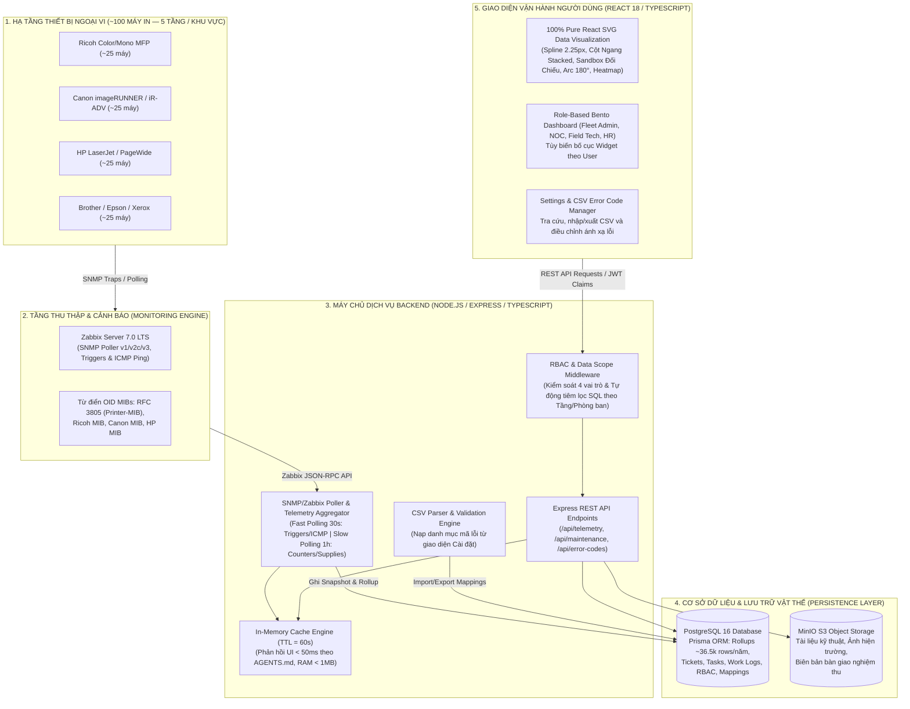

# FleetMonitor — Kiến Trúc Hệ Thống & Đặc Tả Kỹ Thuật (System Architecture & Technical Specification)

> **Dự án:** FleetMonitor — Hệ thống Giám sát & Quản trị Máy in Doanh nghiệp Tập trung  
> **Tài liệu:** Kiến Trúc Hệ Thống & Thiết Kế Kỹ Thuật 4 Hạng Mục Trọng Tâm  
> **Phiên bản:** 2.6.0 (Tối ưu hóa hạm đội ~100 máy in, 100% Pure React SVG, Quản trị Bảo trì CMMS, Chuẩn hóa mã lỗi CSV & RBAC Data Scope)  
> **Trạng thái:** Authoritative Architectural Blueprint (Chuẩn thiết kế kỹ thuật)

---

## 1. Kiến Trúc Tổng Thể Hệ Thống (System Overview)

Hệ thống FleetMonitor được xây dựng theo mô hình kiến trúc phân lớp hướng dịch vụ (Layered Service-Oriented Architecture), tối ưu hóa chuyên biệt cho quy mô giám sát **hạm đội khoảng 100 máy in** đa thương hiệu (Ricoh, HP, Canon, Epson, Brother, Xerox) phân bổ trên khoảng 5 tầng/khu vực làm việc (~15–25 máy/tầng). Hệ thống đảm bảo thời gian phản hồi giao diện $< 50\text{ms}$ thông qua bộ đệm In-Memory Cache và tổng hợp dữ liệu định kỳ (Rollup Aggregation).



### 1.1. Chuẩn Kiến Trúc Frontend, Quy Tắc Giới Hạn Code (<300 LOC) & Hệ Sinh Thái Thư Viện

Frontend được xây dựng theo chuẩn **Enterprise Feature-Based Architecture**, tuân thủ nghiêm ngặt các quy định sau:

1. **Quy tắc Giới hạn Độ dài File (< 300 LOC):**
   - **Hard Limit:** Mọi file mã nguồn (`.tsx`, `.ts`) tuyệt đối không vượt quá 300 dòng code (Sweet spot tối ưu: 150 – 250 LOC).
   - **Tự động phân rã:** Khi component hoặc page đạt 200–250 dòng code, bắt buộc phân tách thành các file chuyên biệt:
     - `features/<feature>/components/`: Chứa JSX hiển thị giao diện thuần túy, không ôm đồm logic.
     - `features/<feature>/hooks/`: Bóc tách toàn bộ state phức tạp, tính toán toạ độ SVG.
     - `features/<feature>/slices/`: Redux slices & RTK Query API endpoints.
     - `features/<feature>/types/`: Định nghĩa kiểu dữ liệu TypeScript & Enums cục bộ.

2. **Hệ Sinh Thái Thư Viện Frontend Chuẩn (Approved Tech Stack):**
   - **Khung lõi:** React 18 + TypeScript + Vite.
   - **Điều hướng:** React Router v6 (Lazy Loading với `React.lazy()` + Suspense Skeleton).
   - **Trạng thái & Bộ nhớ đệm API:** Redux Toolkit + RTK Query (với cache tag types và mock fallback baseQuery).
   - **Giao diện:** Tailwind CSS + shadcn/ui Design Tokens & Primitives.
   - **Biểu mẫu:** React Hook Form + Zod schema validation.
   - **Bảng dữ liệu:** `@tanstack/react-table` kết hợp Client-side In-memory Filtering & Phân trang thu gọn (10–25 dòng/trang). Toàn bộ danh mục ~100 máy in (< 50KB payload) được tải vào bộ đệm client, cho phép lọc theo Tầng (T1–T5), Hãng và Trạng thái tức thì ($< 5\text{ms}$), loại bỏ gánh nặng Virtualization phức tạp.
   - **Thông báo Realtime:** `sonner` Toast Notifications chuẩn shadcn/ui.
   - **Hệ thống Biểu Tượng Chuẩn Duy Nhất:** **FontAwesome duy nhất** (`@fortawesome/react-fontawesome`, `@fortawesome/free-solid-svg-icons`). Nghiêm cấm sử dụng hoặc cài đặt các thư viện icon khác (AGENTS.md Rule 7.1).

---

## 2. Đặc Tả Hạng Mục 1: Printer Analytics (~100 Máy In)

### 2.1. Thư Viện Trực Quan Hóa: 100% Pure React SVG

Thay vì nạp các thư viện đồ họa cồng kềnh như Apache ECharts hay WebGL ECharts-GL (gây đội thêm ~2MB bundle size và phụ thuộc GPU), hệ thống chuẩn hóa sử dụng **100% Pure React SVG**. Giải pháp này đảm bảo hiển thị sắc nét tuyệt đối trên mọi độ phân giải (Retina/HiDPI), tương thích hoàn toàn với Tailwind CSS tokens và phản hồi hover tức thời:

1. **Biểu Đồ Xu Hướng Sản Lượng & Đỉnh Tải (Soft Spline Chart):**
   - *Cơ chế hiển thị:* Pure React SVG với đường cong Cubic Bézier Spline (stroke 2.25px `#2563eb`).
   - *Vùng bóng mờ:* Linear Gradient bán trong suốt (`rgba(37, 99, 235, 0.22)` $\to$ `0.0`).
   - *Đỉnh tải (Peak Pill):* Viên nang nổi bật đánh dấu mốc giờ/ngày có sản lượng cao nhất hạm đội.
   - *Trục thời gian:* Trục X hiển thị chu kỳ (24 Giờ, 7 Ngày, 30 Ngày), Trục Y hiển thị số trang in.
   - *Tương tác:* Đường gióng dọc (vertical dashed line) và Tooltip đa tầng khi hover hiển thị chi tiết số trang và đối chiếu kỳ trước.

2. **Biểu Đồ Cột Ngang Phân Bố Sản Lượng (Production Horizontal Bar Chart):**
   - *Trục tung (Y-axis):* Tên/model máy in, vị trí tầng (T1–T5) và phòng ban.
   - *Thanh ngang xếp chồng (Stacked Bar):* Phân định tỷ trọng bản in Đen trắng (Mono `#2563eb`) và Màu (Color `#ec4899`).
   - *Tương tác nhanh:* Nút ghim 📌 (Pin Icon) ở cuối mỗi thanh ngang để đưa máy vào Khung đối chiếu.

3. **Khung Ghim Đối Chiếu (Pinned Comparison Sandbox Bento Dock):**
   - *Vị trí:* Đặt song song bên cạnh biểu đồ cột ngang.
   - *Cơ chế chuẩn hóa:* Căn chỉnh tất cả các máy được ghim trên **cùng một thang đo (common scale)** dựa trên sản lượng lớn nhất trong nhóm đã chọn, cho phép so sánh trực diện độ dài thanh tải, độ lệch tải (% so với máy dẫn đầu), tốc độ PPM thực tế và MTBF.
   - *Nút hành động:* Gỡ ghim trực tiếp từng máy, xóa tất cả ghim, hoặc mở Modal phân tích đối chiếu chuyên sâu 1:1.

4. **Biểu Đồ Vòng Cung Chi Phí Phòng Ban (Cost Allocation 180° Arc):**
   - *Hình học SVG:* Vòng cung bán nguyệt 180° nét mảnh 11px (radius = 86px, strokeWidth = 11px).
   - *Tương tác 2 chiều:* Hover thẻ phòng ban $\to$ lát cắt tương ứng trên vòng cung phát sáng và tâm donut cập nhật tổng chi phí động.

5. **Ma Trận Nhiệt Điểm Nóng Sự Cố (SLA Incident Heatmap Matrix):**
   - *Quy mô ma trận:* 5 khu vực/tầng $\times$ 7 tuần theo dõi.
   - *Dải màu UX:* Xám nhạt (0 vụ) $\to$ Vàng hổ phách `#fef3c7` (1 vụ) $\to$ Đỏ hồng `#ffe4e6` (Điểm nóng $\ge 2$ vụ).
   - *Inspector Panel:* Click ô ma trận để xem danh sách sự cố cụ thể, thời gian khắc phục và mã lỗi nội bộ `FM-...`.

### 2.2. Cơ Chế Backend, Tính Toán Băng Thông & Cơ Sở Dữ Liệu Cho ~100 Thiết Bị

#### 1. Tính Toán Băng Thông & Tải Polling (Network & Polling Sizing):
- **Fast Polling (Chu kỳ 30 giây):**
  - Giám sát ICMP Ping, trạng thái kết nối Online/Offline và SNMP Triggers (Hardware Error, Paper Jam).
  - Tải mạng: $100\text{ hosts} \div 30\text{s} \approx 3.3\text{ req/s}$. Lưu lượng mạng cực thấp ($< 10\text{ KB/s}$), hoàn toàn không ảnh hưởng đến băng thông mạng nội bộ doanh nghiệp.
- **Slow Polling (Chu kỳ 1 giờ):**
  - Quét số counter tổng (Total, Color, Mono) và mức tiêu hao vật tư (CMYK, Drum, Fuser, Waste Toner Box).
  - Tải mạng: $100\text{ hosts} \div 3.600\text{s} \approx 0.027\text{ req/s}$.

#### 2. Kích Thước Lưu Trữ PostgreSQL (Database Sizing):
- **Bảng `printer_daily_volume`:**
  - $100\text{ thiết bị} \times 1\text{ bản ghi/ngày} = 100\text{ bản ghi/ngày} \approx 36.500\text{ bản ghi/năm}$.
  - Kích thước lưu trữ: $\approx 5\text{ MB/năm}$ (bao gồm cả chỉ mục B-Tree).
- **Bảng `printer_monthly_volume`:**
  - $100\text{ bản ghi/tháng} = 1.200\text{ bản ghi/năm} \approx 200\text{ KB/năm}$.
- **In-Memory Cache (TTL 60s):**
  - Snapshot toàn bộ 100 máy in và dữ liệu phân tích chỉ chiếm $< 1\text{ MB}$ RAM trên máy chủ Node.js.
  - Tỷ lệ Cache Hit $> 98\%$, thời gian đáp ứng API $< 10\text{ms}$ (vượt xa mục tiêu $< 50\text{ms}$).

#### Thiết Kế Bảng PostgreSQL Cho Analytics:

```sql
-- 1. Lưu snapshot sản lượng theo ngày
CREATE TABLE printer_daily_volume (
    id UUID PRIMARY KEY DEFAULT gen_random_uuid(),
    printer_id VARCHAR(50) NOT NULL REFERENCES printers(id) ON DELETE CASCADE,
    record_date DATE NOT NULL,
    start_total_counter BIGINT NOT NULL,
    end_total_counter BIGINT NOT NULL,
    delta_total_pages INTEGER NOT NULL CHECK (delta_total_pages >= 0),
    delta_color_pages INTEGER NOT NULL DEFAULT 0 CHECK (delta_color_pages >= 0),
    delta_mono_pages INTEGER NOT NULL DEFAULT 0 CHECK (delta_mono_pages >= 0),
    is_abnormal_burst BOOLEAN DEFAULT FALSE, -- Cờ đánh dấu đột biến tải
    created_at TIMESTAMP WITH TIME ZONE DEFAULT CURRENT_TIMESTAMP,
    CONSTRAINT uq_printer_date UNIQUE (printer_id, record_date)
);

CREATE INDEX idx_printer_daily_date ON printer_daily_volume (record_date);
CREATE INDEX idx_printer_daily_lookup ON printer_daily_volume (printer_id, record_date);

-- 2. Bảng tổng hợp theo tháng (Monthly Rollup phục vụ báo cáo dài hạn)
CREATE TABLE printer_monthly_volume (
    id UUID PRIMARY KEY DEFAULT gen_random_uuid(),
    printer_id VARCHAR(50) NOT NULL REFERENCES printers(id) ON DELETE CASCADE,
    year_month VARCHAR(7) NOT NULL, -- Định dạng: YYYY-MM
    total_pages INTEGER NOT NULL,
    color_pages INTEGER NOT NULL,
    mono_pages INTEGER NOT NULL,
    color_ratio_percent NUMERIC(5, 2),
    uptime_percent NUMERIC(5, 2),
    incident_count INTEGER DEFAULT 0,
    maintenance_cost_vnd NUMERIC(12, 2) DEFAULT NULL, -- Null nếu chưa có dữ liệu chi phí
    CONSTRAINT uq_printer_month UNIQUE (printer_id, year_month)
);

CREATE INDEX idx_printer_monthly_lookup ON printer_monthly_volume (year_month, total_pages DESC);
```

#### Xử Lý Sự Cố Counter Reset & 32-bit Rollover:
- Khi `end_counter < start_counter`:
  - Kiểm tra nếu `start_counter > 4,200,000,000` và `end_counter < 100,000`: Xử lý theo thuật toán 32-bit Rollover: $\text{delta} = (2^{32} - \text{start\_counter}) + \text{end\_counter}$.
  - Nếu không thỏa mãn mốc rollover (ví dụ kỹ thuật viên thay mainboard làm reset counter về 0): Ghi nhận cờ `is_counter_reset = TRUE`, lấy mốc `end_counter` làm cơ sở chu kỳ mới, tuyệt đối không tạo số âm hoặc số liệu giả.

---

## 3. Đặc Tả Hạng Mục 2: Maintenance Management (Quản Lý Bảo Trì)

### 3.1. Mô Hình Phân Cấp 3 Tầng: Ticket $\to$ Task $\to$ Work Log

Hệ thống quản lý bảo trì được thiết kế theo quy trình khép kín, phân định rõ ràng giữa yêu cầu sự cố, kế hoạch phân công, và nhật ký thực thi tại hiện trường:

```
[1. TICKET (Yêu Cầu / Sự Cố)]
  │
  ├── Sinh tự động từ Cảnh báo SNMP Zabbix (Hardware Error / Paper Jam / Supplies Critical)
  └── Hoặc do Người dùng / Quản lý tạo thủ công
        │
        ▼ (Phân công kỹ thuật viên & Lập kế hoạch)
[2. TASK / WORK ORDER (Lệnh Công Việc)]
  │
  ├── Chế độ xem: Bảng danh sách, Lịch trình tiến độ Gantt (Timeline)
  ├── Quy trình Dynamic Stepper (Kiểm tra -> Vệ sinh -> Thay thế -> Nghiệm thu)
  ├── Quản lý trạng thái: Planned -> In Progress -> Waiting -> Completed
  └── Tự động nới rộng ô ngày có việc (240px); Hoàn thành tự động chuyển sang Kho Lịch Sử & xóa khỏi Gantt
        │
        ▼ (Ghi chép chi tiết từng phiên can thiệp)
[3. WORK LOG (Nhật Ký Phiên Làm Việc)]
  ├── Người thực hiện, Giờ bắt đầu, Giờ kết thúc
  ├── Chi tiết linh kiện thay thế, Chi phí vật tư & Chi phí nhân công (VNĐ)
  ├── Kết quả in thử nghiệm thu (Đạt / Không đạt)
  └── Đính kèm tài liệu, ảnh chụp lỗi & ảnh sau sửa chữa (Lưu trữ trên MinIO S3)
```

### 3.2. Thiết Kế Cơ Sở Dữ Liệu PostgreSQL Cho Bảo Trì

```sql
-- 1. Bảng Ticket (Phiếu yêu cầu / sự cố tiếp nhận)
CREATE TABLE maintenance_tickets (
    id VARCHAR(50) PRIMARY KEY, -- Định dạng: TCK-202611-001
    printer_id VARCHAR(50) NOT NULL REFERENCES printers(id),
    title VARCHAR(255) NOT NULL,
    description TEXT,
    source VARCHAR(20) NOT NULL CHECK (source IN ('SNMP_TRIGGER', 'USER_REPORT', 'PREVENTIVE_SCHEDULE')),
    severity VARCHAR(20) NOT NULL CHECK (severity IN ('Critical', 'Warning', 'Info')),
    status VARCHAR(30) NOT NULL DEFAULT 'OPEN' CHECK (status IN ('OPEN', 'IN_PROGRESS', 'WAITING_PARTS', 'RESOLVED', 'CLOSED')),
    internal_error_code VARCHAR(50), -- Liên kết tới bộ mã chuẩn hóa FM-...
    reported_by VARCHAR(100),
    created_at TIMESTAMP WITH TIME ZONE DEFAULT CURRENT_TIMESTAMP,
    resolved_at TIMESTAMP WITH TIME ZONE
);

-- 2. Bảng Task (Lệnh thực thi công việc)
CREATE TABLE maintenance_tasks (
    id VARCHAR(50) PRIMARY KEY, -- Định dạng: TSK-202611-001
    ticket_id VARCHAR(50) REFERENCES maintenance_tickets(id) ON DELETE SET NULL,
    printer_id VARCHAR(50) NOT NULL REFERENCES printers(id),
    title VARCHAR(255) NOT NULL,
    task_type VARCHAR(30) NOT NULL CHECK (task_type IN ('CORRECTIVE_REPAIR', 'PERIODIC_MAINTENANCE', 'TONER_REPLACEMENT', 'FIRMWARE_UPGRADE')),
    priority VARCHAR(10) NOT NULL CHECK (priority IN ('P1', 'P2', 'P3', 'P4')),
    status VARCHAR(30) NOT NULL DEFAULT 'Planned' CHECK (status IN ('Planned', 'In Progress', 'Waiting', 'Pending Verification', 'Completed')),
    assigned_to UUID REFERENCES users(id),
    due_date TIMESTAMP WITH TIME ZONE,
    pending_reason TEXT, -- Bắt buộc khi chuyển sang Waiting
    pending_next_check TIMESTAMP WITH TIME ZONE,
    progress_percent INTEGER DEFAULT 0 CHECK (progress_percent BETWEEN 0 AND 100),
    dynamic_steps JSONB DEFAULT '[]'::jsonb, -- Danh sách các bước stepper động
    created_at TIMESTAMP WITH TIME ZONE DEFAULT CURRENT_TIMESTAMP,
    completed_at TIMESTAMP WITH TIME ZONE
);

-- 3. Bảng Work Log (Nhật ký thực địa & Chi phí chi tiết)
CREATE TABLE maintenance_work_logs (
    id UUID PRIMARY KEY DEFAULT gen_random_uuid(),
    task_id VARCHAR(50) NOT NULL REFERENCES maintenance_tasks(id) ON DELETE CASCADE,
    technician_id UUID NOT NULL REFERENCES users(id),
    started_at TIMESTAMP WITH TIME ZONE NOT NULL,
    finished_at TIMESTAMP WITH TIME ZONE NOT NULL,
    work_performed TEXT NOT NULL, -- Nội dung kỹ thuật đã can thiệp
    parts_replaced JSONB DEFAULT '[]'::jsonb, -- Danh sách linh kiện [{ part_code, name, qty, unit_cost }]
    parts_cost_vnd NUMERIC(12, 2) DEFAULT 0,
    labor_cost_vnd NUMERIC(12, 2) DEFAULT 0,
    total_cost_vnd NUMERIC(12, 2) GENERATED ALWAYS AS (parts_cost_vnd + labor_cost_vnd) STORED,
    test_print_result VARCHAR(20) CHECK (test_print_result IN ('PASSED', 'FAILED', 'MARGINAL')),
    counter_at_service BIGINT, -- Số counter máy in lúc hoàn tất sửa chữa
    notes TEXT,
    created_at TIMESTAMP WITH TIME ZONE DEFAULT CURRENT_TIMESTAMP
);

-- 4. Bảng Đính Kèm Tệp Tin Lưu Trữ MinIO
CREATE TABLE work_log_attachments (
    id UUID PRIMARY KEY DEFAULT gen_random_uuid(),
    work_log_id UUID NOT NULL REFERENCES maintenance_work_logs(id) ON DELETE CASCADE,
    file_name VARCHAR(255) NOT NULL,
    file_type VARCHAR(100) NOT NULL,
    file_size_bytes BIGINT NOT NULL,
    minio_bucket VARCHAR(64) NOT NULL DEFAULT 'fleetmonitor-maintenance',
    minio_object_key VARCHAR(512) NOT NULL, -- Đường dẫn tệp trong bucket MinIO
    uploaded_by UUID NOT NULL REFERENCES users(id),
    uploaded_at TIMESTAMP WITH TIME ZONE DEFAULT CURRENT_TIMESTAMP
);
```

### 3.3. Tích Hợp MinIO S3 Object Storage

- **Cấu trúc lưu trữ (Bucket Storage Layout):**
  - Bucket: `fleetmonitor-maintenance`
  - Object Key Pattern: `printers/{printerId}/tasks/{taskId}/worklogs/{workLogId}/{timestamp}_{filename}`
- **Bảo mật truy cập:**
  - Backend cung cấp API Presigned Upload URL cho Client để upload file trực tiếp lên MinIO mà không làm quá tải CPU máy chủ Backend.
  - Khi xem tài liệu/ảnh trên Drawer, Backend sinh Presigned Download URL có hiệu lực ngắn hạn (15 phút).

### 3.4. Cơ Chế Truy Xuất & Tái Sử Dụng Lịch Sử Bảo Trì (Knowledge Reuse Engine)

Khi một Ticket mới xuất hiện trên thiết bị model $M$ kèm mã lỗi $E$ (ví dụ: `FM-FUS-01` hoặc Ricoh SC542):
1. Hệ thống tự động truy vấn các Work Log có kết quả `test_print_result = 'PASSED'` của các máy in cùng model $M$ trong quá khứ.
2. Trích xuất:
   - Các linh kiện thay thế phổ biến nhất và giá tham khảo.
   - Các bước can thiệp kỹ thuật đạt hiệu quả cao nhất.
   - Thời gian trung bình để khắc phục thành công (MTTR).
3. Hiển thị khối gợi ý giải pháp (Historical Recommended Fix) trực tiếp trong Drawer chẩn đoán để kỹ thuật viên xử lý chính xác ngay từ đầu.

---

## 4. Đặc Tả Hạng Mục 3: Error Code Standardization (Chuẩn Hóa Mã Lỗi)

### 4.1. Quy Trình Nạp & Quản Lý Mã Lỗi Qua CSV Tại Giao Diện Settings

Toàn bộ từ điển mã lỗi được nạp vào PostgreSQL thông qua tính năng **Import/Export CSV** trong phân hệ Cài đặt (`/settings`), hỗ trợ xuất khẩu, tra cứu, và điều chỉnh linh hoạt:

```
[File CSV Chuẩn Hóa từ Chuyên Gia / Hãng]
        │
        ▼ (Upload qua Giao diện /settings)
[Backend CSV Parser & Validator]
        │
        ├── Kiểm tra tính hợp lệ của phân hệ (Subsystem) và cấu trúc FM-...
        ├── Kiểm tra tính toàn vẹn 6 thương hiệu (Ricoh, HP, Canon, Epson, Brother, Xerox)
        └── Ghi vết vào error_code_audit_logs
        │
        ▼
[PostgreSQL Database] ──> [Giao diện Settings: Tra cứu, Sửa trực tiếp, Xuất CSV]
```

### 4.2. Cấu Trúc Bảng PostgreSQL Cho Chuẩn Hóa Mã Lỗi

```sql
-- 1. Bảng Định Danh Mã Lỗi Nội Bộ Chuẩn Hóa
CREATE TABLE internal_error_definitions (
    id VARCHAR(50) PRIMARY KEY, -- Mã chuẩn: FM-<SUBSYSTEM>-<INDEX> (Ví dụ: FM-FUS-01)
    subsystem VARCHAR(10) NOT NULL CHECK (subsystem IN (
        'FUS', -- Cụm sấy (Fuser)
        'OPT', -- Khối quang học / Laser Polygon Motor
        'SCN', -- Khối quét / ADF (Scanner)
        'FED', -- Cơ kéo giấy / Khay giấy / Cụm cuốn (Paper Feed)
        'DRM', -- Cụm trống hình (Drum / Imaging Unit)
        'DEV', -- Cụm từ (Developer Unit)
        'TNR', -- Hệ thống cấp mực / Bơm mực (Toner Supply)
        'TRN', -- Băng tải chuyển ảnh (Transfer Belt)
        'PWR', -- Khối nguồn & Cao áp (Power Supply / High Voltage)
        'NET'  -- Bo mạch điều khiển & Mạng (Controller / Mainboard)
    )),
    name_vi VARCHAR(255) NOT NULL, -- Tên lỗi tiếng Việt chuẩn doanh nghiệp
    root_cause_vi TEXT NOT NULL,   -- Nguyên nhân bản chất kỹ thuật
    default_severity VARCHAR(20) NOT NULL CHECK (default_severity IN ('Critical', 'Warning', 'Info')),
    is_active BOOLEAN DEFAULT TRUE,
    created_at TIMESTAMP WITH TIME ZONE DEFAULT CURRENT_TIMESTAMP,
    updated_at TIMESTAMP WITH TIME ZONE DEFAULT CURRENT_TIMESTAMP
);

-- 2. Bảng Ánh Xạ Mã Hãng Sang Mã Nội Bộ (1 Mã Nội Bộ ánh xạ N Mã Hãng)
CREATE TABLE vendor_error_mappings (
    id UUID PRIMARY KEY DEFAULT gen_random_uuid(),
    internal_error_id VARCHAR(50) NOT NULL REFERENCES internal_error_definitions(id) ON DELETE CASCADE,
    vendor VARCHAR(30) NOT NULL CHECK (vendor IN ('Ricoh', 'HP', 'Canon', 'Epson', 'Brother', 'Xerox')),
    vendor_code VARCHAR(50) NOT NULL, -- Mã hãng gốc: SC542, E000, 50.1, 010-327,...
    model_pattern VARCHAR(100) DEFAULT '*', -- Mẫu áp dụng (ví dụ: 'Pro C7200s*', '*' cho tất cả model)
    vendor_description TEXT, -- Mô tả kỹ thuật trong Service Manual của hãng
    remedy_steps_vi TEXT, -- Quy trình xử lý khuyến nghị của hãng dịch sang tiếng Việt
    created_at TIMESTAMP WITH TIME ZONE DEFAULT CURRENT_TIMESTAMP,
    updated_at TIMESTAMP WITH TIME ZONE DEFAULT CURRENT_TIMESTAMP,
    CONSTRAINT uq_vendor_code_pattern UNIQUE (vendor, vendor_code, model_pattern)
);

CREATE INDEX idx_vendor_code_lookup ON vendor_error_mappings (vendor, vendor_code);

-- 3. Bảng Lưu Vết Lịch Sử Thay Đổi Từ Điển Mã Lỗi (Audit Trail)
CREATE TABLE error_code_audit_logs (
    id UUID PRIMARY KEY DEFAULT gen_random_uuid(),
    internal_error_id VARCHAR(50) NOT NULL,
    action VARCHAR(20) NOT NULL CHECK (action IN ('IMPORT_CSV', 'CREATE', 'UPDATE', 'DELETE')),
    changed_by UUID REFERENCES users(id),
    old_data JSONB,
    new_data JSONB,
    change_reason TEXT,
    created_at TIMESTAMP WITH TIME ZONE DEFAULT CURRENT_TIMESTAMP
);
```

### 4.3. Định Dạng Chuẩn File Mẫu CSV Import/Export

File CSV có thể được tạo từ Excel và tải lên hệ thống với cấu trúc cột bắt buộc:

```csv
internal_code,subsystem,name_vi,root_cause_vi,default_severity,vendor,vendor_code,model_pattern,vendor_description,remedy_steps_vi
FM-FUS-01,FUS,Lỗi nhiệt cụm sấy không đạt ngưỡng,Cảm biến nhiệt Thermistor đứt hoặc đèn sấy hỏng,Critical,Ricoh,SC542,*,Fusing temperature warm-up error,Kiểm tra Thermistor và cầu chì nhiệt cụm sấy
FM-FUS-01,FUS,Lỗi nhiệt cụm sấy không đạt ngưỡng,Cảm biến nhiệt Thermistor đứt hoặc đèn sấy hỏng,Critical,Canon,E000,*,Fixing unit warm-up failure,Đo điện trở sấy và vệ sinh thanh nhiệt fixing
FM-FUS-01,FUS,Lỗi nhiệt cụm sấy không đạt ngưỡng,Cảm biến nhiệt Thermistor đứt hoặc đèn sấy hỏng,Critical,HP,50.1,*,Fuser low temperature error,Kiểm tra nguồn AC cấp cụm sấy và cáp kết nối DC controller
FM-FUS-01,FUS,Lỗi nhiệt cụm sấy không đạt ngưỡng,Cảm biến nhiệt Thermistor đứt hoặc đèn sấy hỏng,Critical,Xerox,010-327,*,Fuser warm up fail,Kiểm tra thermostat cụm sấy và thay thế nếu hở mạch
FM-OPT-01,OPT,Lỗi động cơ gương đa giác Polygon Motor,Động cơ quay lăng kính laser không đạt tốc độ đồng bộ,Critical,Ricoh,SC320,*,Polygon motor error,Tra dầu bạc đạn hoặc thay thế cụm laser polygon
FM-FED-01,FED,Kẹt giấy liên tục tại khay kéo giấy,Bánh xe cao su kéo giấy mòn hoặc cảm biến lệch,Warning,Ricoh,SC990,*,Paper feed jam sensor error,Thay bánh xe kéo giấy (Pick-up roller) và vệ sinh sensor
```

---

## 5. Đặc Tả Hạng Mục 4: Role-Based Dashboard & RBAC

### 5.1. Ma Trận Phân Quyền 4 Cấp (RBAC Matrix)

| Nhóm Vai Trò (Role) | Đối Tượng Thực Tế | Phạm Vi Truy Cập Dữ Liệu (Data Scope) | Quyền Hạn Chức Năng Cốt Lõi |
| :--- | :--- | :--- | :--- |
| **Fleet Manager** | Trưởng phòng IT / Quản lý Tài sản | **Toàn công ty** (Tất cả chi nhánh, 5 tầng, phòng ban) | Toàn quyền xem và cấu hình; phê duyệt thanh lý thiết bị Lemon; xem báo cáo tổng chi phí bảo trì & SLA; quản lý người dùng; cấu hình quy tắc an toàn. |
| **NOC Engineer** | Kỹ sư vận hành hệ thống IT | **Toàn hệ thống kỹ thuật** (~100 máy in) | Quản lý hàng đợi sự cố (Incidents); thao tác Stepper chẩn đoán; import/sửa mã lỗi CSV; theo dõi Ma trận nhiệt điểm nóng; quản lý polling Zabbix. |
| **Field Technician** | Kỹ thuật viên bảo trì hiện trường | **Chỉ những Ticket & Task được giao** | Xem chi tiết lệnh bảo trì được phân công; ghi chép Work Log; nhập chi phí vật tư; chụp ảnh tải lên MinIO; xác nhận in thử nghiệm thu. |
| **Department Head / HR** | Trưởng phòng ban / Kế toán nội bộ | **Chỉ trong Phòng ban / Tầng của mình** | Xem Dashboard sản lượng phòng ban; theo dõi định mức in ấn tháng; xem tỷ lệ Trang Màu vs Đơn Sắc; yêu cầu cấp thêm máy hoặc tạo ticket sửa máy. |

### 5.2. Cơ Chế Thực Thi Phân Vùng Dữ Liệu (Data Scope Enforcement)

1. **JWT Payload & Claims:**
   Khi đăng nhập, máy chủ cấp JWT token chứa thông tin vai trò và phạm vi dữ liệu:
   ```json
   {
     "sub": "usr_9981",
     "username": "truong_phong_ke_toan",
     "role": "DEPARTMENT_HEAD",
     "dataScope": {
       "departmentIds": ["dept-ketoan-t1"],
       "branchIds": ["branch-hanoi-hq"]
     }
   }
   ```

2. **Backend Express Authorization Middleware:**
   Middleware tự động tiêm điều kiện lọc vào truy vấn ORM Prisma / SQL:
   ```typescript
   // Middleware kiểm tra Data Scope
   export const applyDataScope = (req: Request, res: Response, next: NextFunction) => {
     const user = req.user;
     if (user.role === 'FLEET_MANAGER' || user.role === 'NOC_ENGINEER') {
       req.dataScopeFilter = {}; // Toàn quyền, không lọc
     } else if (user.role === 'FIELD_TECHNICIAN') {
       req.dataScopeFilter = { assigned_to: user.id };
     } else if (user.role === 'DEPARTMENT_HEAD') {
       req.dataScopeFilter = { department_id: { in: user.dataScope.departmentIds } };
     }
     next();
   };
   ```

3. **Bảng Lưu Trữ Tùy Biến Giao Diện Người Dùng (Dashboard Preferences):**
   ```sql
   CREATE TABLE user_dashboard_preferences (
       id UUID PRIMARY KEY DEFAULT gen_random_uuid(),
       user_id UUID NOT NULL REFERENCES users(id) ON DELETE CASCADE,
       dashboard_layout JSONB NOT NULL DEFAULT '{"widgets": ["hero_trend", "radar", "heatmap", "top_contributors"]}',
       theme_mode VARCHAR(10) DEFAULT 'dark',
       default_period VARCHAR(10) DEFAULT 'monthly',
       pinned_printer_ids JSONB DEFAULT '[]'::jsonb,
       updated_at TIMESTAMP WITH TIME ZONE DEFAULT CURRENT_TIMESTAMP,
       CONSTRAINT uq_user_prefs UNIQUE (user_id)
   );
   ```

---

## 6. Bảng Ánh Xạ Công Nghệ & Tuân Thủ Nguyên Tắc (Compliance Matrix)

| Tiêu Chí | Đặc Tả Kỹ Thuật FleetMonitor (~100 Máy In) | Trạng Thái Tuân Thủ AGENTS.md |
| :--- | :--- | :--- |
| **Giá trị đo lường số** | `MetricValue = number | null`, không tự động gán `0` khi thiếu dữ liệu, hiển thị `—`. | ✅ Tuân thủ 100% mục 5 |
| **Dữ liệu giả lập** | Tuyệt đối không sinh dữ liệu giả khi mất kết nối Zabbix API; hiển thị trạng thái `Stale`. | ✅ Tuân thủ 100% mục 5 |
| **Quy chuẩn mã lỗi** | Chuẩn hóa `FM-<SUBSYSTEM>-<INDEX>`, tách bạch sự cố phần cứng với trạng thái vật tư. | ✅ Tuân thủ 100% mục 6 |
| **Trường cấm** | Tuyệt đối không chứa hoặc sử dụng trường `actionGuidance` trong database và giao diện. | ✅ Tuân thủ 100% mục 6 |
| **Ngôn ngữ hiển thị** | Giao diện thuần Việt chuẩn doanh nghiệp: *Danh sách máy in, Lịch trình, Lệnh bảo trì, Hộp mực thải*. | ✅ Tuân thủ 100% mục 7 |
| **Hiệu năng giao diện** | Phản hồi giao diện $< 50\text{ms}$ nhờ In-Memory Cache TTL 60s và bảng Rollup nhẹ (~36.5k rows/năm). | ✅ Tuân thủ 100% mục 7 |
| **Bảo mật & Phân quyền** | RBAC 4 cấp kết hợp Data Scope tiêm tự động tại Backend, không phụ thuộc Frontend ẩn nút. | ✅ Tuân thủ 100% mục 4 |
| **Giới hạn File Code** | Tất cả file mã nguồn `.tsx`/`.ts` tuân thủ nghiêm ngặt quy định $< 300\text{ LOC}$. | ✅ Tuân thủ 100% mục 7.1 |
| **Chuẩn biểu tượng** | Sử dụng duy nhất FontAwesome (`@/shared/icons/`), cấm thư viện icon khác. | ✅ Tuân thủ 100% mục 7.1 |
