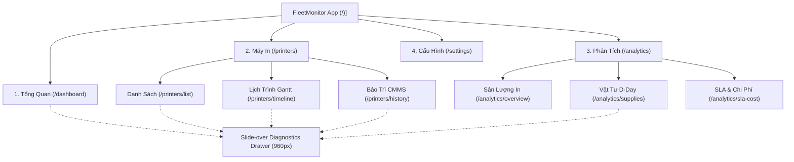

# FleetMonitor — Đặc Tả Điều Hướng & Giao Diện Người Dùng (UI/UX Navigation Specs)

> **Dự án:** FleetMonitor — Hệ thống Giám sát & Quản trị Máy in Doanh nghiệp Tập trung  
> **Tài liệu:** Đặc Tả Luồng Điều Hướng, Cấu Trúc Sub-Tabs & Thành Phần Giao Diện 4 Phân Hệ  
> **Phiên bản:** 2.6.0 (Chuẩn hóa quy mô hạm đội ~100 máy in, 100% Pure React SVG, FontAwesome duy nhất, CMMS & Drawer 2 Tab)  
> **Trạng thái:** Authoritative (Đã nghiệm thu giao diện)

---

## 1. Tổng Quan Cấu Trúc Điều Hướng (Navigation Hierarchy)

Hệ thống FleetMonitor áp dụng mô hình điều hướng phân cấp chuẩn **Enterprise SaaS Dashboard**, bao gồm thanh điều hướng chính (Sidebar cố định bên trái) kết hợp cây phân nhánh (Treeview Connector Lines) và các Sub-Tabs chuyên biệt cho từng phân hệ:

---

## 2. Đặc Tả Chi Tiết 4 Phân Hệ Giao Diện

### 2.1. Phân Hệ 1: Dashboard Tổng Quan (`/dashboard`)

Bố cục dạng **Bento Minimalist** hiện đại, loại bỏ hiệu ứng gradient lòe loẹt kiểu cũ, sử dụng nền phẳng viền mảnh `#e2e8f0`, số liệu nổi bật font JetBrains Mono và màu thương hiệu `#2563eb`:

1. **Khối 4 Thẻ Fleet KPI Bento:**
   - *Thẻ 1 (Sự cố phần cứng):* Số máy bị lỗi nguy cấp (`${criticalAlertsCount} máy`), badge `Khẩn cấp` (đỏ) hoặc `An toàn` (xanh), icon `faTriangleExclamation`. Bấm thẻ kích hoạt lọc nhanh.
   - *Thẻ 2 (Tỷ lệ khả dụng):* Tỷ lệ trực tuyến hạm đội (`${onlineRate}%`), badge động `${onlineCount}/${totalPrinters} Trực tuyến` (loại bỏ dữ liệu cứng), icon `faWifi`.
   - *Thẻ 3 (Tổng số thiết bị):* Tổng số máy in trong hạm đội (`${totalPrinters} máy`), badge `Toàn hạm đội`, icon `faPrint`.
   - *Thẻ 4 (Vật tư cần chú ý):* Số máy có vật tư $\le 10\%$ (`${lowSuppliesCount} máy`), badge `≤ 10% CMYK`, icon `faBox`. Nút chuyển hướng nhanh trỏ chuẩn xác sang `/analytics/supplies`.
2. **Lưới Biểu Đồ Kép (Side-by-Side Bento Grid):**
   - *Cột trái (60%): Biểu đồ Khả dụng (AvailabilitySplineChart):* Pure React SVG, đường cong spline mượt mà (stroke 2.25px, gradient glow bán trong suốt), trục thời gian 24h và tooltip tương tác tức thì hiển thị số máy online/offline.
   - *Cột phải (40%): Biểu đồ Cung tròn đồng tâm (RefinedFleetDonut):* 3 vòng tròn thể hiện phân bổ trạng thái: Hoạt động tốt (Xanh lá), Cảnh báo vật tư (Vàng), Sự cố & Ngoại tuyến (Đỏ). Bấm từng vòng để lọc trực tiếp danh sách bên dưới.
3. **Bảng Thiết Bị Cần Xử Lý (AttentionDevicesTable):**
   - Tách bạch rõ ràng giữa Mất kết nối mạng (Offline) và Lỗi phần cứng/cơ khí (Hardware Error) theo chuẩn Rule 5 & 6 AGENTS.md.
   - Tích hợp phân trang thu gọn (5 dòng/trang).
   - Nút thao tác kép:
     + `[Chẩn đoán]`: Mở Slide-over Diagnostics Drawer 960px.
     + `[+ Lập lệnh]`: Chuyển sang tạo nhiệm vụ bảo trì.

---

### 2.2. Phân Hệ 2: Máy In & Bảo Trì (`/printers`)

Phân hệ cốt lõi quản lý hạm đội ~100 máy in, chia thành 3 Sub-tabs chuyên trách:

#### Sub-Tab 1: Danh Sách Máy In (`/printers/list`)
- **Thanh công cụ Toolbar:** Ô tìm kiếm tức thì theo tên/model/IP, bộ lọc theo Hãng sản xuất (Ricoh, Canon, HP, Brother, Epson, Xerox), bộ lọc theo Tầng (Tất cả, T1–T5) và trạng thái kết nối.
- **Bảng Danh mục Thiết bị (PrinterTableView):**
  + 7 cột thông tin chuẩn mực: Tên & Model thiết bị, Địa chỉ IP (hỗ trợ copy nhanh 1-click), Vị trí (Tầng - Phòng ban), Trạng thái kết nối (Online / Offline), Sức khỏe phần cứng (Healthy / Warning / Critical), Số lệnh bảo trì đang mở, Thao tác chẩn đoán.
  + Phân trang thu gọn (10–25 dòng/trang), nạp toàn bộ danh mục ~100 máy in (< 50KB) vào bộ nhớ client để tìm kiếm và lọc tức thì $< 5\text{ms}$.

#### Sub-Tab 2: Lịch Trình Tiến Độ Gantt (`/printers/timeline`)
- **Khung thời gian (View Duration):** Tùy chọn 7 ngày, 14 ngày, hoặc 30 ngày. Khắc phục triệt để lỗi lệch múi giờ bằng định dạng chuẩn Local Date `YYYY-MM-DD`.
- **Cơ chế nới rộng ô tự động (Expandable Day Width):** Tự động nới rộng chiều ngang ô ngày lên **240px** khi có công việc để thẻ task hiển thị trọn vẹn (tiêu đề, người phụ trách, tiến độ %) mà không bị tràn ô hoặc chồng lấn.
- **Quy tắc chuyển dịch trạng thái tự động:** Khi một task hoàn thành (`status = 'Completed'`), task đó lập tức được chuyển sang Kho lịch sử và **tự động xóa khỏi biểu đồ Gantt** để người vận hành chỉ tập trung vào các công việc đang xử lý.
- **Nút hành động nhanh:** `[+ Tạo việc mới]` mở modal tạo nhanh công việc bảo trì.

#### Sub-Tab 3: Lệnh Bảo Trì CMMS (`/printers/history`)
- **Bảng Quản Lý Lệnh Bảo Trì (WorkOrdersTable):**
  + Theo dõi toàn diện vòng đời công việc 3 tầng `Ticket -> Task -> Work Log`.
  + Bộ lọc phạm vi: `Tất cả`, `Đang xử lý` (Planned, In Progress, Waiting), và `Kho lịch sử` (Completed).
  + Hỗ trợ mở rộng dòng (Sub-steps Row) xem chi tiết các bước SOP kỹ thuật.

#### Slide-over Diagnostics Drawer (960px):
Khung trượt từ cạnh phải màn hình, hỗ trợ phím tắt `Esc` và điều hướng nhanh giữa các máy:
- **Tab 1: Chẩn đoán & Vật tư (DiagnosticsCmykTab):** Đồng hồ đo mức mực CMYK thực tế (0–100%), tuổi thọ Cụm Trống (Drum Life), Cụm Sấy (Fuser Life), tình trạng Hộp mực thải (Waste Toner Box) và các bộ đếm OID SNMP Zabbix.
- **Tab 2: Lệnh Bảo Trì & Tiến Độ (DiagnosticsTasksTab):**
  + *Bộ chuyển đổi chế độ:* `Đang xử lý` vs `Kho lịch sử`.
  + *Đang xử lý:* Khối Thời gian & Chi phí (Time & Cost) cho phép tick bật/tắt trường và nhập nhanh giờ/phút (+15p/+30p/+1h); Khối Liên hệ hãng sản xuất (Vendor Communication); Khối File đính kèm MinIO S3; Dynamic Stepper SOP tự động tính % tiến độ (đạt 100% tự động chuyển sang Completed).
  + *Kho lịch sử (Accordion Collapsible):* Hiển thị dạng thẻ đóng/mở tóm tắt (chọn tới đâu hiện tới đó), tích hợp biên bản nghiệm thu và kết quả in thử.

---

### 2.3. Phân Hệ 3: Phân Tích & Báo Cáo (`/analytics`)

Giao diện trực quan hóa dữ liệu sản lượng và vật tư bằng **100% Pure React SVG**, chia thành 3 Sub-tabs:

#### Sub-Tab 1: Sản Lượng In (`/analytics/overview`)
- **Banner Tổng Sản Lượng In:** Hiển thị tổng số trang in theo chu kỳ (24 Giờ, 7 Ngày, 30 Ngày), tỷ lệ tăng trưởng so với kỳ trước, và thanh phân bổ sản lượng theo tầng.
- **Biểu Đồ Xu Hướng Sản Lượng & Đỉnh Tải (PrintVolumePeakLineChart):**
  + Pure React SVG, Soft Spline 2.25px với Gradient Glow bán trong suốt.
  + Viên nang đỉnh tải (Peak Pill) chỉ báo thời điểm có lượng in cao nhất.
  + Chú giải trực quan: Kỳ hiện tại (nét liền xanh dương `#2563eb`), Kỳ trước (nét đứt xám `#94a3b8`).
- **Khối Phân Bố Sản Lượng & Đối Chiếu Hạm Đội (Side-by-Side Bento):**
  + *Cột trái: Sản lượng theo thiết bị (ProductionHorizontalBarChart):* Biểu đồ cột ngang chia rõ tỷ trọng Mono & Color. Nút ghim nhanh 📌 đưa máy vào sàn đối chiếu.
  + *Cột phải: Đối chiếu thiết bị (PinnedComparisonSandbox):* Khung hình Bento riêng biệt chứa các thanh cột ngang của các máy được ghim đặt song song, căn chỉnh **cùng thang đo (common scale)** để so sánh trực diện độ dài thanh, độ lệch tải (% vs #1), tốc độ PPM và chỉ số MTBF.
  + *Modal So sánh 1:1:* Phân tích đối sánh đa chiều chuyên sâu giữa các thiết bị đã chọn.

#### Sub-Tab 2: Vật Tư Tiêu Hao (`/analytics/supplies`)
- **3 Thẻ Thống Kê Tổng Quan Bento:** `Khẩn cấp (< 15%)`, `Cần lưu ý (< 25%)`, và `Cạn kiệt sớm nhất`. Hỗ trợ bấm thẻ để kích hoạt lọc nhanh.
- **Bảng Cảnh Báo Cạn Kiệt Vật Tư (UrgentConsumablesAlertsTable):**
  + Theo dõi hạn chót cạn kiệt với huy hiệu đếm ngược D-Day: `[D-4]` (Đỏ $\le 5$ ngày), `[D-7]` (Vàng $\le 14$ ngày), `[D-25]` (Xanh an toàn).
  + Nút hành động nhanh: `[+ Lập lệnh thay]` mở modal tạo task cấp phát vật tư chuyển thẳng sang lịch trình bảo trì.
- **Bảng Vật Tư Máy Tải Cao (HighLoadFleetSuppliesTable):**
  + Trực quan hóa linh kiện 6 thành phần (CMYK, Drum, Fuser) trong cùng 1 hàng.
  + **Quy chuẩn hiển thị:** Máy in đơn sắc hiển thị 1 chấm đen duy nhất ⚫ + chỉ số % mực K (kèm tooltip); Máy in màu hiển thị 4 vạch thanh đứng siêu nhỏ đại diện cho K-C-M-Y.
  + Pill theo dõi trạng thái Hộp mực thải (Waste Toner: Bình thường, Sắp đầy ⚠️, Đầy 🛑).
  + Bấm bất kỳ dòng nào để mở Slide-over Diagnostics Drawer.

#### Sub-Tab 3: Hiệu Suất SLA & Chi Phí (`/analytics/sla-cost`)
- **4 Thẻ KPI Bento SLA:** Tỷ lệ sẵn sàng SLA hạm đội (Uptime %), Thời gian chạy ổn định trung bình (MTBF), Thời gian xử lý sự cố (MTTR), và Tổng chi phí in kỳ này (VNĐ).
- **Lưới Phân Tích Kép (Side-by-Side):**
  + *Cột trái: Chi phí theo phòng ban (CostAllocationArcChart):* Vòng cung bán nguyệt 180° nét mảnh 11px kèm 5 Micro-Cards phòng ban (tỷ trọng %, số trang mono/color, chi phí VNĐ).
  + *Cột phải: Điểm nóng sự cố (SLAIncidentHeatmapMatrix):* Ma trận nhiệt 5 khu vực/tầng $\times$ 7 tuần nhận diện tần suất hỏng hóc, kèm Inspector Panel xem chi tiết từng vụ việc.

---

### 2.4. Phân Hệ 4: Cấu Hình & Quản Lý Mã Lỗi (`/settings`)

Giao diện quản trị hệ thống phục vụ kỹ sư NOC và Fleet Manager:

1. **Quy Tắc An Toàn Vận Hành NOC (Operational Safety Rules):**
   - *Safe Window 10m:* Cơ chế giữ cảnh báo an toàn tối thiểu 10 phút trước khi tự động đóng, ngăn chặn hiện tượng flapping (chập chờn mạng/sensor).
   - *Critical Protection:* Ngăn chặn việc đóng tự động các sự cố mức Critical nếu chưa có biên bản nghiệm thu từ kỹ thuật viên.
   - *In-Memory Cache TTL 60s:* Điều chỉnh thời gian sống của bộ đệm cache dữ liệu Zabbix.
2. **Từ Điển & Chuẩn Hóa Mã Lỗi Đa Thương Hiệu (Error Code Standardization):**
   - Tra cứu danh mục mã lỗi chuẩn nội bộ `FM-<SUBSYSTEM>-<INDEX>`.
   - **Cơ chế Import/Export CSV:** Quản trị viên tải tệp CSV mẫu, điền danh mục mã lỗi từ Service Manual của 6 hãng (Ricoh, HP, Canon, Epson, Brother, Xerox) và upload lên hệ thống.
   - Bảng lịch sử thay đổi (Audit Trail): Lưu vết bất biến ai đã thêm/sửa mã lỗi, thời gian và lý do thay đổi.

---

## 3. Quy Chuẩn Kỹ Thuật Giao Diện Bắt Buộc (Mandatory UI Principles)

1. **100% FontAwesome Icons Duy Nhất:** Sử dụng độc quyền `@/shared/icons/` (`@fortawesome/react-fontawesome`, `@fortawesome/free-solid-svg-icons`). Tuyệt đối không cài đặt hoặc sử dụng Lucide, Heroicons hay React Icons.
2. **Quy Tắc File Length < 300 LOC:** Mọi component `.tsx` và file logic `.ts` phải duy trì dưới 300 dòng code. Bóc tách logic phức tạp ra Custom Hooks (`use<Feature>.ts`).
3. **Tính Toàn Vẹn Dữ Liệu Đo Lường:** `MetricValue = number | null`. Tuyệt đối không thay thế giá trị thiếu bằng số `0`, hiển thị dấu gạch ngang `—` hoặc `Chưa có dữ liệu`.
4. **Không Sử Dụng Trường `actionGuidance`:** Nghiêm cấm xuất hiện trường `actionGuidance` trên toàn bộ giao diện và cơ sở dữ liệu.
5. **Ngôn Ngữ Giao Diện:** 100% tiếng Việt tự nhiên, chuẩn kỹ thuật vận hành IT NOC doanh nghiệp.

