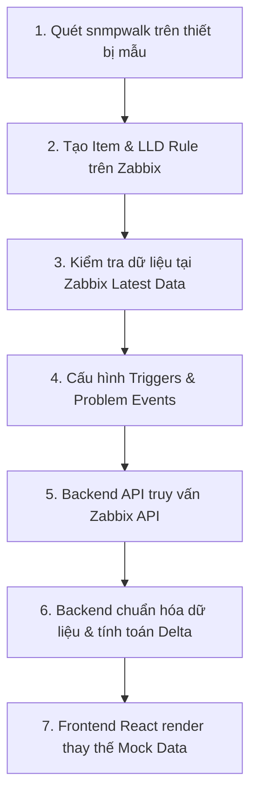

# Đặc Tả Dữ Liệu Cần Thu Thập Từ Máy In Mạng (Printer Data Requirements)

> **Tài liệu chuyển đổi từ Mock Data sang Dữ liệu Thực tế (SNMP / Zabbix / Backend / Web Metadata)**  
> **Áp dụng cho:** Hệ thống Giám Sát Máy In Tập Trung (Printer Monitoring System)  
> **Thiết bị tham chiếu chính (Phase 1):** Ricoh MP C6004 (IP: 10.48.3.252)  
> **Mở rộng (Phase 2):** 19 máy in đa hãng (HP, Canon, Xerox, Brother, Epson, Generic)  
> **Nền tảng giám sát đích:** Zabbix 7.0 LTS / Zabbix API / Application Backend  

---

## 1. Mục Đích & Nguyên Tắc Cốt Lõi

### 1.1 Mục Đích
Tài liệu này phân tích toàn diện giao diện frontend, cấu trúc component và các trường dữ liệu hiện hữu trong hệ thống Printer Monitoring (gồm 5 trang nghiệp vụ chính, 2 modal chẩn đoán và thanh điều hướng toàn cục). Từ đó, tài liệu xác lập bản danh mục (checklist) chi tiết về các trường dữ liệu cần thu thập từ thiết bị máy in thực tế để thay thế 100% mock data mà không phá vỡ giao diện và trải nghiệm người dùng hiện tại.

### 1.2 Nguyên Tắc Dữ Liệu Bắt Buộc (Theo `AGENTS.md` & `DATA_SOURCES.md`)
1. **Ưu tiên số 1 là cảnh báo lỗi phần cứng:** Độ chính xác của phát hiện sự cố, mô tả lỗi và mã lỗi quan trọng hơn số lượng trường hiển thị trên dashboard.
2. **Tuyệt đối không tự bịa OID hoặc gán nhãn hỗ trợ khi chưa có bằng chứng:** Mọi metric phải có nguồn gốc rõ ràng từ RFC chuẩn hoặc Vendor Enterprise MIB đã kiểm chứng.
3. **Phân biệt rạch ròi 4 tầng dữ liệu:**
   - **Tầng 1: SNMP Thuần (SNMP Standard / Vendor MIB):** Trích xuất trực tiếp từ máy in qua giao thức SNMP v2c/v3.
   - **Tầng 2: Zabbix Native Monitoring:** Dữ liệu do Zabbix Server đo đạc, tính toán và lưu trữ (ICMP Ping, Uptime, Item History, Active Problems, Triggers).
   - **Tầng 3: Backend Xử Lý (Application Backend):** Logic tổng hợp trạng thái (Overall Device Health), tính toán biến thiên sản lượng (Delta 30 ngày), vòng đời sự cố (Incident Lifecycle), khử trùng lặp (Deduplication).
   - **Tầng 4: Nghiệp Vụ Website (Admin / Metadata):** Dữ liệu cấu hình do người quản trị gán (Tên định danh quản lý, Vị trí phòng ban tùy chỉnh, Ghi chú vận hành, Phân loại thiết bị nghiệp vụ).
4. **Không đánh đồng các trạng thái chất lượng dữ liệu:**
   - `0`: Giá trị số học bằng không thực sự.
   - `Unknown`: Không đủ thông tin xác định.
   - `Unsupported`: Thiết bị hoặc MIB phần cứng không hỗ trợ tính năng này.
   - `Data Unavailable`: Lỗi mất kết nối hoặc không thu thập được từ thiết bị ngoại tuyến.
   - `Stale`: Dữ liệu lưu tạm (cache) từ lần quét thành công trước đó khi thiết bị hiện tại không phản hồi.
   - `Offline`: Mất kết nối mạng (trượt ICMP ping liên tiếp).

---

## 2. Quy Ước Trạng Thái Kiểm Chứng (Verification Status)

| Trạng thái | Ký hiệu | Định nghĩa kỹ thuật |
| :--- | :---: | :--- |
| **VERIFIED** | ✅ | Đã kiểm chứng đầy đủ trên thiết bị thực tế, hiểu rõ đơn vị đo, hành vi khi lỗi phát sinh và chu kỳ tự xóa lỗi khi khắc phục xong (ví dụ: `sysUpTime`, `icmpping`). |
| **OBSERVED** | 🔍 | Đã quét thấy giá trị trên thiết bị mẫu (Ricoh MP C6004 / snmpwalk), nhưng ngữ nghĩa, đơn vị hoặc cơ chế phục hồi cần tiếp tục theo dõi thực nghiệm. |
| **TBD** | ⏳ | Chưa xác định được OID chính thức hoặc chưa có bằng chứng thực nghiệm trên thiết bị vật lý; cần tiến hành snmpwalk kiểm tra MIB chuyên biệt của hãng. |
| **UNSUPPORTED** | 🚫 | Thiết bị phần cứng hoặc giao thức MIB của dòng máy đó không hỗ trợ tính năng này (ví dụ: máy in laser đơn năng không có cảm biến Scanner/ADF). |
| **INCONCLUSIVE** | ❓ | Dữ liệu thu thập được có mâu thuẫn hoặc không đủ bằng chứng kỹ thuật để đưa ra kết luận. |

---

## 3. Danh Mục Chi Tiết Dữ Liệu Theo Giao Diện Thực Tế

### 3.1 Thanh Điều Hướng & Tiêu Đề Toàn Cục (Header & Navigation Sidebar)

#### A. Header (`Header.tsx`)
| Tên Field trên Web | Vị trí hiển thị | Ý nghĩa & Mục đích | Dữ liệu cần lấy | Kiểu dữ liệu / Đơn vị | OID / MIB tương ứng | Nguồn dữ liệu | Model áp dụng | Trạng thái | Ghi chú kỹ thuật |
| :--- | :--- | :--- | :--- | :--- | :--- | :--- | :--- | :---: | :--- |
| **Monitoring Operational** | Header trái | Trạng thái hoạt động của kênh giám sát | Tính sẵn sàng của Zabbix Server và tiến trình thu thập | Boolean (`Online` / `Degraded`) | `icmpping` (Zabbix Simple Check) | Zabbix Native | Tất cả | ✅ VERIFIED | Nhấp nháy xanh khi Zabbix Server đang thu thập bình thường; đỏ khi dịch vụ giám sát gặp lỗi |
| **MOCK DATASET ({N} Nodes)** | Header phải | Huy hiệu minh bạch chế độ dữ liệu | Chế độ chạy dữ liệu và tổng số node máy in kết nối | String + Số nguyên | API metadata / Host count | Backend / Web | Tất cả | ✅ VERIFIED | Khi kết nối live API, chuyển thành `LIVE TELEMETRY ({N} Nodes)` |
| **UTC Clock** | Header phải | Đồng hồ đồng bộ thời gian quốc tế | Thời gian thực hệ thống | String (`HH:mm:ss UTC`) | Server NTP time | Backend / Web | Toàn hệ thống | ✅ VERIFIED | Đồng bộ chu kỳ quét SNMP với mốc thời gian chuẩn |

#### B. Sidebar (`Sidebar.tsx`)
| Tên Field trên Web | Vị trí hiển thị | Ý nghĩa & Mục đích | Dữ liệu cần lấy | Kiểu dữ liệu / Đơn vị | OID / MIB tương ứng | Nguồn dữ liệu | Model áp dụng | Trạng thái | Ghi chú kỹ thuật |
| :--- | :--- | :--- | :--- | :--- | :--- | :--- | :--- | :---: | :--- |
| **Printers Count** | Badge tab "Printers" | Tổng số máy in đang trong danh bạ quản lý | Đếm số lượng máy in đã đăng ký | Số nguyên (nodes) | `host.get` (Zabbix Host Inventory) | Backend / Zabbix | Tất cả | ✅ VERIFIED | Hiện tại là 20 node |
| **Low Supplies Count** | Badge tab "Supplies" | Số lượng máy in có vật tư chạm ngưỡng cảnh báo | Số máy có mực < 15% hoặc mực thải ≥ 85% | Số nguyên (nodes) | Tổng hợp từ `prtMarkerSuppliesLevel` | Backend Xử lý | Tất cả | 🔍 OBSERVED | Ẩn badge nếu không có máy nào chạm ngưỡng |
| **Active Incidents Count**| Badge tab "Incidents" | Số lượng sự cố đang hoạt động cần xử lý | Số lượng sự cố có `status = 'Active'` | Số nguyên (sự cố) | `problem.get` (Zabbix Active Problems) | Zabbix / Backend | Tất cả | 🔍 OBSERVED | Đổi màu đỏ cảnh báo nếu có sự cố mức Critical |

---

### 3.2 Trang Tổng Quan & Vận Hành (Dashboard - `Dashboard.tsx`)

#### A. Tiêu đề trang & Thanh trạng thái
| Tên Field trên Web | Vị trí hiển thị | Ý nghĩa & Mục đích | Dữ liệu cần lấy | Kiểu dữ liệu / Đơn vị | OID / MIB tương ứng | Nguồn dữ liệu | Model áp dụng | Trạng thái | Ghi chú kỹ thuật |
| :--- | :--- | :--- | :--- | :--- | :--- | :--- | :--- | :---: | :--- |
| **Tổng số thiết bị giám sát** | Header trang Dashboard | Số lượng máy in trong hệ thống | Đếm tổng số Host active | Số nguyên (máy) | `host.get` (status=0) | Zabbix / Backend | Tất cả | ✅ VERIFIED | 20 thiết bị |
| **Lần quét SNMP gần nhất** | Header trang Dashboard | Thời điểm hoàn tất chu kỳ thu thập gần nhất | Timestamp của lần scrape SNMP thành công gần nhất | Thời gian tương đối (ví dụ: "5s trước") | Max `clock` trong Zabbix `history` | Zabbix Native | Tất cả | ✅ VERIFIED | Giúp phát hiện dữ liệu telemetry có bị treo hay không |

#### B. Khối thẻ chỉ số KPI (5 Thẻ Thống Kê Chính)
| Tên Field trên Web | Vị trí hiển thị | Ý nghĩa & Mục đích | Dữ liệu cần lấy | Kiểu dữ liệu / Đơn vị | OID / MIB tương ứng | Nguồn dữ liệu | Model áp dụng | Trạng thái | Ghi chú kỹ thuật |
| :--- | :--- | :--- | :--- | :--- | :--- | :--- | :--- | :---: | :--- |
| **Tổng số máy in** | Thẻ KPI 1 | Quy mô toàn bộ đội máy in | Tổng số host được kích hoạt giám sát | Số nguyên (20 máy) | `host.get` | Zabbix / Backend | Tất cả | ✅ VERIFIED | Nhấp vào điều hướng sang trang Printers (filter All) |
| **Trực tuyến (Online)** | Thẻ KPI 2 | Số lượng và tỷ lệ máy in hoạt động bình thường | Số máy phản hồi ICMP ping và SNMP agent | Số nguyên + Tỷ lệ % (vd: 16 máy, 80.0%) | `icmpping=1` & `sysUpTime > 0` | Zabbix Native | Tất cả | ✅ VERIFIED | Phải thỏa mãn cả ping mạng và SNMP trả lời |
| **Ngoại tuyến (Offline)**| Thẻ KPI 3 | Số lượng và tỷ lệ máy in bị gián đoạn kết nối | Số máy trượt ping 3 lần liên tiếp hoặc tắt nguồn | Số nguyên + Tỷ lệ % (vd: 3 máy, 15.0%) | `max(/host/icmpping,#3)=0` | Zabbix Trigger | Tất cả | ✅ VERIFIED | Kích hoạt cảnh báo mức HIGH trên Zabbix |
| **Sự cố đang mở** | Thẻ KPI 4 | Số lượng sự cố chưa được khắc phục | Đếm số vấn đề đang mở, phân tách Khẩn cấp/Cảnh báo | Số nguyên (vd: 4 sự cố: 3 critical, 1 warning) | `problem.get` (filter: unresolved) | Zabbix Native | Tất cả | 🔍 OBSERVED | Lấy từ danh sách Problem active của Zabbix |
| **Vật tư cần nạp** | Thẻ KPI 5 | Số lượng máy in sắp hết mực hoặc hộp thải đầy | Đếm số máy có mực < 15% hoặc mực thải ≥ 85% | Số nguyên (vd: 4 máy) | `prtMarkerSuppliesLevel` (`1.3.6.1.2.1.43.11.1.1.9`) | SNMP / Backend | Tất cả | 🔍 OBSERVED | Áp dụng ngưỡng chuẩn: Mực < 15% hoặc Thải ≥ 85% |

#### C. Dải nhãn chủng loại thiết bị (Quick Chips Strip)
| Tên Field trên Web | Vị trí hiển thị | Ý nghĩa & Mục đích | Dữ liệu cần lấy | Kiểu dữ liệu / Đơn vị | OID / MIB tương ứng | Nguồn dữ liệu | Model áp dụng | Trạng thái | Ghi chú kỹ thuật |
| :--- | :--- | :--- | :--- | :--- | :--- | :--- | :--- | :---: | :--- |
| **Phân loại dòng máy** | Dải chip dưới KPI | Thống kê số lượng máy theo từng nhóm công năng | Phân loại thiết bị (`deviceType`): Color MFP, Mono Laser, Mono MFP, Thermal, Plotter | Danh sách chuỗi + Số đếm | Metadata thiết bị / Phân tích `sysDescr` (`1.3.6.1.2.1.1.1.0`) | Backend / Nghiệp vụ | Tất cả | 🔍 OBSERVED | Cho phép lọc nhanh danh sách máy theo tính chất công việc |

#### D. Biểu đồ đường xu hướng khả dụng (Fleet Availability Trend)
| Tên Field trên Web | Vị trí hiển thị | Ý nghĩa & Mục đích | Dữ liệu cần lấy | Kiểu dữ liệu / Đơn vị | OID / MIB tương ứng | Nguồn dữ liệu | Model áp dụng | Trạng thái | Ghi chú kỹ thuật |
| :--- | :--- | :--- | :--- | :--- | :--- | :--- | :--- | :---: | :--- |
| **Khung thời gian (1h, 6h, 24h, 7d)** | Bộ chọn trên biểu đồ đường | Phạm vi quan sát lịch sử kết nối | Khoảng thời gian truy vấn dữ liệu | Enum (`1h`, `6h`, `24h`, `7d`) | Query parameter của API | Web UI | Tất cả | ✅ VERIFIED | Điều khiển thời gian truy vấn lịch sử |
| **Máy trực tuyến (Online curve)** | Đường màu xanh lá | Số máy in online tại từng thời điểm | Chuỗi thời gian số lượng máy `icmpping=1` | Time-series (Số máy / Mốc thời gian) | Zabbix trend/history của `icmpping` | Zabbix API | Tất cả | ✅ VERIFIED | Không được nội suy ngẫu nhiên; phải lấy từ trend Zabbix |
| **Máy ngoại tuyến (Offline curve)**| Đường màu đỏ | Số máy in mất kết nối tại từng thời điểm | Chuỗi thời gian số lượng máy `icmpping=0` | Time-series (Số máy / Mốc thời gian) | Zabbix trend/history của `icmpping` | Zabbix API | Tất cả | ✅ VERIFIED | Tổng Online + Offline tại mỗi mốc bằng tổng số node |

#### E. Biểu đồ tròn phân bổ (Donut Chart)
| Tên Field trên Web | Vị trí hiển thị | Ý nghĩa & Mục đích | Dữ liệu cần lấy | Kiểu dữ liệu / Đơn vị | OID / MIB tương ứng | Nguồn dữ liệu | Model áp dụng | Trạng thái | Ghi chú kỹ thuật |
| :--- | :--- | :--- | :--- | :--- | :--- | :--- | :--- | :---: | :--- |
| **Phân bổ theo Trạng thái** | Donut tab "Trạng thái" | Cơ cấu Online / Offline / Unknown | Tỷ lệ phần trăm các trạng thái kết nối | Phần trăm (%) + Số lượng | Zabbix Host Availability | Zabbix Native | Tất cả | ✅ VERIFIED | Tính toán trên tổng số máy in quản lý |
| **Phân bổ theo Chủng loại** | Donut tab "Chủng loại" | Cơ cấu công nghệ in ấn | Tỷ lệ các loại máy (Color MFP, Mono Laser,...) | Phần trăm (%) + Số lượng | Metadata thiết bị | Nghiệp vụ Web | Tất cả | 🔍 OBSERVED | Đánh giá cơ cấu phần cứng trong doanh nghiệp |
| **Phân bổ theo Hãng (Brand)** | Donut tab "Hãng" | Cơ cấu nhà sản xuất phần cứng | Số lượng máy của từng hãng (HP, Canon, Ricoh,...) | Phần trăm (%) + Số lượng | `prtGeneralPrinterName` (`1.3.6.1.2.1.43.5.1.1.16.1`) hoặc `sysDescr` | SNMP / Nghiệp vụ | Tất cả | 🔍 OBSERVED | Lấy từ MIB-II hoặc khai báo quản trị |
| **Phân bổ theo Khu vực** | Donut tab "Khu vực" | Cơ cấu bố trí máy in tại trụ sở/chi nhánh | Thống kê theo phòng ban, tầng, chi nhánh | Phần trăm (%) + Số lượng | `sysLocation` (`1.3.6.1.2.1.1.6.0`) hoặc cấu hình Web | SNMP / Nghiệp vụ | Tất cả | 🔍 OBSERVED | Hỗ trợ lập kế hoạch tiếp liệu và bảo dưỡng |

#### F. Danh sách sự cố thời gian thực & Cảnh báo nhanh
| Tên Field trên Web | Vị trí hiển thị | Ý nghĩa & Mục đích | Dữ liệu cần lấy | Kiểu dữ liệu / Đơn vị | OID / MIB tương ứng | Nguồn dữ liệu | Model áp dụng | Trạng thái | Ghi chú kỹ thuật |
| :--- | :--- | :--- | :--- | :--- | :--- | :--- | :--- | :---: | :--- |
| **Dòng Sự Cố Giám Sát (Incident Timeline)** | Widget sự cố gần đây | 5 sự cố mới phát sinh gần nhất | Thông tin Problem: Tên máy, mô tả, mức độ, thời điểm, thời gian kéo dài | Danh sách đối tượng sự cố | `problem.get` kết hợp `prtAlertTable` (`1.3.6.1.2.1.43.18.1.1`) | Zabbix / SNMP | Tất cả | 🔍 OBSERVED | Có điểm đánh dấu trạng thái (pulse dot) màu tương ứng mức lỗi |
| **Thiết bị cần can thiệp** | Bảng cảnh báo bên trái | Danh sách máy có cảnh báo lỗi hoặc Offline | Tên máy, loại máy, IP, nội dung lỗi, lần quét cuối | Danh sách máy in lọc theo severity = critical / warning | `prtAlertDescription` (`1.3.6.1.2.1.43.18.1.1.8`) | SNMP / Zabbix | Tất cả | 🔍 OBSERVED | Bấm vào mở trực tiếp modal chẩn đoán của máy đó |
| **Cảnh báo vật tư & mực** | Bảng cảnh báo bên phải | Danh sách máy in chạm ngưỡng vật tư | Tên máy, loại máy, hãng, model, chi tiết cảnh báo mực | Danh sách máy in lọc theo mực thấp hoặc mực thải đầy | `prtMarkerSuppliesLevel` (`1.3.6.1.2.1.43.11.1.1.9`) | SNMP Standard | Tất cả | 🔍 OBSERVED | Phân biệt rõ hết mực in và đầy hộp mực thải |

---

### 3.3 Trang Danh Mục & Trạng Thái Máy In (Printers - `Printers.tsx`)

#### A. Bộ lọc & Tìm kiếm (Toolbar)
| Tên Field trên Web | Vị trí hiển thị | Ý nghĩa & Mục đích | Dữ liệu cần lấy | Kiểu dữ liệu / Đơn vị | Nguồn dữ liệu | Trạng thái | Ghi chú kỹ thuật |
| :--- | :--- | :--- | :--- | :--- | :--- | :---: | :--- |
| **Tìm kiếm máy in** | Ô input tìm kiếm | Tra cứu nhanh thiết bị | Chuỗi từ khóa: Tên, ID, IP, Model, Hãng, Vị trí, Serial | String (Text) | Client-side / Backend | ✅ VERIFIED | Khớp từ khóa không phân biệt hoa thường |
| **Bộ lọc nhanh (Quick Status)** | Nút lọc trạng thái | Lọc theo tình trạng vận hành | Lựa chọn: Tất cả, Cần chú ý, Online, Offline, Critical, Warning, Stale, Unknown | Enum String | Client-side / Backend | ✅ VERIFIED | Đồng bộ với trạng thái click từ Dashboard |
| **Bộ lọc Hãng sản xuất** | Dropdown Hãng | Lọc theo nhà sản xuất | Danh sách hãng có trong cơ sở dữ liệu (HP, Canon, Ricoh,...) | Enum String | Backend Metadata | ✅ VERIFIED | Tạo động từ danh sách máy in hiện có |
| **Bộ lọc Chủng loại** | Dropdown Loại máy | Lọc theo loại hình thiết bị | Danh sách chủng loại (Color MFP, Mono Laser, Mono MFP, Plotter,...) | Enum String | Backend Metadata | ✅ VERIFIED | Phân chia đúng nhóm phần cứng |
| **Sắp xếp (Sort)** | Dropdown Sort | Thứ tự hiển thị bản ghi | Tiêu chí: Mức độ lỗi, Thời gian Offline, Tên (A-Z), ID, IP, Hãng, Loại máy | Enum String | Client-side / Backend | ✅ VERIFIED | Mặc định sắp xếp theo mức độ lỗi giảm dần |
| **Số máy/trang** | Dropdown Page Size | Điều tiết mật độ bảng | 10 hoặc 20 máy in / trang | Số nguyên (10, 20) | Web UI State | ✅ VERIFIED | Hỗ trợ phân trang mượt mà |

#### B. Bảng dữ liệu chi tiết máy in (Printers Data Table)
| Tên Cột / Trường | Trường con trên Web | Ý nghĩa & Mục đích | Dữ liệu cần lấy | Kiểu dữ liệu / Đơn vị | OID / MIB tương ứng | Nguồn dữ liệu | Model áp dụng | Trạng thái | Ghi chú kỹ thuật |
| :--- | :--- | :--- | :--- | :--- | :--- | :--- | :--- | :---: | :--- |
| **Thiết bị & Chủng loại** | Tên máy in (`name`) | Tên định danh thiết bị trên mạng | Chuỗi tên dễ nhớ do quản trị đặt | String (text) | `sysName` (`1.3.6.1.2.1.1.5.0`) hoặc Web Metadata | SNMP / Nghiệp vụ | Tất cả | 🔍 OBSERVED | Có thể ghi đè bằng tên quản lý nội bộ |
| | Mã máy in (`id`) | Khóa chính quản lý thiết bị | Mã định danh duy nhất (vd: `PRN-001`) | String (`PRN-xxx`) | Khóa chính cơ sở dữ liệu | Nghiệp vụ Web | Tất cả | ✅ VERIFIED | Dùng cho liên kết dữ liệu giữa các bảng |
| | Huy hiệu Stale Cache | Cảnh báo dữ liệu lưu tạm | Thiết bị đang offline, hiển thị giá trị cũ | Boolean (`true`/`false`) | `isStale` tính từ thời điểm scrape | Backend Xử lý | Tất cả | ✅ VERIFIED | Hiển thị badge vàng khi máy mất kết nối |
| | Chủng loại (`deviceType`) | Phân loại phần cứng | Nhóm chức năng phần cứng | String (vd: `Color MFP`) | Metadata / Cấu hình máy | Nghiệp vụ Web | Tất cả | 🔍 OBSERVED | Cần thiết để biết máy có Scanner/ADF hay không |
| | Hãng & Model | Nhãn hiệu và mã model thương mại | Chuỗi định danh model máy | String (vd: `Ricoh MP C6004`) | `prtGeneralPrinterName` (`1.3.6.1.2.1.43.5.1.1.16.1`) hoặc `sysDescr` | SNMP Standard | Tất cả | 🔍 OBSERVED | Ricoh có thêm `1.3.6.1.4.1.367.3.2.1.1.1.1.0` |
| | Vị trí lắp đặt (`location`)| Vị trí vật lý trong tòa nhà | Tên phòng, tầng, khu vực | String (vd: `Tầng 1 - Photocopy`) | `sysLocation` (`1.3.6.1.2.1.1.6.0`) hoặc Web Metadata | SNMP / Nghiệp vụ | Tất cả | 🔍 OBSERVED | Thường cấu hình trực tiếp trên máy in hoặc Web |
| **Địa chỉ IP** | IP Address | Địa chỉ mạng kết nối SNMP | Địa chỉ IPv4 tĩnh của máy in | String (IPv4: `x.x.x.x`) | Interface IP cấu hình trên Zabbix | Zabbix Host Config | Tất cả | ✅ VERIFIED | Bắt buộc phải cố định IP để không đứt quãng scrape |
| **Kết nối (Connectivity)**| Trạng thái kết nối | Tính sẵn sàng tầng mạng | `Online`, `Offline`, `Unknown` | Enum String | Simple Check `icmpping` | Zabbix Native | Tất cả | ✅ VERIFIED | Ping 30s/lần; trượt 3 gói liên tiếp = Offline |
| | Thời gian gián đoạn | Thời gian máy đã ngừng hoạt động | Khoảng thời gian từ lúc offline đến nay | String (vd: `2h 45m`) | Tính từ `problem.get` event start | Backend Xử lý | Tất cả | ✅ VERIFIED | Chỉ hiển thị khi trạng thái là Offline |
| **Giám sát SNMP** | Monitoring Status | Tình trạng phiên giao tiếp SNMP | Phiên bản giao thức và trạng thái polling | String (vd: `SNMP v2c Đang hoạt động`) | Zabbix Host SNMP availability | Zabbix Native | Tất cả | ✅ VERIFIED | Báo xanh khi SNMP agent phản hồi; xám khi chưa quét |
| **Cảnh báo Chẩn đoán** | Alert Text & Severity | Cảnh báo phần cứng thời gian thực | Nội dung thông báo lỗi và mức độ nghiêm trọng | String + Enum (`critical`, `warning`, `clear`, `unknown`) | `prtAlertDescription` (`1.3.6.1.2.1.43.18.1.1.8`) & `prtAlertSeverityLevel` (`.2`) | SNMP Standard | Tất cả | 🔍 OBSERVED | Ưu tiên hiển thị lỗi kẹt giấy, hết vật tư, hỏng linh kiện |
| **Lần quét gần nhất** | Last Scrape | Thời điểm vừa cố gắng quét dữ liệu | Thời gian tương đối so với hiện tại | String (vd: `10 giây trước`) | Timestamp của poll cycle gần nhất | Zabbix Native | Tất cả | ✅ VERIFIED | Đánh dấu lần gửi request SNMP gần nhất |
| **Lần quét thành công**| Last Successful Scrape | Lần cuối cùng máy in trả về dữ liệu | Mốc thời gian dữ liệu hợp lệ | String (vd: `10 giây trước` hoặc `6 giờ trước`) | Timestamp của item history gần nhất | Zabbix Native | Tất cả | ✅ VERIFIED | Cực kỳ quan trọng để phát hiện dữ liệu Stale |
| **Thao tác** | Nút "Chi tiết" | Mở bảng chẩn đoán chuyên sâu | Sự kiện click mở `PrinterDetailModal` | Action / Callback | Web UI Event | Tất cả | ✅ VERIFIED | Truyền toàn bộ object Printer tương ứng vào modal |

---

### 3.4 Trang Giám Sát Mực & Vật Tư Tiêu Hao (Supplies - `Supplies.tsx`)

#### A. Biểu đồ thanh ngang so sánh mức tiêu hao (Consumable Levels by Printer)
| Tên Field trên Web | Vị trí hiển thị | Ý nghĩa & Mục đích | Dữ liệu cần lấy | Kiểu dữ liệu / Đơn vị | OID / MIB tương ứng | Nguồn dữ liệu | Model áp dụng | Trạng thái | Ghi chú kỹ thuật |
| :--- | :--- | :--- | :--- | :--- | :--- | :--- | :--- | :---: | :--- |
| **Bộ chọn vật tư (K, C, M, Y, Waste)** | Nút chọn trên biểu đồ bar | Chọn màu mực hoặc hộp thải để so sánh | Khóa vật tư đang chọn | Enum (`black`, `cyan`, `magenta`, `yellow`, `waste`) | Lọc theo `prtMarkerSuppliesType` & `Description` | Web UI State | Tất cả | 🔍 OBSERVED | Thay đổi góc nhìn so sánh tức thì |
| **Tên máy in & Mức % còn lại** | Các thanh bar ngang | Xếp hạng các máy có mức vật tư đáng ngại nhất | Giá trị mức hiện tại / dung lượng tối đa | Phần trăm (0 - 100%) | `prtMarkerSuppliesLevel` / `prtMarkerSuppliesMaxCapacity` * 100 | SNMP Standard | Tất cả | 🔍 OBSERVED | Mực in: Sắp xếp tăng dần (thấp nhất lên đầu). Mực thải: Sắp xếp giảm dần (đầy nhất lên đầu) |

#### B. Khối thẻ cảnh báo vật tư khẩn cấp (Low Supplies Attention Cards)
| Tên Field trên Web | Vị trí hiển thị | Ý nghĩa & Mục đích | Dữ liệu cần lấy | Kiểu dữ liệu / Đơn vị | OID / MIB tương ứng | Nguồn dữ liệu | Model áp dụng | Trạng thái | Ghi chú kỹ thuật |
| :--- | :--- | :--- | :--- | :--- | :--- | :--- | :--- | :---: | :--- |
| **Tên máy, ID, Model, Vị trí** | Thẻ cảnh báo vật tư | Nhận diện máy in cần thay vật tư ngay | Thông tin định danh thiết bị | Chuỗi văn bản | Metadata thiết bị | Backend / Web | Tất cả | ✅ VERIFIED | Giúp kỹ thuật viên biết vị trí để mang hộp mực đến |
| **Chi tiết lỗi vật tư** | Dòng chữ cảnh báo màu cam | Nêu rõ màu mực nào sắp hết hoặc mực thải đầy | Tên loại vật tư và tỷ lệ % còn lại | String (vd: `Mực vàng chạm ngưỡng...`) | `prtAlertDescription` hoặc tính toán từ level | SNMP / Backend | Tất cả | 🔍 OBSERVED | Cảnh báo xuất hiện khi Mực < 15% hoặc Thải ≥ 85% |
| **Đồng bộ telemetry** | Chân thẻ cảnh báo | Độ tươi mới của số liệu vật tư | Thời điểm trích xuất chỉ số mực gần nhất | String (vd: `10 giây trước`) | Timestamp của metric level | Zabbix Native | Tất cả | ✅ VERIFIED | Tránh tình trạng số liệu bị cũ khi máy đã tắt nguồn |

#### C. Bảng chi tiết vật tư tiêu hao (Supplies Table)
| Tên Cột / Trường | Ý nghĩa & Mục đích | Dữ liệu cần lấy | Kiểu dữ liệu / Đơn vị | OID / MIB tương ứng | Nguồn dữ liệu | Model áp dụng | Trạng thái | Ghi chú kỹ thuật |
| :--- | :--- | :--- | :--- | :--- | :--- | :--- | :---: | :--- |
| **Máy In & Chủng Loại** | Nhận diện máy in và phân loại | Tên máy in, ID, loại máy, địa chỉ IP | String | Metadata thiết bị | Backend / Web | Tất cả | ✅ VERIFIED | Hiển thị gom nhóm gọn gàng |
| **Hãng & Model** | Thông tin hãng sản xuất và đời máy | Hãng (HP, Ricoh,...) và Model phần cứng | String | `prtGeneralPrinterName` (`1.3.6.1.2.1.43.5.1.1.16.1`) | SNMP Standard | Tất cả | 🔍 OBSERVED | Xác định đúng mã mực tương thích |
| **Mực Đen (K - Black)** | Mức mực in đen còn lại | Chỉ số hộp mực Black | Phần trăm (0 - 100%) hoặc chuỗi ngoại lệ | `prtMarkerSuppliesLevel` (`1.3.6.1.2.1.43.11.1.1.9.1.1`) | SNMP Standard | Tất cả | 🔍 OBSERVED | Xử lý giá trị đặc biệt: `-3` (Bình thường), `0` (Hết), `-2` (Unknown) |
| **Mực Xanh (C - Cyan)** | Mức mực in xanh còn lại | Chỉ số hộp mực Cyan | Phần trăm (0 - 100%) hoặc `N/A (Đơn sắc)` | `prtMarkerSuppliesLevel` (`1.3.6.1.2.1.43.11.1.1.9.1.2`) | SNMP Standard | Máy màu (Color) | 🔍 OBSERVED | Máy đơn sắc (Mono) hiển thị badge xám `N/A (Đơn sắc)`, không vẽ progress bar |
| **Mực Đỏ (M - Magenta)**| Mức mực in đỏ còn lại | Chỉ số hộp mực Magenta | Phần trăm (0 - 100%) hoặc `N/A (Đơn sắc)` | `prtMarkerSuppliesLevel` (`1.3.6.1.2.1.43.11.1.1.9.1.3`) | SNMP Standard | Máy màu (Color) | 🔍 OBSERVED | Không được chuyển đổi giá trị không hỗ trợ thành 0% |
| **Mực Vàng (Y - Yellow)**| Mức mực in vàng còn lại | Chỉ số hộp mực Yellow | Phần trăm (0 - 100%) hoặc `N/A (Đơn sắc)` | `prtMarkerSuppliesLevel` (`1.3.6.1.2.1.43.11.1.1.9.1.4`) | SNMP Standard | Máy màu (Color) | 🔍 OBSERVED | Quy tắc tương tự mực Cyan/Magenta |
| **Hộp Mực Thải (Waste)**| Mức đầy của hộp chứa mực thải | Dung lượng đã tích tụ trong bình thải | Phần trăm (0 - 100%) hoặc `N/A` | `prtMarkerSuppliesLevel` (`1.3.6.1.2.1.43.11.1.1.9.1.5`) | SNMP Standard | Dòng laser/MFP | 🔍 OBSERVED | Loại vật tư `Type=4 (wasteToner)`. Giá trị `100` hoặc `≥ 85` nghĩa là ĐẦY (báo đỏ khẩn cấp) |
| **Cập nhật gần nhất** | Thời điểm đồng bộ telemetry vật tư | Thời gian lấy chỉ số vật tư gần nhất | String (vd: `10 giây trước` hoặc `Bản lưu tạm`) | Timestamp Zabbix Item | Zabbix Native | Tất cả | ✅ VERIFIED | Nếu máy Offline, hiển thị kèm nhãn cảnh báo lưu tạm |

---

### 3.5 Trang Nhật Ký Sự Cố & Cảnh Báo (Incidents - `Incidents.tsx`)

#### A. Bộ thẻ chỉ số sự cố (KPI Summary Cards) & Biểu đồ phân bổ mức độ
| Tên Field trên Web | Vị trí hiển thị | Ý nghĩa & Mục đích | Dữ liệu cần lấy | Kiểu dữ liệu / Đơn vị | OID / MIB tương ứng | Nguồn dữ liệu | Model áp dụng | Trạng thái | Ghi chú kỹ thuật |
| :--- | :--- | :--- | :--- | :--- | :--- | :--- | :---: | :--- |
| **Tổng Số Sự Cố** | KPI Thẻ 1 | Tổng số sự cố ghi nhận trong hệ thống | Đếm tổng số bản ghi sự cố (Active + Resolved) | Số nguyên (phiếu) | Tổng hợp Zabbix Problems + Events | Zabbix / Backend | 🔍 OBSERVED | Bao gồm cả sự cố đang diễn ra và đã đóng |
| **Đang Diễn Ra (Active)**| KPI Thẻ 2 | Số sự cố chưa được giải quyết | Đếm các sự cố có `status = 'Active'` | Số nguyên (phiếu) | `problem.get` (r_eventid = 0) | Zabbix Native | 🔍 OBSERVED | Cần kỹ thuật can thiệp khẩn cấp |
| **Khẩn Cấp (Critical)** | KPI Thẻ 3 | Số sự cố làm ngưng trệ hoàn toàn việc in ấn | Đếm sự cố có `severity = 'Critical'` | Số nguyên (phiếu) | `problem.get` (severity = 4/5) | Zabbix Native | 🔍 OBSERVED | Bao gồm mất kết nối mạng, mất nguồn, kẹt cơ nghiêm trọng |
| **Đã Khắc Phục (Resolved)**| KPI Thẻ 4 | Số sự cố đã được sửa chữa thành công | Đếm các sự cố có `status = 'Resolved'` | Số nguyên (phiếu) | Zabbix recovered events | Zabbix / Backend | 🔍 OBSERVED | Đã có thời điểm kết thúc và phục hồi trạng thái |
| **Biểu đồ Severity Bar** | Biểu đồ cột phân bổ mức độ | So sánh tỷ trọng giữa Critical, Warning và Info | Số lượng sự cố theo từng mức độ nghiêm trọng | 3 cột giá trị (Critical, Warning, Info) | Nhóm `severity` từ Zabbix Problems | Zabbix Native | 🔍 OBSERVED | Cho biết mức độ nghiêm trọng chung của toàn hệ thống |

#### B. Bảng nhật ký sự cố chi tiết (Incidents Table)
| Tên Cột / Trường | Ý nghĩa & Mục đích | Dữ liệu cần lấy | Kiểu dữ liệu / Đơn vị | OID / MIB tương ứng | Nguồn dữ liệu | Model áp dụng | Trạng thái | Ghi chú kỹ thuật |
| :--- | :--- | :--- | :--- | :--- | :--- | :--- | :---: | :--- |
| **Mã Sự Cố (`id`)** | Khóa định danh duy nhất của phiếu sự cố | Mã ticket (vd: `INC-8021`) | String (`INC-xxxx`) | Zabbix `eventid` / Backend Ticket ID | Backend Xử lý | Tất cả | 🔍 OBSERVED | Dùng để tra cứu vòng đời và lịch sử xử lý |
| **Thiết Bị Gặp Sự Cố** | Tên máy in phát sinh lỗi | Tên định danh máy in | String (vd: `HQ-Copier-Floor2`) | `sysName` / Tên Host Zabbix | Zabbix / Backend | Tất cả | ✅ VERIFIED | Khớp chính xác với tên trong danh bạ máy in |
| **Phân Loại (`type`)** | Nhóm danh mục sự cố kỹ thuật | Loại lỗi: Kẹt giấy, Mực sắp hết, Hết kết nối, Hết giấy,... | String (vd: `Hết giấy khay nạp`, `Kẹt giấy`) | Phân loại từ `prtAlertGroup` (`1.3.6.1.2.1.43.18.1.1.4`) | SNMP / Backend | Tất cả | 🔍 OBSERVED | Group: 8=Khay nạp, 11=Vật tư, 6=Cửa nắp, 5=Chung |
| **Chi Tiết Chẩn Đoán** | Chuỗi thông báo lỗi kỹ thuật chi tiết | Payload lỗi SNMP trap hoặc tin nhắn cảnh báo | String (vd: `No Paper: Tray 3 {13400}`) | `prtAlertDescription` (`1.3.6.1.2.1.43.18.1.1.8`) | SNMP Standard | Tất cả | 🔍 OBSERVED | Giữ nguyên văn bản gốc từ thiết bị, không tự dịch sai nghĩa |
| **Mức Độ (`severity`)** | Mức độ nghiêm trọng của sự cố | `Critical`, `Warning`, `Info` | Enum String | `prtAlertSeverityLevel` (`1.3.6.1.2.1.43.18.1.1.2`) | SNMP / Zabbix | Tất cả | 🔍 OBSERVED | Zabbix map: Severity 3 (High), Severity 4 (Warning) |
| **Thời Điểm Phát Hiện** | Mốc thời gian lỗi bắt đầu xảy ra | Thời điểm phát hiện sự cố | Timestamp (`YYYY-MM-DD HH:mm`) | Zabbix event `clock` | Zabbix Native | Tất cả | ✅ VERIFIED | Ghi nhận chính xác lúc trigger kích hoạt |
| **Thời Điểm Xử Lý** | Mốc thời gian lỗi được khắc phục xong | Thời điểm kết thúc sự cố | Timestamp (`YYYY-MM-DD HH:mm` hoặc `Đang diễn ra`) | Zabbix recovery `r_clock` | Zabbix Native | Tất cả | 🔍 OBSERVED | Hiển thị `Đang diễn ra` nếu sự cố vẫn chưa được xử lý |
| **Thời Gian Gián Đoạn** | Tổng thời gian thiết bị bị gián đoạn hoạt động | Khoảng thời gian từ start đến end | String (vd: `4h 50m`, `28m`) | Hiệu số giữa `r_clock` (hoặc now) và `clock` | Backend Xử lý | Tất cả | ✅ VERIFIED | Chỉ số quan trọng để đánh giá độ sẵn sàng (MTTR) |
| **Thông Báo (`notificationStatus`)** | Trạng thái gửi thông báo đa kênh | Gửi email/webhook tới IT Support | Enum (`Sent`, `Failed`, `Pending`, `N/A`) | Zabbix `alerts` action status | Zabbix / Backend | Tất cả | 🔍 OBSERVED | `Sent` nếu mail/webhook thành công; `Failed` nếu timeout |
| **Trạng Thái (`status`)** | Tình trạng đóng/mở của sự cố | `Active` (Đang mở) hoặc `Resolved` (Đã xử lý) | Enum (`Active`, `Resolved`) | Zabbix Problem status / manual close | Zabbix / Backend | Tất cả | 🔍 OBSERVED | Có badge màu cam (Active) hoặc xanh (Resolved) |
| **Thao Tác** | Nút "Chi tiết" & "Đã xử lý" | Mở modal chi tiết hoặc xác nhận khắc phục sự cố | Action callback | Web UI Event | Backend API | Tất cả | ✅ VERIFIED | Khi bấm "Đã xử lý", gọi API đóng ticket trên Zabbix |

---

### 3.6 Trang Phân Tích & Sản Lượng In Ấn (Analytics - `Analytics.tsx`)

#### A. Khối thẻ chỉ số sản lượng tổng thể (KPI Cards)
| Tên Field trên Web | Vị trí hiển thị | Ý nghĩa & Mục đích | Dữ liệu cần lấy | Kiểu dữ liệu / Đơn vị | OID / MIB tương ứng | Nguồn dữ liệu | Model áp dụng | Trạng thái | Ghi chú kỹ thuật |
| :--- | :--- | :--- | :--- | :--- | :--- | :--- | :--- | :---: | :--- |
| **Tổng số trang in trọn đời** | Thẻ KPI 1 | Đồng hồ đo tổng sản lượng phần cứng trọn đời | Tổng cộng dồn `counters.total` của 20 máy in | Số nguyên (trang in / impressions) | `prtMarkerLifeCount` (`1.3.6.1.2.1.43.10.2.1.4.1.1`) | SNMP Standard | Tất cả | 🔍 OBSERVED | Ricoh map bằng `ricohTotalCopies` (`.1.3.6.1.4.1.367.3.2.1.2.19.1.0`) |
| **Sản lượng chu kỳ 30 ngày** | Thẻ KPI 2 | Khối lượng in thực tế phát sinh trong 30 ngày | Biến thiên hiệu số delta giữa bộ đếm hiện tại và 30 ngày trước | Số nguyên (trang in / 30 ngày) | Hiệu số `prtMarkerLifeCount(now) - prtMarkerLifeCount(now - 30d)` | Backend Xử lý | Tất cả | 🔍 OBSERVED | Tuyệt đối không lấy từ một bộ đếm tích lũy đơn lẻ |
| **Sản lượng trung bình / ngày** | Thẻ KPI 3 | Tốc độ in ấn bình quân mỗi ngày | Trung bình số trang in mỗi ngày trong tháng | Số nguyên (trang / ngày) | `Sản lượng 30 ngày / 30` | Backend Xử lý | Tất cả | 🔍 OBSERVED | Đánh giá tải trọng vận hành hàng ngày |
| **Độ phủ dữ liệu Telemetry** | Thẻ KPI 4 | Tỷ lệ thiết bị cung cấp đầy đủ dữ liệu bộ đếm hợp lệ | Tỷ lệ máy in có bộ đếm tăng trưởng hợp lệ | Phần trăm (%) + Số máy (vd: 95.0% - 19/20 máy) | Backend Audit kiểm tra tính hợp lệ dữ liệu | Backend Xử lý | Tất cả | 🔍 OBSERVED | Phát hiện máy in bị bất thường (reset counter, MIB thiếu) |

#### B. Biểu đồ đa đường phụ tải in ấn (Overlapping Multi-line Curves)
| Tên Field trên Web | Vị trí hiển thị | Ý nghĩa & Mục đích | Dữ liệu cần lấy | Kiểu dữ liệu / Đơn vị | OID / MIB tương ứng | Nguồn dữ liệu | Model áp dụng | Trạng thái | Ghi chú kỹ thuật |
| :--- | :--- | :--- | :--- | :--- | :--- | :--- | :--- | :---: | :--- |
| **Khung thời gian (24h, 7d, 30d)** | Bộ chọn thời gian biểu đồ | Phạm vi biểu diễn biến thiên tải in | Khoảng thời gian phân tích | Enum (`24h`, `7d`, `30d`) | Query parameters | Web UI State | Tất cả | ✅ VERIFIED | 24h: 12 mốc 2 giờ; 7d: 7 ngày; 30d: 5 tuần |
| **Bộ lọc Preset (Top 5, Color MFP,...)** | Chip chọn nhóm máy in | Cô lập các nhóm máy in có cùng đặc thù | Danh sách ID máy in được kích hoạt hiển thị | Enum Preset | Web UI State | Tất cả | ✅ VERIFIED | Giảm thiểu rối mắt khi hiển thị 20 đường cùng lúc |
| **20 đường cong Telemetry** | 20 line đồ thị độc lập | Sản lượng trang in qua từng mốc thời gian của từng máy | Mảng giá trị số trang in phát sinh trong từng khoảng thời gian | Time-series delta (trang in) | Zabbix Item History của `prtMarkerLifeCount` | Zabbix API | Tất cả | 🔍 OBSERVED | Mỗi điểm là delta sản lượng phát sinh trong chu kỳ đó |
| **Interactive Legend Chips** | Dải nút bấm 20 máy in bên dưới | Tương tác rê chuột cô lập 1 đường, làm mờ các đường khác | Sự kiện hover và toggle ẩn/hiện từng máy | UI Interaction | Web UI State | Tất cả | ✅ VERIFIED | Rê chuột vào làm nổi bật đường đồ thị 4px, mờ các đường khác 12% |

#### C. Biểu đồ thanh ngang xếp hạng sản lượng (Usage by Printer)
| Tên Field trên Web | Vị trí hiển thị | Ý nghĩa & Mục đích | Dữ liệu cần lấy | Kiểu dữ liệu / Đơn vị | OID / MIB tương ứng | Nguồn dữ liệu | Model áp dụng | Trạng thái | Ghi chú kỹ thuật |
| :--- | :--- | :--- | :--- | :--- | :--- | :--- | :--- | :---: | :--- |
| **Chỉ số xếp hạng (30day vs Lifetime)** | Nút toggle loại chỉ số | Chuyển đổi giữa biến thiên 30 ngày và tổng trọn đời | Khóa lựa chọn chỉ số | Enum (`30day`, `lifetime`) | Web UI State | Tất cả | 🔍 OBSERVED | Phân biệt công suất gần đây và tuổi thọ tổng thể |
| **Giới hạn xếp hạng (Top 5 vs Top 10)** | Nút toggle Top 5 / Top 10 | Điều chỉnh số lượng máy in hiển thị trên biểu đồ | Số lượng máy hiển thị | Số nguyên (5, 10) | Web UI State | Tất cả | ✅ VERIFIED | Cắt danh sách theo thứ hạng sản lượng |
| **Tên máy in & Số trang in** | Các thanh bar ngang | Danh sách máy in có sản lượng cao nhất | Tên máy, ID và số trang in tương ứng | Tên chuỗi + Số nguyên (trang in) | `thirtyDayVolume` hoặc `counters.total` | Backend Xử lý | Tất cả | 🔍 OBSERVED | Sắp xếp giảm dần, có cơ chế phân xử hòa bằng ID |

#### D. Bảng báo cáo & kiểm toán sản lượng chi tiết (Ranked Usage & Telemetry Audit Table)
| Tên Cột / Trường | Ý nghĩa & Mục đích | Dữ liệu cần lấy | Kiểu dữ liệu / Đơn vị | OID / MIB tương ứng | Nguồn dữ liệu | Model áp dụng | Trạng thái | Ghi chú kỹ thuật |
| :--- | :--- | :--- | :--- | :--- | :--- | :--- | :---: | :--- |
| **# STT (Rank)** | Thứ hạng sản lượng trong hạm đội | Vị trí xếp hạng (huy hiệu nổi bật cho Top 3) | Số nguyên (`#1`, `#2`,...) | Tính toán theo thứ tự sort | Client-side / Backend | Tất cả | ✅ VERIFIED | Hỗ trợ click tiêu đề để đảo chiều sắp xếp |
| **Máy In / Địa Chỉ IP** | Nhận diện thiết bị và thông tin mạng | Tên máy in, ID, địa chỉ IP, hãng và model | String tổng hợp | Metadata thiết bị | Backend / Web | Tất cả | ✅ VERIFIED | Cung cấp ngữ cảnh đầy đủ cho kiểm toán |
| **Phân Loại Thiết Bị** | Phân loại công năng và khả năng màu | Chủng loại (`deviceType`) và khả năng (`Color`/`Mono`) | Badge String | Metadata thiết bị | Nghiệp vụ Web | Tất cả | 🔍 OBSERVED | Nhận diện máy in văn phòng, công nghiệp hay máy vẽ |
| **Bộ Đếm Vòng Đời** | Tổng số trang máy in đã sản xuất từ trước đến nay | Đồng hồ đo phần cứng trọn đời (odometer) | Số nguyên (trang in) | `prtMarkerLifeCount` (`1.3.6.1.2.1.43.10.2.1.4.1.1`) | SNMP Standard | Tất cả | 🔍 OBSERVED | Hiển thị định dạng số có dấu phẩy ngăn cách |
| **Sản Lượng 30 Ngày** | Sản lượng thực tế phát sinh trong tháng qua | Biến thiên delta 30 ngày gần nhất | Số nguyên (trang in) | Hiệu số lịch sử Zabbix trong 30 ngày | Backend Xử lý | Tất cả | 🔍 OBSERVED | Tô đậm màu tím thương hiệu; gạch ngang (`—`) nếu thiếu dữ liệu |
| **Phân Rã MFP (Copy/Scan/Fax)** | Tách bạch sản lượng theo từng chức năng nghiệp vụ | Số trang Copy, Scan, Fax riêng biệt | 3 dòng số liệu (Copy, Scan, Fax) | Ricoh MIB: `.1.3.6.1.4.1.367.3.2.1.2.19.4.0` (Copy), `.3.0` (Fax), `.2.0` (In driver) | Vendor MIB | Ricoh MFP | 🔍 OBSERVED | Máy in đơn sắc hiển thị `— (Đơn năng)`. Các hãng khác: `TBD` |
| **Độ Tin Cậy Telemetry**| Đánh giá chất lượng và tính toàn vẹn của MIB | Kiểm toán bất thường (Xác thực MIB, Reset Anomaly,...) | Badge trạng thái kỹ thuật | Backend Telemetry Integrity Check | Backend Xử lý | Tất cả | 🔍 OBSERVED | Phát hiện máy in bị gián đoạn OID hoặc reset counter bất thường |
| **Thao Tác** | Nút "Chi tiết" | Mở modal chi tiết máy in | Action callback | Web UI Event | Tất cả | ✅ VERIFIED | Mở modal chẩn đoán phần cứng |

---

### 3.7 Hộp Thoại Chi Tiết Máy In (Printer Detail Modal - `PrinterDetailModal.tsx`)

Modal này bao gồm 5 phần tuần tự theo thiết kế chuẩn không chia tab:

#### A. Tiêu đề cố định (Sticky Header) & Banner Cảnh báo Dữ liệu Lưu Tạm (Stale Data Banner)
| Tên Field trên Web | Vị trí hiển thị | Ý nghĩa & Mục đích | Dữ liệu cần lấy | Kiểu dữ liệu / Đơn vị | OID / MIB tương ứng | Nguồn dữ liệu | Model áp dụng | Trạng thái | Ghi chú kỹ thuật |
| :--- | :--- | :--- | :--- | :--- | :--- | :--- | :--- | :---: | :--- |
| **Tên máy & Mã ID** | Header Modal | Định danh thiết bị đang xem xét | Tên máy và mã ID | String | Metadata thiết bị | Backend / Web | Tất cả | ✅ VERIFIED | Cố định trên cùng khi cuộn nội dung |
| **Badge Kết Nối** | Header Modal | Tình trạng trực tuyến tầng mạng | `Online`, `Offline`, `Unknown` | Enum String | `icmpping` | Zabbix Native | Tất cả | ✅ VERIFIED | Đi kèm icon Wifi / WifiOff |
| **Badge Cảnh Báo Hiện Tại**| Header Modal | Trạng thái chẩn đoán lỗi tức thời | Nội dung tóm tắt lỗi và mức độ | String + Severity | `prtAlertDescription` & `prtAlertSeverityLevel` | SNMP Standard | Tất cả | 🔍 OBSERVED | Báo `Normal` màu xanh nếu không có lỗi nào |
| **Hãng, Model & IP** | Header Modal phụ | Nhận diện cấu hình mạng và model | Hãng, mã model và IPv4 | String | Metadata / `sysDescr` | SNMP / Web | Tất cả | 🔍 OBSERVED | Địa chỉ IP tô đậm |
| **Banner Stale Telemetry**| Đầu thân modal | Cảnh báo khi dữ liệu đang hiển thị là dữ liệu cũ | Thông báo máy offline, thời gian gián đoạn và lần scrape thành công cuối | String (văn bản cảnh báo) | Logic tính toán `isStale` từ lần scrape cuối | Backend Xử lý | Tất cả | ✅ VERIFIED | Chỉ hiển thị khi máy in Offline và có dữ liệu lưu tạm |

#### B. Phần 1: Thông tin chung & Đồng bộ Telemetry (General Information & Telemetry Sync)
| Tên Field trên Web | Ý nghĩa & Mục đích | Dữ liệu cần lấy | Kiểu dữ liệu / Đơn vị | OID / MIB tương ứng | Nguồn dữ liệu | Model áp dụng | Trạng thái | Ghi chú kỹ thuật |
| :--- | :--- | :--- | :--- | :--- | :--- | :--- | :---: | :--- |
| **Printer Node Name** | Tên thiết bị trên mạng | Tên định danh host | String | `sysName` (`1.3.6.1.2.1.1.5.0`) | SNMP MIB-II | Tất cả | 🔍 OBSERVED | Tên hệ thống máy in |
| **IPv4 Address** | Địa chỉ IP máy in | Địa chỉ IP tĩnh | String (IPv4) | Zabbix host interface IP | Zabbix Host | Tất cả | ✅ VERIFIED | Định dạng IP tiêu chuẩn |
| **Hardware Model** | Model phần cứng thiết bị | Chuỗi mô tả model chi tiết | String | `prtGeneralPrinterName` (`1.3.6.1.2.1.43.5.1.1.16.1`) | SNMP Standard | Tất cả | 🔍 OBSERVED | Ricoh: `1.3.6.1.4.1.367.3.2.1.1.1.1.0` |
| **Device Type & Capability**| Chủng loại và khả năng màu | Loại máy và khả năng in màu/đơn sắc | String (vd: `Color MFP (Color)`) | Metadata thiết bị | Nghiệp vụ Web | Tất cả | 🔍 OBSERVED | Khai báo trong cơ sở dữ liệu quản trị |
| **Serial Number** | Số Serial phần cứng khung máy | Mã số serial vật lý duy nhất của máy | String | `prtGeneralSerialNumber` (`1.3.6.1.2.1.43.5.1.1.17.1`) | SNMP Standard | Tất cả | 🔍 OBSERVED | Ricoh Engine Serial: `1.3.6.1.4.1.367.3.2.1.2.1.4.0` |
| **Firmware Build** | Phiên bản firmware điều khiển | Phiên bản phần mềm hệ thống | String | `ricohFirmwareVersion` (`1.3.6.1.4.1.367.3.2.1.1.1.2.0`) | Vendor MIB | Ricoh MP C6004 | 🔍 OBSERVED | Hãng khác: `TBD` (tìm trong MIB hãng hoặc `sysDescr`) |
| **Physical Facility Location**| Vị trí lắp đặt thực tế | Địa điểm đặt máy trong cơ quan | String | `sysLocation` (`1.3.6.1.2.1.1.6.0`) hoặc cấu hình Web | SNMP / Nghiệp vụ | Tất cả | 🔍 OBSERVED | Quản trị viên cập nhật |
| **SNMP Profile & Protocol**| Hồ sơ giao thức giám sát | Phiên bản SNMP và profile mẫu | String (vd: `SNMP v2c (ricoh_focused)`) | Zabbix SNMP interface configuration | Zabbix Native | Tất cả | ✅ VERIFIED | Khai báo trong Zabbix Host Interface |
| **Last Scrape Attempt** | Thời điểm gửi yêu cầu SNMP gần nhất | Mốc thời gian thử thu thập gần nhất | String (vd: `5 giây trước` hoặc `5 giờ trước (Thất bại)`) | Timestamp lần poll Zabbix Item gần nhất | Zabbix Native | Tất cả | ✅ VERIFIED | Tô đỏ nếu lần thử gần nhất bị thất bại |
| **Last Successful Scrape** | Thời điểm lấy dữ liệu thành công cuối | Mốc thời gian dữ liệu thực tế gần nhất | String (vd: `5 giây trước`) | Timestamp của item history hợp lệ gần nhất | Zabbix Native | Tất cả | ✅ VERIFIED | Số liệu cơ sở để xác thực tính tươi mới |
| **Diagnostic Note** | Ghi chú bất thường vận hành | Cảnh báo kỹ thuật nội bộ nếu có | String | `anomalyNote` từ kiểm toán backend | Backend Xử lý | Tất cả | 🔍 OBSERVED | Chỉ hiển thị khi phát hiện bất thường bộ đếm/MIB |

#### C. Phần 2: Sức khỏe & Chẩn đoán hệ thống con (Health & Subsystem Diagnostics - CAO NHẤT)
| Tên Field trên Web | Ý nghĩa & Mục đích | Dữ liệu cần lấy | Kiểu dữ liệu / Đơn vị | OID / MIB tương ứng | Nguồn dữ liệu | Model áp dụng | Trạng thái | Ghi chú kỹ thuật |
| :--- | :--- | :--- | :--- | :--- | :--- | :--- | :---: | :--- |
| **Overall Node Health** | Đánh giá tổng quát tình trạng máy | Trạng thái sức khỏe tổng hợp: Bình thường, Cảnh báo, Nguy cấp, Ngoại tuyến, Chưa xác định | Enum String | Thuật toán Backend: Kết hợp Ping, Data Freshness và Active Alerts | Backend Xử lý | Tất cả | 🔍 OBSERVED | Tuyệt đối không quy về Healthy khi thiếu telemetry |
| **Scanner Subsystem** | Tình trạng cụm quang học bộ quét | Trạng thái hoạt động của bộ phận quét | String (`Bình thường`, `Lỗi bộ quét`, `N/A`) | `ricohScannerErrorStatus` (`1.3.6.1.4.1.367.3.2.1.2.2.13.0`) & `ricohScannerErrorSummary` (`.18.0`) | Vendor MIB | Ricoh MFP | 🔍 OBSERVED | Máy đơn năng hiển thị `N/A (Máy in đơn năng)`. Hãng khác: `TBD` |
| **ADF Auto-Feeder** | Khay nạp bản gốc tự động | Phát hiện kẹt giấy bản gốc, mở nắp nạp | String (`Bình thường`, `Kẹt giấy ADF`, `N/A`) | `ricohScannerErrorStatus` (`1.3.6.1.4.1.367.3.2.1.2.2.13.0`) & `prtAlertGroup=8` | Vendor / SNMP | Ricoh MFP | 🔍 OBSERVED | Phân tách lỗi nạp bản gốc với kẹt giấy khay in chính |
| **Copier Engine** | Khối sao chụp trực tiếp tại máy | Trạng thái ứng dụng copy tại chỗ | String (`Bình thường`, `Lỗi Copy`, `N/A`) | `ricohCopyErrorSummary` (`1.3.6.1.4.1.367.3.2.1.2.2.22.0`) | Vendor MIB | Ricoh MFP | 🔍 OBSERVED | Kích hoạt khi bitmask copy > 0. Hãng khác: `TBD` |
| **MFP Controller** | Bo mạch điều khiển & nền tảng MFP | Lỗi bo điều khiển, service call, lỗi hệ thống | String (`Bình thường`, `Lỗi hệ điều hành MFP`, `N/A`) | `ricohMfpErrorSummary` (`1.3.6.1.4.1.367.3.2.1.2.2.20.0`) | Vendor MIB | Ricoh MFP | 🔍 OBSERVED | **Ưu tiên cao nhất**. Lỗi SC (Service Call) hệ thống. Hãng khác: `TBD` |

#### D. Phần 3: Vật tư & Mực in (Consumables & Supplies)
| Tên Field trên Web | Ý nghĩa & Mục đích | Dữ liệu cần lấy | Kiểu dữ liệu / Đơn vị | OID / MIB tương ứng | Nguồn dữ liệu | Model áp dụng | Trạng thái | Ghi chú kỹ thuật |
| :--- | :--- | :--- | :--- | :--- | :--- | :--- | :---: | :--- |
| **Telemetry Sync** | Thời điểm đồng bộ mực | Mốc thời gian trích xuất chỉ số vật tư | String (timestamp) | Timestamp Zabbix Item của supplies | Zabbix Native | Tất cả | ✅ VERIFIED | Đảm bảo chỉ số mực là chỉ số mới |
| **Black Toner (K)** | Mức mực đen và thanh tiến trình | Mức mực in màu đen | Phần trăm (%) + Progress Bar | `prtMarkerSuppliesLevel` (`1.3.6.1.2.1.43.11.1.1.9.1.1`) | SNMP Standard | Tất cả | 🔍 OBSERVED | Đổi màu đỏ khi < 15%, cam khi 15-25% |
| **Cyan Toner (C)** | Mức mực xanh và thanh tiến trình | Mức mực in màu xanh | Phần trăm (%) hoặc `N/A (Đơn sắc)` | `prtMarkerSuppliesLevel` (`1.3.6.1.2.1.43.11.1.1.9.1.2`) | SNMP Standard | Máy màu | 🔍 OBSERVED | Nếu là chuỗi `N/A`, không hiển thị thanh progress |
| **Magenta Toner (M)** | Mức mực đỏ và thanh tiến trình | Mức mực in màu đỏ | Phần trăm (%) hoặc `N/A (Đơn sắc)` | `prtMarkerSuppliesLevel` (`1.3.6.1.2.1.43.11.1.1.9.1.3`) | SNMP Standard | Máy màu | 🔍 OBSERVED | Xử lý thống nhất với Cyan |
| **Yellow Toner (Y)** | Mức mực vàng và thanh tiến trình | Mức mực in màu vàng | Phần trăm (%) hoặc `N/A (Đơn sắc)` | `prtMarkerSuppliesLevel` (`1.3.6.1.2.1.43.11.1.1.9.1.4`) | SNMP Standard | Máy màu | 🔍 OBSERVED | Xử lý thống nhất với Cyan |
| **Waste Toner Box** | Mức chứa bình mực thải | Trạng thái đầy của bình chứa mực thừa | Phần trăm (%) + Nhãn `Đầy / Cần thay` | `prtMarkerSuppliesLevel` (`1.3.6.1.2.1.43.11.1.1.9.1.5`) | SNMP Standard | Laser / MFP | 🔍 OBSERVED | Loại receptacle: Giá trị `100` hoặc `≥ 85` là nguy cấp (báo đỏ) |

#### E. Phần 4: Bộ đếm sử dụng & Vòng đời (Usage & Lifetime Counters)
| Tên Field trên Web | Ý nghĩa & Mục đích | Dữ liệu cần lấy | Kiểu dữ liệu / Đơn vị | OID / MIB tương ứng | Nguồn dữ liệu | Model áp dụng | Trạng thái | Ghi chú kỹ thuật |
| :--- | :--- | :--- | :--- | :--- | :--- | :--- | :---: | :--- |
| **Total Lifetime Counter** | Bộ đếm vòng đời tổng | Tổng số trang in toàn bộ vòng đời máy | Số nguyên (trang in) | `prtMarkerLifeCount` (`1.3.6.1.2.1.43.10.2.1.4.1.1`) | SNMP Standard | Tất cả | 🔍 OBSERVED | Odometer cơ sở của máy in |
| **30-Day Monthly Volume** | Sản lượng thực tế 30 ngày | Số trang đã in trong 30 ngày gần nhất | Số nguyên (trang in) | Biến thiên delta lấy từ lịch sử Zabbix | Backend Xử lý | Tất cả | 🔍 OBSERVED | Tính toán bởi backend qua API Zabbix |
| **Copier Engine Counter** | Bộ đếm bản sao chụp | Số lượt sao chụp trực tiếp qua kính/ADF | Số nguyên (trang copy) | `ricohCopierModeCopies` (`1.3.6.1.4.1.367.3.2.1.2.19.4.0`) | Vendor MIB | Ricoh MFP | 🔍 OBSERVED | Giá trị `0` hiển thị rõ là 0; máy đơn năng: `N/A`. Hãng khác: `TBD` |
| **Fax Transmissions** | Bộ đếm nhận bản fax | Số trang fax đã in ra | Số nguyên (trang fax) | `ricohFaxModeCopies` (`1.3.6.1.4.1.367.3.2.1.2.19.3.0`) | Vendor MIB | Ricoh MFP | 🔍 OBSERVED | Giá trị `0` hiển thị rõ là 0; không có card fax: `N/A`. Hãng khác: `TBD` |
| **Scanner Optical Scans** | Bộ đếm trang quét số hóa | Số lượt quét quang học gửi qua mạng (Email/Folder) | Số nguyên (lượt quét) | `ricohPrinterModeCopies` (`1.3.6.1.4.1.367.3.2.1.2.19.2.0`) hoặc Scanner OID | Vendor MIB | Ricoh MFP | 🔍 OBSERVED | Cần tiếp tục đối soát OID quét chuyên biệt trên Ricoh |

#### F. Phần 5: Nhật ký sự cố gần đây của máy in (Recent Incidents Table)
| Tên Cột / Trường | Ý nghĩa & Mục đích | Dữ liệu cần lấy | Kiểu dữ liệu / Đơn vị | OID / MIB tương ứng | Nguồn dữ liệu | Model áp dụng | Trạng thái | Ghi chú kỹ thuật |
| :--- | :--- | :--- | :--- | :--- | :--- | :--- | :---: | :--- |
| **Event ID** | Mã số phiếu sự cố | Mã định danh ticket | String (`INC-xxxx`) | Zabbix Event ID | Backend Xử lý | Tất cả | 🔍 OBSERVED | Chỉ hiển thị các sự cố liên quan đúng máy in này |
| **Category** | Danh mục phân loại lỗi | Nhóm sự cố (Mực, Giấy, Kết nối,...) | String | `prtAlertGroup` | SNMP / Backend | Tất cả | 🔍 OBSERVED | Tương thích với trang Incidents |
| **Diagnostic Message** | Mô tả kỹ thuật chi tiết | Chi tiết lỗi từ SNMP Alert | String | `prtAlertDescription` (`1.3.6.1.2.1.43.18.1.1.8`) | SNMP Standard | Tất cả | 🔍 OBSERVED | Chuỗi thông báo gốc từ thiết bị |
| **Severity** | Mức độ nghiêm trọng | `Critical`, `Warning`, `Info` | Badge Enum | `prtAlertSeverityLevel` (`1.3.6.1.2.1.43.18.1.1.2`) | SNMP / Zabbix | Tất cả | 🔍 OBSERVED | Hiển thị badge màu tương ứng |
| **Start Time** | Thời điểm bắt đầu phát sinh lỗi | Thời điểm kích hoạt cảnh báo | Timestamp (`YYYY-MM-DD HH:mm`) | Zabbix Event `clock` | Zabbix Native | Tất cả | ✅ VERIFIED | Khớp với lịch sử Problem của Zabbix |
| **Status** | Tình trạng khắc phục | `Active` (Đang mở) hoặc `Resolved` (Đã đóng) | Badge Enum | Zabbix Problem resolution status | Zabbix / Backend | Tất cả | 🔍 OBSERVED | Báo cam nếu lỗi vẫn đang tồn tại trên máy in |

---

### 3.8 Hộp Thoại Chi Tiết Sự Cố (Incident Detail Modal - `IncidentDetailModal.tsx`)

| Tên Field trên Web | Vị trí hiển thị | Ý nghĩa & Mục đích | Dữ liệu cần lấy | Kiểu dữ liệu / Đơn vị | OID / MIB tương ứng | Nguồn dữ liệu | Trạng thái | Ghi chú kỹ thuật |
| :--- | :--- | :--- | :--- | :--- | :--- | :--- | :---: | :--- |
| **Incident Ticket ID** | Metadata Grid | Khóa định danh phiếu sự cố | Mã sự cố duy nhất (vd: `INC-8021`) | String (`INC-xxxx`) | Zabbix `eventid` / DB Ticket ID | Backend Xử lý | 🔍 OBSERVED | Sử dụng cho đối soát chéo và audit |
| **Printer Node** | Metadata Grid | Tên thiết bị xảy ra sự cố | Tên máy in liên kết | String | `sysName` / Zabbix Host Name | Zabbix Native | ✅ VERIFIED | Tên máy in gặp sự cố |
| **Event Category** | Metadata Grid | Phân loại tính chất sự cố | Nhóm lỗi (vd: `Hết giấy khay nạp`) | String | Phân loại từ `prtAlertGroup` | SNMP / Backend | 🔍 OBSERVED | Khớp với phân loại trên bảng Incidents |
| **Severity Level** | Metadata Grid | Cấp độ rủi ro đối với vận hành | `Critical`, `Warning`, `Info` | Enum String | `prtAlertSeverityLevel` (`.2`) | SNMP / Zabbix | 🔍 OBSERVED | Thể hiện mức độ ưu tiên xử lý |
| **Trigger / Start Time**| Metadata Grid | Mốc thời gian lỗi được bắt đầu ghi nhận | Thời điểm phát hiện sự cố | Timestamp (`YYYY-MM-DD HH:mm`) | Zabbix event `clock` | Zabbix Native | ✅ VERIFIED | Ghi nhận theo thời gian thực |
| **Recovery / End Time** | Metadata Grid | Mốc thời gian lỗi được giải quyết xong | Thời điểm khắc phục hoặc `Ongoing (Unresolved)` | Timestamp hoặc String | Zabbix recovery `r_clock` | Zabbix Native | 🔍 OBSERVED | Đổi thành mốc thời gian khi sự cố được đóng |
| **Active Duration** | Metadata Grid | Tổng thời gian kéo dài sự cố | Khoảng thời gian gián đoạn | String (vd: `4h 50m`, `12m`) | Hiệu số giữa End Time và Start Time | Backend Xử lý | ✅ VERIFIED | Đo lường độ trễ khắc phục sự cố |
| **Notification Dispatch**| Metadata Grid | Kết quả chuyển tiếp thông báo | Tình trạng gửi cảnh báo qua Email/Webhook | Enum (`Sent`, `Failed`, `Pending`, `N/A`) | Zabbix Action Alert delivery status | Zabbix Native | 🔍 OBSERVED | `Sent` khi gửi mail thành công; `Failed` khi lỗi gateway |
| **Ticket Lifecycle** | Metadata Grid | Mã vòng đời phiếu kiểm toán | Chuỗi ghi nhận vòng đời duy nhất | String (vd: `Phiếu sự cố đang hoạt động #8021`) | Backend State Management | Backend Xử lý | 🔍 OBSERVED | Khử trùng lặp (không tạo ticket mới cho cùng 1 lỗi đang kéo dài) |
| **State Transition Audit Trail**| Khung timeline giữa | Lịch sử các bước chuyển dịch trạng thái | Mảng lịch sử: Thời gian, Trạng thái (Phát hiện, Đã gửi thông báo, Đã khắc phục), Ghi chú | Array of `{ time, status, note }` | Zabbix Event Acknowledges + Audit Logs | Backend Xử lý | 🔍 OBSERVED | Cung cấp vết kiểm toán đầy đủ từ lúc phát sinh đến lúc đóng |
| **Raw Diagnostic Event Trace**| Khung terminal cuối | Chuỗi bản tin chẩn đoán kỹ thuật gốc | Payload thô từ SNMP Trap hoặc Zabbix trigger expression | String (Terminal Code Style) | `prtAlertDescription` hoặc raw SNMP Trap PDU | SNMP Standard | 🔍 OBSERVED | Giúp kỹ sư nắm chính xác sensor và mã code phần cứng |
| **Nút "Đánh dấu Đã xử lý"** | Footer modal | Hành động của quản trị viên xác nhận đã sửa xong | Gọi API đóng sự cố thủ công | Action Callback | Zabbix API `event.acknowledge` (action=1) | Backend API | 🔍 OBSERVED | Chỉ hiển thị khi sự cố đang ở trạng thái `Active` |

---

## 4. Ma Trận Tổng Hợp OID & Nguồn Thu Thập Dữ Liệu (Master Matrix)

### 4.1 Danh mục OID Đã Xác Định (RFC 1213, RFC 3805 & Ricoh Enterprise MIB)

| OID Số | Tên Đối Tượng / MIB | Tầng Dữ Liệu | Kiểu Dữ Liệu | Đơn Vị | Thuộc Tính / Tần Suất | Model Áp Dụng | Trạng Thái | Ý Nghĩa Chức Năng |
| :--- | :--- | :--- | :--- | :--- | :--- | :--- | :---: | :--- |
| `1.3.6.1.2.1.1.1.0` | `sysDescr` (RFC 1213) | SNMP Thuần | DisplayString | text | Định kỳ (1h) | Tất cả | 🔍 OBSERVED | Mô tả hệ thống, model và phiên bản controller |
| `1.3.6.1.2.1.1.2.0` | `sysObjectID` (RFC 1213) | SNMP Thuần | OBJECT IDENTIFIER | oid | Định kỳ (1h) | Tất cả | 🔍 OBSERVED | Nhánh Enterprise OID để nhận diện hãng sản xuất |
| `1.3.6.1.2.1.1.3.0` | `sysUpTime` (RFC 1213) | SNMP Thuần | TimeTicks | uptime (s) | Liên tục (1m) | Tất cả | ✅ VERIFIED | Thời gian hoạt động của agent; phát hiện máy in reboot |
| `1.3.6.1.2.1.1.5.0` | `sysName` (RFC 1213) | SNMP Thuần | DisplayString | text | Định kỳ (1h) | Tất cả | 🔍 OBSERVED | Tên Host được đặt trên card mạng máy in |
| `1.3.6.1.2.1.1.6.0` | `sysLocation` (RFC 1213) | SNMP Thuần | DisplayString | text | Định kỳ (1h) | Tất cả | 🔍 OBSERVED | Vị trí lắp đặt cấu hình trong máy in |
| `icmpping` | Zabbix Simple Check | Zabbix Native | UNSIGNED | boolean | Tần suất cao (30s) | Tất cả | ✅ VERIFIED | Kiểm tra kết nối mạng tầng IP (1=Online, 0=Offline) |
| `1.3.6.1.2.1.43.5.1.1.16.1` | `prtGeneralPrinterName` (RFC 3805) | SNMP Thuần | DisplayString | text | Định kỳ (1h) | Chuẩn chung | 🔍 OBSERVED | Tên thương mại/model của máy in theo chuẩn IETF |
| `1.3.6.1.2.1.43.5.1.1.17.1` | `prtGeneralSerialNumber` (RFC 3805) | SNMP Thuần | DisplayString | text | Định kỳ (1h) | Chuẩn chung | 🔍 OBSERVED | Số Serial khung máy (Chassis Serial Number) |
| `1.3.6.1.2.1.43.5.1.1.18.1` | `prtAlertCriticalEvents` (RFC 3805) | SNMP Thuần | Counter32 | events | Liên tục (1m) | Chuẩn chung | 🔍 OBSERVED | Bộ đếm tích lũy số lượng cảnh báo khẩn cấp |
| `1.3.6.1.2.1.43.5.1.1.19.1` | `prtAlertAllEvents` (RFC 3805) | SNMP Thuần | Counter32 | events | Liên tục (1m) | Chuẩn chung | 🔍 OBSERVED | Bộ đếm tích lũy toàn bộ các sự kiện cảnh báo |
| `1.3.6.1.2.1.43.8.2.1.13` | `prtInputName` (RFC 3805) | SNMP Thuần | DisplayString | text | Discovery (1h) | Chuẩn chung | 🔍 OBSERVED | LLD Macro `{#TRAY_NAME}` tên khay giấy (Tray 1, Tray 2, Bypass) |
| `1.3.6.1.2.1.43.8.2.1.10` | `prtInputCurrentLevel` (RFC 3805) | SNMP Thuần | Integer32 | sheets | Liên tục (2m) | Chuẩn chung | 🔍 OBSERVED | Mức giấy trong khay (`-3`: bình thường, `0`: hết giấy) |
| `1.3.6.1.2.1.43.8.2.1.9` | `prtInputMaxCapacity` (RFC 3805) | SNMP Thuần | Integer32 | sheets | Định kỳ (1d) | Chuẩn chung | 🔍 OBSERVED | Dung lượng chứa tối đa của khay giấy |
| `1.3.6.1.2.1.43.8.2.1.11` | `prtInputStatus` (RFC 3805) | SNMP Thuần | Integer32 | bitmask | Liên tục (2m) | Chuẩn chung | 🔍 OBSERVED | Trạng thái khay giấy (mở, nâng khay, kẹt khay) |
| `1.3.6.1.2.1.43.10.2.1.4.1.1`| `prtMarkerLifeCount` (RFC 3805) | SNMP Thuần | Counter32 | sheets | Định kỳ (5m) | Chuẩn chung | 🔍 OBSERVED | Tổng số trang in toàn bộ vòng đời máy (Marker Odometer) |
| `1.3.6.1.2.1.43.11.1.1.6` | `prtMarkerSuppliesDescription` | SNMP Thuần | DisplayString | text | Discovery (1h) | Chuẩn chung | 🔍 OBSERVED | LLD Macro `{#SUPPLY_NAME}` tên vật tư (Black Toner, Waste Box) |
| `1.3.6.1.2.1.43.11.1.1.5` | `prtMarkerSuppliesType` (RFC 3805) | SNMP Thuần | INTEGER | enum | Định kỳ (1d) | Chuẩn chung | 🔍 OBSERVED | Loại vật tư: `3=toner` (hộp mực), `4=wasteToner` (hộp thải) |
| `1.3.6.1.2.1.43.11.1.1.8` | `prtMarkerSuppliesMaxCapacity` | SNMP Thuần | Integer32 | units/% | Định kỳ (1d) | Chuẩn chung | 🔍 OBSERVED | Dung lượng chuẩn tối đa của hộp vật tư (thường là 100) |
| `1.3.6.1.2.1.43.11.1.1.9` | `prtMarkerSuppliesLevel` (RFC 3805) | SNMP Thuần | Integer32 | units/% | Định kỳ (5m) | Chuẩn chung | 🔍 OBSERVED | Mức vật tư còn lại (`-3`: an toàn, `0`: hết mực / đầy thải) |
| `1.3.6.1.2.1.43.18.1.1.8` | `prtAlertDescription` (RFC 3805) | SNMP Thuần | DisplayString | text | Discovery (1m) | Chuẩn chung | 🔍 OBSERVED | LLD Macro `{#ALERT_DESC}` chuỗi văn bản mô tả lỗi phần cứng |
| `1.3.6.1.2.1.43.18.1.1.2` | `prtAlertSeverityLevel` (RFC 3805)| SNMP Thuần | INTEGER | enum | Liên tục (1m) | Chuẩn chung | 🔍 OBSERVED | Cấp độ lỗi: `3=critical` (báo động đỏ), `4=warning` (cảnh báo) |
| `1.3.6.1.2.1.43.18.1.1.7` | `prtAlertCode` (RFC 3805) | SNMP Thuần | INTEGER | code | Liên tục (1m) | Chuẩn chung | 🔍 OBSERVED | Mã code lỗi chuẩn (vd: `808` = Hết giấy khay nạp) |
| `1.3.6.1.2.1.43.18.1.1.4` | `prtAlertGroup` (RFC 3805) | SNMP Thuần | INTEGER | enum | Liên tục (1m) | Chuẩn chung | 🔍 OBSERVED | Phân nhóm bộ phận gặp sự cố (8=input, 11=supplies, 6=cover) |
| `1.3.6.1.4.1.367.3.2.1.1.1.1.0` | `ricohPrinterModel` | SNMP Vendor | DisplayString | text | Định kỳ (1h) | Ricoh MP C6004 | 🔍 OBSERVED | Chuỗi model chuyên biệt Ricoh (trả về: `MP C6004`) |
| `1.3.6.1.4.1.367.3.2.1.1.1.2.0` | `ricohFirmwareVersion` | SNMP Vendor | DisplayString | text | Định kỳ (1h) | Ricoh MP C6004 | 🔍 OBSERVED | Phiên bản firmware controller Ricoh (trả về: `G179-1120 / 1.43`) |
| `1.3.6.1.4.1.367.3.2.1.2.1.4.0` | `ricohEngineSerialNumber` | SNMP Vendor | DisplayString | text | Định kỳ (1h) | Ricoh MP C6004 | 🔍 OBSERVED | Số Serial khung máy Engine Ricoh (trả về: `W537M700142`) |
| `1.3.6.1.4.1.367.3.2.1.2.2.11.0`| `ricohScannerShareStatus` | SNMP Vendor | INTEGER | enum | Liên tục (1m) | Ricoh MP C6004 | 🔍 OBSERVED | Trạng thái sẵn sàng cụm quét: `1=available`, `2=busy` |
| `1.3.6.1.4.1.367.3.2.1.2.2.12.0`| `ricohScannerGlassPaperStatus` | SNMP Vendor | INTEGER | enum | Liên tục (1m) | Ricoh MP C6004 | 🔍 OBSERVED | Cảm biến mặt kính: `1=trống`, `2=có bản gốc trên mặt kính` |
| `1.3.6.1.4.1.367.3.2.1.2.2.13.0`| `ricohScannerErrorStatus` | SNMP Vendor | INTEGER | code | Liên tục (1m) | Ricoh MP C6004 | 🔍 OBSERVED | Lỗi cơ học cụm Scanner/ADF (kích hoạt cảnh báo khi `> 1`) |
| `1.3.6.1.4.1.367.3.2.1.2.2.18.0`| `ricohScannerErrorSummary` | SNMP Vendor | INTEGER | bitmask | Liên tục (1m) | Ricoh MP C6004 | 🔍 OBSERVED | Bitmask lỗi ứng dụng quét Scanner (kích hoạt khi `> 0`) |
| `1.3.6.1.4.1.367.3.2.1.2.15.2.0`| `ricohAdfName` | SNMP Vendor | DisplayString | text | Định kỳ (1h) | Ricoh MP C6004 | 🔍 OBSERVED | Tên model bộ nạp bản gốc ARDF/SPDF (trả về: `ARDF DF3090`) |
| `1.3.6.1.4.1.367.3.2.1.2.2.20.0`| `ricohMfpErrorSummary` | SNMP Vendor | INTEGER | bitmask | Liên tục (1m) | Ricoh MP C6004 | 🔍 OBSERVED | **Lỗi hệ thống MFP Platform (Ưu tiên cao nhất)**: cảnh báo khi `> 0` |
| `1.3.6.1.4.1.367.3.2.1.2.2.22.0`| `ricohCopyErrorSummary` | SNMP Vendor | INTEGER | bitmask | Liên tục (1m) | Ricoh MP C6004 | 🔍 OBSERVED | Lỗi ứng dụng sao chụp Copier (kích hoạt khi `> 0`) |
| `1.3.6.1.4.1.367.3.2.1.2.19.1.0`| `ricohTotalCopies` | SNMP Vendor | Counter32 | sheets | Định kỳ (5m) | Ricoh MP C6004 | 🔍 OBSERVED | Tổng số bản copy/in trọn đời (bằng `prtMarkerLifeCount`) |
| `1.3.6.1.4.1.367.3.2.1.2.19.2.0`| `ricohPrinterModeCopies` | SNMP Vendor | Counter32 | sheets | Định kỳ (5m) | Ricoh MP C6004 | 🔍 OBSERVED | Số bản in xuất phát từ driver máy tính qua mạng LAN |
| `1.3.6.1.4.1.367.3.2.1.2.19.3.0`| `ricohFaxModeCopies` | SNMP Vendor | Counter32 | sheets | Định kỳ (5m) | Ricoh MP C6004 | 🔍 OBSERVED | Số trang in ra từ các bản tin fax nhận được |
| `1.3.6.1.4.1.367.3.2.1.2.19.4.0`| `ricohCopierModeCopies` | SNMP Vendor | Counter32 | sheets | Định kỳ (5m) | Ricoh MP C6004 | 🔍 OBSERVED | Số bản in từ chức năng sao chụp trực tiếp tại máy |

---

### 4.2 Danh Mục Dữ Liệu Cần Điều Tra Thêm Cho Các Hãng Khác (HP, Canon, Xerox, Brother, Epson)

Đối với 19 máy in còn lại ngoài Ricoh MP C6004, các thông số chuẩn RFC 3805 (Toner, Trays, Alerts cơ bản, Marker Life Count) đều áp dụng chung. Tuy nhiên, các trường chẩn đoán subsystem và bộ đếm phân tách theo chế độ thuộc nhánh MIB riêng của từng hãng, hiện được đánh dấu `TBD`:

| Hãng Sản Xuất | Dòng Máy Trong Hạm Đội | Hạng Mục Cần Thu Thập | OID Root Enterprise | Trạng Thái | Hướng Điều Tra Kỹ Thuật & Khuyến Nghị |
| :--- | :--- | :--- | :--- | :---: | :--- |
| **HP** | Color LaserJet E87750, LaserJet M608dn, M507, M15w | Lỗi cụm sấy (Fuser), Nhiệt độ sấy, Bảo dưỡng định kỳ (Maintenance kit %) | `.1.3.6.1.4.1.11.2.3.9` (HP PML MIB) | ⏳ TBD | Thực hiện snmpwalk trên HP E87750 để trích xuất bảng chẩn đoán PML và bộ đếm chi tiết màu/đơn sắc |
| **Canon** | imageRUNNER ADV DX C5860i, imagePROGRAF PRO-4100 | Bộ đếm phân rã MEAP, Tình trạng cụm trống (Drum life), Bộ quét Canon | `.1.3.6.1.4.1.1602` (Canon MIB) | ⏳ TBD | Tra cứu Canon Enterprise MIB nhánh `.1.3.6.1.4.1.1602.1` để bóc tách bộ đếm Copy và Scan |
| **Xerox** | AltaLink B8090 | Bộ đếm Xerox Common Print Service, Cụm hoàn thiện (Finisher), Drum Cartridge | `.1.3.6.1.4.1.253` (Xerox Enterprise) | ⏳ TBD | Đối chiếu MIB Xerox XCMI để đọc trạng thái bộ hoàn thiện và lỗi ứng dụng sao chụp |
| **Brother** | HL-L6200DW Mono Laser | Tuổi thọ cụm Trống (Drum), Cụm sấy (Fuser Unit), Trục cuốn giấy (Roller Life) | `.1.3.6.1.4.1.2435` (Brother MIB) | ⏳ TBD | Quét nhánh `.1.3.6.1.4.1.2435.2.3` để lấy phần trăm hao mòn cơ học của Drum và Fuser |
| **Epson** | WorkForce Pro WF-M5799 | Hộp mực dung lượng lớn (Ink Pack System), Hộp mực bảo trì (Maintenance Box) | `.1.3.6.1.4.1.268` (Epson MIB) | ⏳ TBD | Kiểm tra cơ chế báo mức mực in phun dạng gói (Ink Pack) qua MIB chuẩn Printer-MIB hay Epson Private |

---

## 5. Quy Trình Chuyển Đổi & Checklist Xác Minh (Actionable Checklist)

Khi tiến hành kết nối hệ thống frontend vào Backend API và Zabbix thực tế, quản trị viên và lập trình viên thực hiện đối soát theo checklist từng bước sau:

### Checklist Kiểm Thử Từng Trường Dữ Liệu:

- [ ] **1. Kiểm thử Kết nối & Tính sẵn sàng (Availability):**
  - [ ] Khóa mạng máy in hoặc rút cáp mạng -> Kiểm tra `icmpping` chuyển về `0` sau 3 lần ping.
  - [ ] Kiểm tra dashboard hiển thị badge `OFFLINE`, thẻ KPI tăng số lượng Offline, và thời gian gián đoạn bắt đầu đếm.
  - [ ] Cắm lại cáp mạng -> Kiểm tra hệ thống tự động phục hồi về `ONLINE`, badge chuyển xanh.

- [ ] **2. Kiểm thử Cảnh báo Lỗi Phần Cứng (Hardware Alerts - Cao Nhất):**
  - [ ] Rút khay giấy (Tray 3) trên Ricoh MP C6004 -> Kiểm tra Zabbix bắt được OID `prtAlertDescription` ("No Paper: Tray 3").
  - [ ] Kiểm tra bảng sự cố (Incidents) tự động sinh phiếu với `prtAlertCode: 808`, mức `Warning`.
  - [ ] Nạp lại giấy và đóng khay -> Kiểm tra sự cố tự động chuyển sang `Resolved`, mốc `endTime` được ghi nhận.
  - [ ] Mở nắp cửa máy in -> Kiểm tra cảnh báo Door Open xuất hiện tức thời trên thanh trạng thái.

- [ ] **3. Kiểm thử Vật tư Tiêu hao (Supplies):**
  - [ ] So sánh giá trị mức mực K, C, M, Y trên giao diện Web với trang cấu hình in nội bộ của máy in (Configuration Page).
  - [ ] Kiểm tra xử lý trường hợp mực thải: Giá trị `100` hoặc `≥ 85` phải hiển thị rõ là `Đầy / Cần thay` và đổi màu đỏ.
  - [ ] Kiểm tra các máy in đơn sắc: Cột C, M, Y phải hiển thị `N/A (Đơn sắc)`, không được hiển thị `0%` hay lỗi giao diện.

- [ ] **4. Kiểm thử Bộ Đếm & Phân Tích Sản Lượng (Analytics):**
  - [ ] Đọc giá trị `prtMarkerLifeCount` lúc bắt đầu ca làm việc và sau khi in 100 trang -> Kiểm tra bộ đếm tăng đúng 100 đơn vị.
  - [ ] Kiểm tra Backend tính toán `thirtyDayVolume` dựa trên hiệu số lưu trữ thực tế, không bị âm và không bị đột biến khi máy reboot.
  - [ ] Kiểm tra biểu đồ đa đường tải in: Các mốc thời gian hiển thị đúng delta thực tế từ Zabbix Item History.

- [ ] **5. Kiểm thử Chẩn đoán Hệ thống con Ricoh (Scanner/ADF/MFP):**
  - [ ] Kiểm tra OID `1.3.6.1.4.1.367.3.2.1.2.2.11.0` trả về `1` khi máy sẵn sàng.
  - [ ] Đặt giấy lên mặt kính quét -> Kiểm tra OID `1.3.6.1.4.1.367.3.2.1.2.2.12.0` đổi từ `1` sang `2`.
  - [ ] Kiểm tra bitmask `ricohMfpErrorSummary` (`1.3.6.1.4.1.367.3.2.1.2.2.20.0`) luôn duy trì giá trị `0` ở trạng thái bình thường.

---

## 6. Kết Luận

Tài liệu này đóng vai trò là kim chỉ nam kỹ thuật cho toàn bộ giai đoạn chuyển tiếp dữ liệu của hệ thống Printer Monitoring. Bằng việc phân định rõ ranh giới giữa **SNMP thuần**, **Zabbix Native**, **Backend tính toán** và **Dữ liệu nghiệp vụ**, hệ thống đảm bảo duy trì tính ổn định, thẩm mỹ cao cấp của giao diện frontend hiện có, đồng thời đảm bảo mọi con số và cảnh báo lỗi phần cứng hiển thị tới người quản trị đều chính xác, tin cậy và có bằng chứng kỹ thuật rõ ràng.
