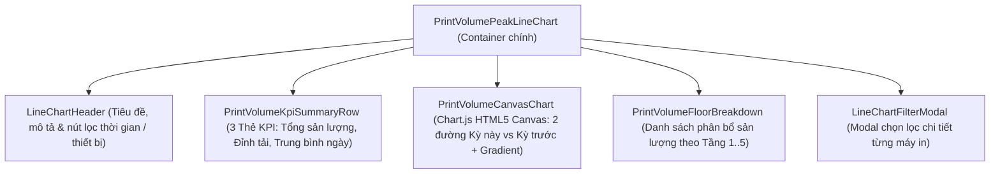

# Kế Hoạch Tái Thiết Kế Biểu Đồ 'Biến Động Sản Lượng In' (Layout Ảnh 1 - Chuẩn Chart.js Canvas)

## 1. Mục Tiêu & Yêu Cầu Thiết Kế

1. **Chuyển đổi Layout theo chuẩn Ảnh 1 (Thẻ 'Amount spent'):**
   - Loại bỏ giao diện đơn điệu chỉ có mỗi biểu đồ sóng nhân tạo.
   - Bố cục 4 tầng hoàn chỉnh: **Header tinh gọn** → **3 Thẻ KPI tóm tắt** → **Biểu đồ Chart.js Canvas trực quan** → **Danh sách phân bổ theo Tầng ở chân thẻ**.
2. **Loại bỏ 100% SVG cứng (`LineChartSplineSvg.tsx`):**
   - Không sử dụng các đường path cubic Bezier nhân tạo cố định.
   - Sử dụng thư viện **Chart.js** (`^4.4.6`) có sẵn trong dự án, vẽ trên HTML5 `<canvas>` để tự động co giãn, tính scale trục X/Y linh hoạt và sẵn sàng nhận mảng dữ liệu thực từ Backend (`ProductionTrendResponse`).
3. **Tương tác trực tiếp (Interactive Cross-Filtering):**
   - Bấm vào từng dòng Tầng ở chân thẻ sẽ lọc ngay dữ liệu biểu đồ của tầng đó.
   - Nút chuyển mốc thời gian `[24h | 7 ngày | 30 ngày]` và nút chọn thiết bị đặt gọn gàng ở góc phải Header.

---

## 2. Kiến Trúc Chi Tiết Thành Phần

### 2.1. Tầng 1: Header Tinh Gọn (Header Controls)
- **Bên trái:**
  - Tiêu đề: **Biến Động Sản Lượng In** (chấm xanh nhận diện)
  - Mô tả: *Đối chiếu lượng trang in theo thời gian giữa kỳ hiện tại và kỳ trước*
- **Bên phải:**
  - Cụm nút mốc thời gian: `[24 giờ | 7 ngày | 30 ngày]` (active style pill nền trắng/xanh sang trọng).
  - Nút dropdown: `[Tất cả thiết bị (23) ▾]` mở modal chọn lọc từng máy in.

### 2.2. Tầng 2: Hàng 3 Chỉ Số KPI Tóm Tắt (Executive Metrics Row)
- **Thẻ 1 - Tổng sản lượng kỳ này:**
  - Số lớn font mono: `15.700` trang.
  - Badge xu hướng: `+6.4%` (màu xanh lá) so với kỳ trước.
- **Thẻ 2 - Đỉnh tải cao nhất (Peak Volume):**
  - Số lớn: `13.636` trang.
  - Subtext: Đạt đỉnh lúc 09:30 Ngày 2 (hoặc ngày cao điểm).
- **Thẻ 3 - Sản lượng trung bình ngày:**
  - Số lớn: `523` trang/ngày.
  - Subtext: Trạng thái hạm đội: *Vận hành bình thường / Ổn định*.

### 2.3. Tầng 3: Biểu Đồ Spline Mượt Mà (Chart.js Canvas)
- **Công nghệ:** HTML5 Canvas quản lý bởi `Chart.js` (không dùng SVG path cứng).
- **2 đường xu hướng đối chiếu:**
  1. **Kỳ này (Current Series):** Đường cong spline mượt mà (`tension: 0.4`), màu xanh dương (#2563eb), kèm gradient chuyển màu từ xanh mờ ở đỉnh xuống trong suốt ở trục hoành.
  2. **Kỳ trước (Previous Baseline Series):** Đường nét đứt màu vàng cam (#f59e0b) thể hiện mốc cơ sở cùng kỳ.
- **Trục tọa độ & Grid:**
  - Trục Y bên trái: Định dạng số nghìn (`0`, `3.9k`, `7.8k`, `11.8k`, `15.7k` trang), đường lưới ngang mờ thanh thoát (`dash: [4, 4]`).
  - Trục X bên dưới: Các mốc ngày/giờ chuẩn hóa (`Ngày 1`, `Ngày 5`, `Ngày 10`... hoặc `00:00`, `04:00`...).
- **Tooltip chuyên nghiệp:** Tự động kích hoạt khi rê chuột qua điểm dữ liệu, hiển thị rõ ràng số trang kỳ này, kỳ trước và độ chênh lệch.

### 2.4. Tầng 4: Bảng Đối Soát Phân Bổ Theo Tầng (Floor Breakdown Section)
- Đặt ngay dưới biểu đồ tương tự danh sách metric của thẻ "Amount spent" trong Ảnh 1.
- Hiển thị danh sách các tầng (`Tầng 1`, `Tầng 2`, `Tầng 3`, `Tầng 4`, `Tầng 5`):
  - Tên tầng & Phòng ban đại diện.
  - Số trang in thực tế (ví dụ: `4.800 trang`).
  - Thanh mini progress bar và tỷ trọng phần trăm (ví dụ: `31%`).
  - **Tương tác lọc:** Bấm vào dòng tầng nào thì biểu đồ sẽ lọc dữ liệu theo tầng đó tức thì (kèm nút `[Xem tất cả]` để reset).

---

## 3. Kế Hoạch Triển Khai File & Code

1. **Tạo mới `PrintVolumeCanvasChart.tsx`:**
   - Thay thế cho `LineChartSplineSvg.tsx`.
   - Sử dụng `Chart.js` với canvas ref, lifecycle cleanup và cấu hình dataset động từ mảng `dataPoints`.
2. **Tạo mới `PrintVolumeFloorBreakdown.tsx`:**
   - Component hiển thị danh sách phân bổ các tầng kèm tỷ trọng và click handler.
3. **Cập nhật `PrintVolumePeakLineChart.tsx`:**
   - Tái cấu trúc thành card hoàn chỉnh theo layout 4 tầng của Ảnh 1.
   - Tích hợp 3 thẻ KPI phía trên và phân bổ tầng phía dưới.
4. **Cập nhật `LineChartHeader.tsx`:**
   - Đưa cụm nút chọn thời gian và nút chọn thiết bị lên góc phải Header.
5. **Kiểm thử chất lượng:**
   - Chạy `npm run typecheck` và `vitest run`.
   - Đảm bảo tất cả file tuân thủ AGENTS.md Rule 7.1 (< 300 LOC/file).
