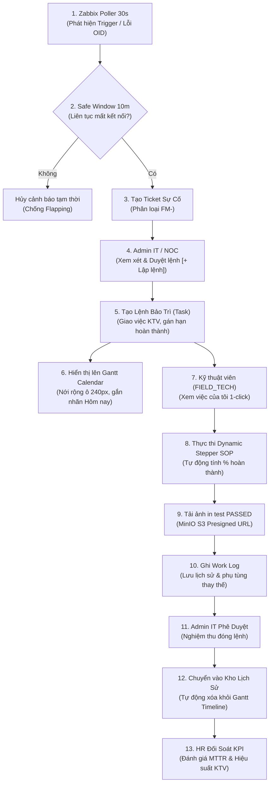

# FleetMonitor — Quy Trình Vận Hành & Luồng Tác Nghiệp (Operational Workflows)

> **Dự án:** FleetMonitor — Hệ thống Giám sát & Quản trị Máy in Doanh nghiệp Tập trung  
> **Tài liệu:** Thư mục đặc tả quy trình vận hành, xử lý sự cố và luồng công việc CMMS  
> **Phiên bản:** 2.6.0  
> **Trạng thái:** Authoritative Operational Specifications

---

## 1. Mục Đích & Phạm Vi Áp Dụng

Thư mục `docs/Plan/workflow/` chuẩn hóa toàn diện các luồng nghiệp vụ giữa **3 nhóm vai trò**:
1. **Quản trị viên IT & NOC (`ADMIN`):** Giám sát trạng thái, phê duyệt nghiệm thu, điều chuyển thiết bị và cấu hình hệ thống.
2. **Kỹ thuật viên hiện trường (`FIELD_TECH`):** Nhận lệnh công việc, thực thi quy trình SOP, ghi Work Log và tải ảnh nghiệm thu.
3. **HR / Kiểm kê tài sản (`ASSET_HR`):** Đối soát danh mục tài sản, kiểm tra số Serial, và hạch toán chi phí in ấn / đối soát KPI.

---

## 2. Danh Mục Tài Liệu Quy Trình Chi Tiết

| Tài Liệu Quy Trình | Nội Dung Kỹ Thuật | Tham Chiếu Nhiệm Vụ |
| :--- | :--- | :--- |
| [maintenance_lifecycle.md](file:///f:/Code/Github/Monitoring/docs/Plan/workflow/maintenance_lifecycle.md) | Vòng đời bảo trì 3 tầng chuẩn CMMS (`Ticket -> Task -> Work Log`), quy trình thực thi Dynamic Stepper %, tải ảnh nghiệm thu MinIO S3 (`PASSED`), và cơ chế tự động chuyển Task sang Kho Lịch Sử. | `TASK-FE-02`, `TASK-BE-03` |
| [alert_and_incident_flow.md](file:///f:/Code/Github/Monitoring/docs/Plan/workflow/alert_and_incident_flow.md) | Luồng phát hiện cảnh báo từ Zabbix Poller, cơ chế Safe Window 10m chống giật trạng thái (anti-flapping), phân loại lỗi phần cứng, và quy tắc an toàn Auto-Closure (khóa cứng đóng sự cố Critical). | `TASK-BE-01`, `TASK-BE-02` |

---

## 3. Sơ Đồ Khái Quát Luồng Tác Nghiệp Khép Kín

