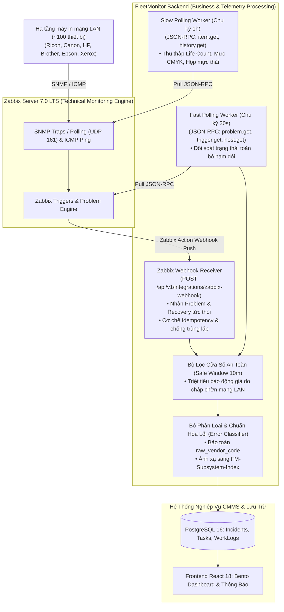

# FleetMonitor — Luồng Cảnh Báo & Xử Lý Sự Cố Phần Cứng (Alert & Incident Flow)

> **Phân hệ:** Monitoring & Diagnostics / CMMS Incident Pipeline  
> **Tham chiếu kỹ thuật:** `TASK-BE-04` (Zabbix Integration), `TASK-BE-05` (Telemetry Normalization), `TASK-BE-07` (Error Standardization), `TASK-BE-08` (CMMS Lifecycle), `AGENTS.md Rule 5 & 6`  
> **Mô hình hạ tầng:** On-Premises (LAN-Only) — Máy chủ nội bộ kết nối trực tiếp với Zabbix Server 7.0 LTS

---

## 1. Cơ Chế Thu Thập Kép (Hybrid Ingestion: Pull Định Kỳ + Webhook Push)

Hệ thống FleetMonitor triển khai mô hình nạp dữ liệu kỹ thuật kép giữa Zabbix 7.0 LTS và Backend:

---

## 2. Cơ Chế Cửa Sổ An Toàn (Safe Window 10 Phút Lọc Nhiễu Mạng)

Trong mạng LAN doanh nghiệp, các máy in có thể tạm thời khởi động lại, bảo trì dây cáp mạng hoặc chuyển chế độ ngủ sâu (Deep Sleep):
1. **Mất gói ICMP lần đầu:** Backend không kích hoạt sự cố ngay lập tức. Bắt đầu bộ đếm `Safe Window 10m` và đánh dấu cờ cảnh báo mềm `is_transient: true`.
2. **Khôi phục trước 10 phút:** Khi gói tin ICMP phản hồi trở lại qua Webhook Recovery hoặc Fast Polling kế tiếp, bộ đếm tự động reset, trạng thái máy in giữ nguyên `Online`.
3. **Mất kết nối liên tục $\ge$ 10 phút:** Thiết bị chính thức chuyển trạng thái `Offline`, kích hoạt bản ghi Incident trong PostgreSQL và bắn thông báo chuông cho Quản trị viên NOC/IT.

---

## 3. Quy Trình Phân Loại Lỗi Phần Cứng (Hardware Error Normalization)

Khi tiếp nhận chuỗi mã lỗi kỹ thuật từ Zabbix (qua trigger description hoặc item value), Backend thực thi quy trình chuẩn hóa:

### 3.1 Bảo toàn mã gốc của nhà sản xuất (`raw_vendor_code`)
- Firmware máy in trả về chuỗi mã kỹ thuật đặc thù (Ví dụ: Ricoh `SC541`, Canon `E000`, HP `50.1`).
- Hệ thống luôn bảo toàn nguyên vẹn chuỗi này trong trường `raw_vendor_code` để hỗ trợ KTV kiểm tra tài liệu hãng.

### 3.2 Ánh xạ sang 10 Phân Hệ Cơ Điện Tử Lõi
- **`FM-FUS-xx`**: Cụm sấy (Fuser Roller, Đèn sấy, Cảm biến nhiệt Thermistor).
- **`FM-OPT-xx`**: Khối quang học & Laser (Polygon Mirror Motor, Laser Diode, Thấu kính).
- **`FM-DRM-xx`**: Khối tạo ảnh & Trống (Drum Unit, Thanh gạt mực thải, Cao áp sạc).
- **`FM-DEV-xx`**: Khối từ & Cụm mực (Developer Unit, Cảm biến nồng độ từ TD Sensor).
- **`FM-PPR-xx`**: Cơ cấu kéo nạp giấy (Paper Feed Roller, Khay nâng giấy, Rơ-le tách giấy).
- **`FM-TRS-xx`**: Băng tải trung gian & Cao áp tách (Transfer Belt, Transfer Roller).
- **`FM-SCN-xx`**: Khối quét hình ảnh & Khay nạp bản gốc tự động (Scanner Flatbed, ADF).
- **`FM-PWR-xx`**: Khối cấp nguồn & Bo mạch chính (Power Supply Unit, Mainboard, Quạt tản nhiệt).
- **`FM-FIN-xx`**: Bộ dập ghim & Hoàn thiện bản in (Finisher, Stapler, Khay đảo mặt Duplex).
- **`FM-NET-xx`**: Cổng mạng & Giao tiếp (NIC, Cáp mạng LAN, Controller).

### 3.3 Cơ chế Fallback an toàn (`FM-UNK-01`)
- Nếu mã lỗi chưa có trong từ điển CSDL, hệ thống **tuyệt đối không bịa đặt mô tả lỗi** (tuân thủ nghiêm ngặt **AGENTS.md Rule 5 & 6**).
- Gán mã nội bộ `FM-UNK-01` ("Lỗi phần cứng chưa được định nghĩa").
- Đặt cờ `needs_mapping_review: true` và tự động đẩy vào hàng đợi kiểm duyệt Unmapped Queue để Quản trị viên cập nhật từ điển qua giao diện `/settings/dictionary`.

---

## 4. Quy Tắc Khóa Cứng Tự Động Đóng Sự Cố (Auto-Closure Safety Policy)

Theo quy định bắt buộc tại **AGENTS.md Rule 6**, hệ thống thiết lập hàng rào bảo vệ tuyệt đối:

| Loại Sự Cố | Có Được Tự Động Đóng (Auto-Close)? | Điều Kiện Đóng Sự Cố |
| :--- | :---: | :--- |
| **Sự cố Phần Cứng Nghiêm Trọng (`Critical`)** (Ví dụ: Cháy cụm sấy, vỡ bánh răng, hỏng bo nguồn, SC Codes) | 🛑 **TUYỆT ĐỐI CẤM** | Bắt buộc phải có Kỹ thuật viên hiện trường đến kiểm tra, thực thi SOP, nạp ảnh in test PASSED lên MinIO S3 và được Admin duyệt nghiệm thu. Một trigger Zabbix tự tắt (OK) KHÔNG chứng minh phần cứng đã sửa xong. |
| **Sự cố Do Người Dùng Báo Cáo (`User-Reported`)** (Ví dụ: Bản in bị vệt đen mờ, kẹt giấy liên tục) | 🛑 **TUYỆT ĐỐI CẤM** | Cần sự xác nhận trực tiếp của người sử dụng hoặc KTV bảo trì. |
| **Sự cố Vận Hành Tự Phục Hồi Nhẹ (`Operational Recoverable`)** (Ví dụ: Đóng lại nắp máy in, nạp thêm giấy vào khay rỗng) | ✅ **Cho phép Auto-Close** | Tự động đóng sau khi cảm biến trạng thái trả về bình thường liên tục trong 5 phút. |
