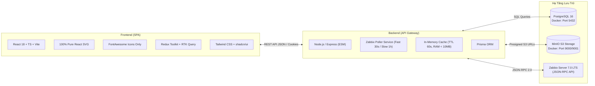

# FleetMonitor — Tài Liệu Kỹ Thuật Dự Án (Master Documentation Portal)

> **Dự án:** FleetMonitor — Enterprise Centralized Printer Fleet Monitoring & Operations Management  
> **Quy mô:** Hạm đội ~100 máy in đa thương hiệu (Chủ lực: Ricoh, Canon; Đồng hành: HP, Brother, Epson, Toshiba, Olivetti)  
> **Kiến trúc:** Layered Service-Oriented Architecture, 100% Pure React SVG, In-Memory Caching 60s, PostgreSQL 16 + MinIO S3  
> **Dành cho:** Kỹ sư phát triển, DevOps, và Trợ lý Lập trình Trí tuệ Nhân tạo (AI Coding Agents)

---

## 1. Mục Lục Tài Liệu Kỹ Thuật (Master Navigation Sitemap)

Hệ thống tài liệu FleetMonitor được cấu trúc phân tầng rõ ràng, phục vụ tra cứu nhanh và bảo đảm tính toàn vẹn:

```text
docs/
├── README.md                                 # [AUTHORITATIVE] Cổng thông tin tài liệu trung tâm & AI Agent Quickstart
├── Build/
│   └── API_CONTRACT.MD                       # Đặc tả Hợp đồng REST API chuẩn hóa giữa Frontend & Backend
├── Design/
│   ├── 00_overview.MD                        # Tổng quan dự án, 4 trọng tâm chiến lược & Master Index
│   ├── architecture.md                       # Kiến trúc kỹ thuật chi tiết v2.6.0 & Bộ 6 Cổng Cutover
│   ├── frontend_mock_to_oid_mapping.md       # Đặc tả ánh xạ toàn bộ Mock -> APIs, Database & SNMP OIDs
│   ├── rbac_roles_and_ui_permissions_spec.md # Đặc tả 3 vai trò RBAC (ADMIN, FIELD_TECH, ASSET_HR) & UI Matrix
│   ├── storage_and_database_architecture.md  # Kiến trúc CSDL PostgreSQL 16, MinIO S3 & Dual-Token Auth
│   └── ui_navigation_specs.MD                # Đặc tả điều hướng 4 phân hệ & trải nghiệm Bento Grid
├── Plan/
│   ├── business_requirements.MD              # Yêu cầu nghiệp vụ chuẩn doanh nghiệp (BRD v2.6.0)
│   ├── progress.MD                           # Báo cáo tiến độ triển khai Frontend-First & Roadmap Backend
│   └── workflow/                             # Thư mục đặc tả quy trình vận hành & CMMS khép kín
│       ├── README.md                         # Mục lục quy trình vận hành
│       ├── maintenance_lifecycle.md          # Vòng đời bảo trì 3 tầng (Ticket -> Task -> Work Log)
│       └── alert_and_incident_flow.md        # Luồng xử lý sự cố, Safe Window 10m & Khóa Auto-Closure
├── snmp-oids/                                # Thư mục từ điển SNMP OIDs & MIBs đa thương hiệu
│   ├── README.md                             # Tổng quan kiến trúc thu thập Zabbix Poller & Tra cứu OID
│   ├── rfc3805_printer_mib.md                # Đặc tả OID chuẩn RFC 3805 (Printer-MIB) & RFC 2790
│   └── vendor_enterprise_oids.md             # Tra cứu Private Enterprise OIDs (Ricoh, Canon, HP...)
├── Tasks/
│   ├── README.md                             # Sổ bộ tổng hợp danh mục Tasks & Bảng trạng thái
│   ├── task_template.MD                      # Mẫu chuẩn hóa tạo nhiệm vụ kỹ thuật mới
│   ├── Frontend/                             # 4 Nhiệm vụ Frontend đã hoàn thành 100%
│   │   ├── TASK-FE-01_dashboard_overview.MD
│   │   ├── TASK-FE-02_printers_diagnostics_and_tasks.MD
│   │   ├── TASK-FE-03_analytics_charts_and_rankings.MD
│   │   └── TASK-FE-04_settings_error_dictionary_rules.MD
│   └── Backend/                              # Bộ 6 Task Đặc tả kỹ thuật Backend sẵn sàng lập trình
│       ├── TASK-BE-01_zabbix_gateway.MD
│       ├── TASK-BE-02_cache_and_error_classification.MD
│       ├── TASK-BE-03_maintenance_cmms.MD
│       ├── TASK-BE-04_analytics_rollup_engine.MD
│       ├── TASK-BE-05_error_dictionary_csv.MD
│       └── TASK-BE-06_rbac_data_scope.MD
└── Test/
    └── test_plan.md                          # Kế hoạch kiểm thử toàn diện đa tầng (Vitest)
```

---

## 2. Hướng Dẫn Tối Ưu Hóa Dành Riêng Cho AI Agents (AI Agent Quickstart)

Để đảm bảo hiệu quả làm việc cao nhất khi AI Agent (Antigravity, Cursor, Copilot) tham gia đọc mã nguồn hoặc tạo mã mới, Agent **bắt buộc phải tuân thủ các quy tắc bất biến** sau:

### 2.1 Thứ Tự Tra Cứu Tài Liệu (Source of Truth Hierarchy)
1. `.agent/rules/AGENTS.md` (Nguyên tắc kỹ thuật tối cao).
2. [docs/README.md](file:///f:/Code/Github/Monitoring/docs/README.md) (Mục lục tra cứu nhanh này).
3. [docs/Design/00_overview.MD](file:///f:/Code/Github/Monitoring/docs/Design/00_overview.MD) & [architecture.md](file:///f:/Code/Github/Monitoring/docs/Design/architecture.md).
4. [docs/Build/API_CONTRACT.MD](file:///f:/Code/Github/Monitoring/docs/Build/API_CONTRACT.MD) & [frontend/src/types/api.ts](file:///f:/Code/Github/Monitoring/frontend/src/types/api.ts).
5. [docs/Plan/progress.MD](file:///f:/Code/Github/Monitoring/docs/Plan/progress.MD) (Trạng thái công việc hiện tại).

### 2.2 Quy Định Vàng Kỹ Thuật (Mandatory Engineering Guardrails)
- **Hard Limit số dòng (Rule 7.1):** Mỗi file code `.ts`/`.tsx` phải **dưới 300 dòng (LOC)** (tối ưu: 150 – 250 LOC). Tuyệt đối không tạo hoặc duy trì "God Component".
- **Hệ thống Icon duy nhất (Rule 7.1):** **BẮT BUỘC 100% FontAwesome** (`@/shared/icons`), nghiêm cấm cài đặt hoặc sử dụng Lucide, Heroicons, Feather hay bất kỳ thư viện icon nào khác.
- **Tính toàn vẹn dữ liệu (Rule 5):** `MetricValue = number | null`. Khi thiếu dữ liệu hoặc mất kết nối, hiển thị `—` hoặc `Chưa có dữ liệu`. Tuyệt đối không tự ý thay thế bằng số `0`.
- **Nghiêm cấm trường bịa đặt (Rule 6):** Tuyệt đối không thêm trường `actionGuidance` trong API phản hồi sự cố.
- **Zero Mock Imports in UI:** Mọi component và biểu đồ phải nạp dữ liệu thông qua Custom Hooks hoặc Service Providers (`analyticsService`, `printerService`), không import trực tiếp từ `mocks/`.

### 2.3 Lệnh Kiểm Tra Chuẩn (Standard Verification Commands)
```bash
# Kiểm tra toàn bộ Unit Tests Frontend
npm --prefix frontend test -- --run

# Kiểm tra biên dịch Vite Production Build (0 warnings/errors)
npm --prefix frontend run build

# Kiểm tra tĩnh kiểu dữ liệu Backend TypeScript
npm --prefix backend run typecheck
```

---

## 3. Bản Đồ 4 Phân Hệ Nghiệp Vụ (Core Application Modules)

| Phân Hệ | Route | Sub-tabs Điều Hướng | Trạng Thái FE | Trạng Thái BE |
| :--- | :--- | :--- | :---: | :---: |
| **1. Tổng Quan** | `/dashboard` | Thẻ KPI Bento, Biểu đồ Khả dụng 24h Pure React SVG, Donut trạng thái, Bảng thiết bị cần chú ý phân trang 5 dòng. | ✅ Hoàn thành | ⏳ Sẵn sàng nối API |
| **2. Máy In** | `/printers` | • `/printers/list`: Bảng danh mục 100 máy in, FleetHealthBar 4 phân đoạn, Modals quản trị.<br>• `/printers/timeline`: Gantt nới ô 240px, đánh dấu ngày hôm nay.<br>• `/printers/history`: Lệnh bảo trì CMMS & Đánh giá KPI KTV.<br>• Drawer 960px: Tab OID CMYK & Tab SOP Stepper %. | ✅ Hoàn thành | ⏳ Sẵn sàng nối API |
| **3. Phân Tích** | `/analytics` | • `/analytics/overview`: Spline 2.25px đỉnh tải, Cột Ngang 100%, Pinned Sandbox Split-View, So sánh 1:1.<br>• `/analytics/supplies`: Thống kê D-Day `[D-4]`, theo dõi Hộp mực thải.<br>• `/analytics/sla-cost`: Vòng cung 180°, Ma trận nhiệt sự cố, Xuất CSV. | ✅ Hoàn thành | ⏳ Sẵn sàng nối API |
| **4. Cấu Hình** | `/settings` | • `/settings/gateway`: Zabbix Live Ping Latency ms & Poller Sync.<br>• `/settings/rbac`: Quản trị người dùng RBAC 3 vai trò.<br>• `/settings/rules`: Ngưỡng cảnh báo động & Safe Window 10m.<br>• `/settings/dictionary`: Tra cứu mã lỗi đa hãng, Nạp/Xuất CSV UTF-8. | ✅ Hoàn thành | ⏳ Sẵn sàng nối API |

---

## 4. Ngăn Xếp Công Nghệ & Hạ Tầng (Technology Stack)



