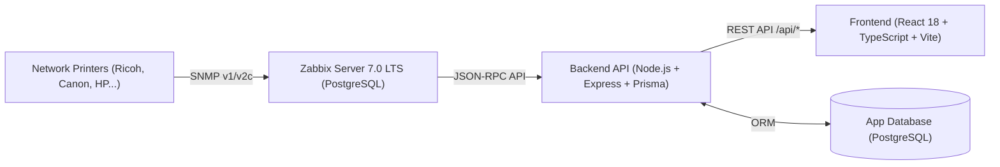

# REPO_OVERVIEW.md — Tài Liệu Tổng Quan Repository Printer Monitoring & Management

> **Tài liệu chuẩn hóa kiến trúc, hiện trạng và lộ trình kỹ thuật**  
> Cập nhật lần cuối: Tháng 10/2026 | Phiên bản: 1.0.0

---

## 1. Giới thiệu Dự Án

**Printer Monitoring & Management** là hệ thống giám sát và quản lý tập trung toàn diện cho đội máy in mạng đa hãng (Ricoh, Canon, HP, Brother, Epson) trong hạ tầng mạng doanh nghiệp.

### Mục tiêu cốt lõi
- **Giám sát thời gian thực & phát hiện lỗi phần cứng tin cậy**: Phát hiện kẹt giấy, nắp mở, hết vật tư, hỏng scanner/ADF/copier dựa trên mã lỗi SNMP chuẩn và mã lỗi chuyên biệt của từng hãng.
- **Theo dõi vòng đời sự cố (Incident Lifecycle)**: Định danh sự cố, chống trùng lặp (deduplication), ghi nhận thời gian bắt đầu, diễn biến và giải quyết.
- **Quản lý vật tư tiêu hao (Supplies & Waste Toner)**: Dự báo và cảnh báo mức mực thấp (< 15%) và hộp mực thải đầy (≥ 85%).
- **Thống kê sản lượng in ấn (Counters & Telemetry)**: Thu thập bộ đếm bản in trọn đời (`prtMarkerLifeCount`), phân tích theo thời gian.

---

## 2. Kiến trúc Hệ thống & Luồng Dữ Liệu

### 2.1 Luồng dữ liệu xác nhận (Confirmed Data Flow)


> **Lưu ý kiến trúc quan trọng**: Prometheus, SNMP Exporter và Grafana từng được thử nghiệm ban đầu nhưng đã được **thay thế hoàn toàn** bằng ngăn xếp Zabbix 7.0 LTS.

### 2.2 Các thành phần hệ thống

| Thành phần | Công nghệ | Vai trò & Trách nhiệm |
| :--- | :--- | :--- |
| **Data Collection Engine** | Zabbix Server 7.0 LTS & Web UI | Triển khai độc lập trên máy ảo Ubuntu Server; Polling SNMP định kỳ, quản trị viên cấu hình hosts/templates qua Zabbix Web UI. |
| **App Storage** | PostgreSQL 16 | Lưu trữ cấu hình & dữ liệu Zabbix trên máy ảo, cùng cơ sở dữ liệu nghiệp vụ của ứng dụng (sự cố, audit log). |
| **Backend API Gateway** | Node.js, Express, TypeScript, Prisma | Đóng vai trò cầu nối: kết nối với Zabbix Web API qua JSON-RPC (`/api_jsonrpc.php`), cache dữ liệu (TTL 60s), chuẩn hóa sang REST schema cho frontend. |
| **Web Frontend** | React 18, TypeScript, Vite | Giao diện Single Page Application hiện đại với 5 phân hệ chức năng, thiết kế Midnight Charcoal-Navy, biểu đồ Chart.js và phản hồi thời gian thực. |

---

## 3. Cấu trúc Thư mục Repository

```
Monitoring/
├── compose.yaml               # Docker Compose Zabbix 7.0 LTS + PostgreSQL 16
├── hosts_all_printers.yaml    # Danh bạ 20 máy in cho Zabbix
├── templates/                 # Zabbix Templates (YAML) cho các dòng máy in
├── mibs/                      # Thư mục MIB mount vào Zabbix (standard & vendors)
├── README.md                  # Hướng dẫn khởi chạy và tổng quan dự án
├── package.json               # NPM Workspaces Monorepo (quản lý frontend & backend)
├── docs/                      # TÀI LIỆU HỆ THỐNG VÀ ĐẶC TẢ KỸ THUẬT TẬP TRUNG
│   ├── SPECIFICATION.md       # Đặc tả yêu cầu chức năng, phi chức năng (IEEE/ISO)
│   ├── ARCHITECTURE.md        # Kiến trúc hệ thống, data flow & quyết định kỹ thuật
│   ├── REPO_OVERVIEW.md       # Tài liệu này (tổng quan toàn diện repo)
│   ├── DATA_SOURCES.md        # Thống kê OID SNMP, bảng metric Ricoh MP C6004 & phân loại xác thực
│   ├── PRINTER_DATA_REQUIREMENTS.md # Bảng checklist ánh xạ UI field - SNMP OID toàn diện
│   ├── snmp-oids/             # Danh mục tra cứu OID MIB tiêu chuẩn
│   │   └── standard-mibs.md   # Tổng hợp MIB-II, Printer-MIB, Host-Resources-MIB
│   └── models/                # Hồ sơ OID kỹ thuật theo từng dòng máy in
│       ├── ricoh-mp-c6004.md  # Dòng tham chiếu chính (Phase 1 verified) & từ điển SC codes
│       ├── canon-c5535i.md    # Dòng Canon iR-ADV C5535i (Phase 2 rollout)
│       └── ricoh-aficio-legacy.md # Dòng Ricoh Aficio đơn sắc thế hệ trước
├── frontend/                  # Ứng dụng Web React 18 + TypeScript (Vite)
│   ├── package.json           # Dependencies: react, lucide-react, chart.js, vitest
│   ├── tsconfig.json          # TypeScript config (strict mode)
│   ├── vite.config.ts         # Vite build config + Vitest test runner config + dev proxy
│   └── src/
│       ├── types/printer.ts   # Core domain interfaces: Printer, Supplies, MetricValue (number | null)
│       ├── diagnostics/       # Hệ thống chẩn đoán lỗi phần cứng & Vendor rule sets
│       ├── services/          # API client kết nối Backend (/api/printers, /api/incidents)
│       ├── hooks/             # Custom hook tự động polling, handling empty/stale/loading
│       ├── components/        # Component UI phân theo 5 module nghiệp vụ và modals
│       └── pages/             # 5 trang: Dashboard, Printers, Supplies, Incidents, Analytics
└── backend/                   # Backend API Gateway (Node.js + Express + Prisma)
    ├── package.json           # express, dotenv, cors, @prisma/client, tsx, vitest
    ├── tsconfig.json          # NodeNext module configuration
    ├── prisma/                # Prisma ORM schema
    └── src/
        ├── index.ts           # Express application bootstrap & route mounting
        ├── types/             # Type definitions Zabbix và API response contracts
        ├── zabbix/            # Zabbix JSON-RPC Client 7.0 LTS
        ├── services/          # In-memory caching (60s TTL), stale-fallback, data mapping
        ├── diagnostics/       # Backend error mapping & problem classifier
        └── api/routes/        # REST Endpoints phân tách theo module
```

---

## 4. Công Nghệ & Tiêu Chuẩn Kỹ Thuật

### 4.1 Frontend Architecture (`frontend/`)
- **React 18 + Vite 5**: Bundling siêu tốc, HMR, cấu hình proxy `/api` sang backend khi dev.
- **Strict TypeScript (`typescript-pro`)**:
  - Không sử dụng `any`.
  - Khai báo chuẩn hóa `MetricValue = number | null` — triệt tiêu hoàn toàn union `number | string` từng gây nhầm lẫn kiểu dữ liệu số và trạng thái chuỗi.
  - Xử lý tường minh các trạng thái dữ liệu rỗng (`Empty State`), mất kết nối (`Offline`), chưa xác định (`Unknown`) và lỗi OID.
- **Data Hook (`usePrinterData.ts`)**: Quản lý vòng đời dữ liệu, tích hợp `AbortController` để hủy request khi unmount, cơ chế polling tự động (mặc định 30 giây) và `fallback` về dữ liệu cũ khi có lỗi tạm thời.
- **Unit Testing (`Vitest`)**:
  - Đã tích hợp cấu hình `vitest` và `@testing-library/react`.
  - Toàn bộ 19 test cases cho `fleetService.ts` đạt kết quả kiểm thử **100% Pass**.

### 4.2 Backend Architecture (`backend/`)
- **Modular Monolith (`backend-architect`, `api-design-principles`)**:
  - Phân tách rõ ràng 3 lớp: Router (`api/routes`) → Business/Cache Service (`services`) → Data Source Client (`zabbix/client.ts`).
  - **Caching Strategy**: TTL 60 giây bộ nhớ đệm giúp giảm tải cho Zabbix Server và bảo đảm độ trễ API dưới 50ms đối với frontend.
  - **Resilience Pattern**: Cơ chế Stale-While-Revalidate — khi Zabbix API bị timeout hoặc gián đoạn mạng, Backend vẫn trả về snapshot gần nhất kèm trường `isStale: true` thay vì gây lỗi cho toàn bộ UI.
- **Prisma ORM & PostgreSQL**: Quản lý vòng đời sự cố (lifecycle tracking) gồm trạng thái `OPEN`, `ACKNOWLEDGED`, `RESOLVED`, lưu vết người xử lý và lịch sử audit.

### 4.3 Monitoring & SNMP Architecture
- **Mô hình tham chiếu ban đầu**: **Ricoh MP C6004** đa chức năng màu (Color MFP).
- **Phân loại xác thực dữ liệu (Verification Status)**:
  - `VERIFIED`: Đã kiểm chứng tính chính xác trên máy in thật qua `snmpwalk` (ví dụ: `prtMarkerLifeCount`, `sysDescr`, `sysUpTime`, `ricohFirmwareVersion`).
  - `OBSERVED`: Đã thu được OID nhưng cần kiểm chứng thêm trong kịch bản phần cứng thực tế (mực thải `ricohWasteTonerFullIndicator`, bộ đếm copy/fax).
  - `UNSUPPORTED`: Thiết bị không hỗ trợ qua SNMP MIB tiêu chuẩn.
  - `INCONCLUSIVE`: Chưa đủ bằng chứng kết luận.

---

## 5. Chức Năng Đã Triển Khai vs. Phần Còn Thiếu

### 5.1 Các chức năng đã triển khai hoàn tất
- [x] **Giao diện người dùng đầy đủ 5 phân hệ (UI Prototype)**: Dashboard, Printers, Supplies, Incidents, Analytics với thiết kế Dark/Light mode chuẩn hoá.
- [x] **Hệ thống Type chuẩn hóa**: Triệt tiêu `number | string`, hỗ trợ phân loại thiết bị, mức độ cảnh báo và tình trạng kết nối.
- [x] **Backend API Gateway Skeleton**: Hoàn thành Express server, Zabbix JSON-RPC Client, Cache layer và router.
- [x] **Prisma Database Schema**: Mô hình hóa dữ liệu máy in, sự cố và nhật ký xử lý.
- [x] **Unit Testing Suite**: Bộ kiểm thử Vitest tự động cho các hàm phân tích số liệu cốt lõi (19/19 passing).
- [x] **Tài liệu hóa kỹ thuật**: Cập nhật chuẩn xác `ARCHITECTURE.md`, `AGENTS.md` (loại bỏ thông tin lỗi thời về Prometheus/Grafana) và `REPO_OVERVIEW.md`.

### 5.2 Phần còn thiếu & Kế hoạch giai đoạn tiếp theo
1. **Kết nối Live Zabbix API**:
   - Hiện tại Frontend hiển thị trạng thái `No Data / Pending` do chưa chạy Zabbix Server và Backend thật.
   - Cần cấu hình biến môi trường `.env` (`ZABBIX_API_URL`, `ZABBIX_API_USER`, `ZABBIX_API_PASSWORD`) kết nối tới Zabbix VM trên VMware Workstation.
2. **Triển khai Database Migration**:
   - Khởi chạy PostgreSQL trên Ubuntu Server và chạy `npx prisma migrate dev` để tạo bảng.
3. **Mã lỗi phần cứng chi tiết (Hardware Error Mapping)**:
   - Viết mapper giải mã `prtAlertDescription` và trigger priority của Zabbix thành nguyên nhân gây lỗi chi tiết (kẹt giấy khay 1, mở nắp trước, hết giấy, kẹt bộ quét ADF).
4. **Tối ưu hóa Bundle Size (Frontend Performance)**:
   - Chunk hiện tại của `index.js` là ~505KB. Cần áp dụng `React.lazy` và code splitting cho tab `Analytics` và `Supplies` để giảm dung lượng file ban đầu xuống < 200KB.
5. **Xác thực và phân quyền (Authentication & Authorization)**:
   - Bổ sung xác thực JWT hoặc Session cho người quản trị mạng khi nhấn "Xử lý / Đóng sự cố" (`POST /api/incidents/:id/resolve`).

---

## 6. Hướng Dẫn Phát Triển & Vận Hành

### Chạy Frontend
```bash
cd frontend
npm install
npm run dev        # Khởi chạy Vite dev server tại http://localhost:3000
npm run test       # Chạy unit tests với Vitest
npm run typecheck  # Kiểm tra toàn bộ type TypeScript
npm run build      # Build bản sản phẩm (production bundle)
```

### Chạy Backend
```bash
cd backend
npm install
cp .env.example .env   # Điền thông tin kết nối Zabbix và Database
npx prisma generate    # Sinh mã nguồn Prisma Client
npm run dev            # Khởi chạy server Express tại http://localhost:5000
```

---
*Tài liệu được bảo trì và tuân thủ nghiêm ngặt các quy tắc trong [docs/AGENTS.md](file:///f:/Code/Github/Monitoring/docs/AGENTS.md).*
