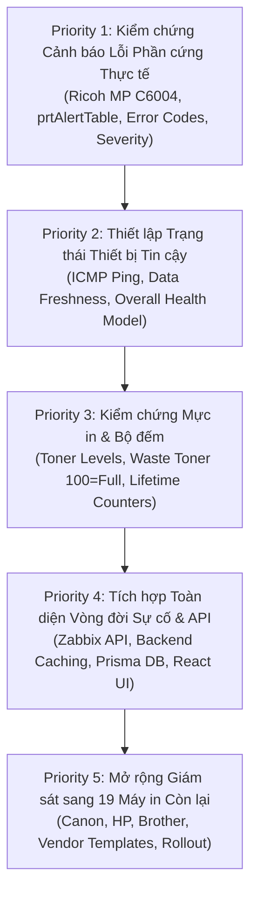

# SPECIFICATION.md — Đặc Tả Yêu Cầu Kỹ Thuật Hệ Thống Giám Sát Máy In

> **Hệ Thống Giám Sát & Quản Lý Máy In Mạng Tập Trung (Printer Monitoring & Management System)**  
> Chuẩn hóa theo tiêu chuẩn IEEE 830 / ISO/IEC/IEEE 29148  
> Cập nhật lần cuối: Tháng 10/2026 | Phiên bản: 1.0.0

---

## 1. Mục Đích & Bối Cảnh Dự Án

### 1.1 Mục đích
Tài liệu này xác lập toàn bộ đặc tả yêu cầu nghiệp vụ, yêu cầu chức năng, yêu cầu phi chức năng và tiêu chí nghiệm thu cho **Hệ thống Giám sát & Quản lý Máy in Mạng Tập trung**. Hệ thống giám sát các máy in mạng thông qua giao thức SNMP, thu thập và quản lý tập trung bởi **Zabbix 7.0 LTS**, chuẩn hóa và cung cấp qua **Backend API (Node.js/Express/Prisma)** và hiển thị trên giao diện trực quan **Web Dashboard (React/TypeScript)**.

Mục tiêu tối thượng của dự án là **phát hiện và cảnh báo chính xác lỗi phần cứng thực tế** từ thiết bị, cung cấp mô tả lỗi có thể hành động được (actionable) và phân loại mức độ nghiêm trọng, giúp đội ngũ kỹ thuật IT phát hiện sự cố ngay tức thì mà không cần kiểm tra thủ công từng thiết bị.

### 1.2 Nguyên tắc cốt lõi (Core Principle)
> **"Phát hiện lỗi phần cứng chính xác và có bằng chứng thực nghiệm quan trọng hơn việc hiển thị nhiều chỉ số hoặc làm đẹp giao diện."**

- Tuyệt đối không tự suy diễn hoặc bịa đặt OID SNMP, mã lỗi, tên metric, mức độ nghiêm trọng hoặc khả năng của thiết bị khi chưa có bằng chứng thực tế từ `snmpwalk` hoặc RFC chuẩn.
- Phân định rõ ràng giữa dữ liệu đã kiểm chứng (`VERIFIED`), dữ liệu mới quan sát được (`OBSERVED`), dữ liệu không hỗ trợ (`UNSUPPORTED`) và dữ liệu chưa kết luận (`INCONCLUSIVE`).
- Tách biệt hoàn toàn trạng thái hiển thị của giao diện với trạng thái giám sát thực tế. Không che giấu lỗi mất kết nối bằng dữ liệu mô phỏng.

---

## 2. Phạm Vi Dự Án (Scope)

### 2.1 Trong phạm vi (In Scope)
1. **Giám sát kết nối mạng & tính tươi mới của dữ liệu**: Kiểm tra tính sẵn sàng của thiết bị (ICMP Ping), chu kỳ quét và cảnh báo khi dữ liệu bị trễ/cũ (`Stale`).
2. **Quản lý danh mục máy in (Fleet Inventory)**: Hiển thị đầy đủ thông tin định danh, model, hãng sản xuất, địa chỉ IP, loại thiết bị và phiên bản firmware.
3. **Thu thập cảnh báo SNMP & lỗi phần cứng**: Tiếp nhận mã lỗi từ `prtAlertDescription`, OID chuyên hãng và trigger của Zabbix.
4. **Phân loại lỗi phần cứng theo phân hệ (Subsystems)**: Điều tra khả năng bóc tách lỗi Scanner, khay nạp tự động ADF, động cơ sao chụp Copier và lỗi bo mạch tổng quát MFP.
5. **Theo dõi vật tư tiêu hao (Supplies)**: Giám sát mức mực các màu (Black, Cyan, Magenta, Yellow) và cảm biến hộp mực thải (Waste Toner).
6. **Thống kê bộ đếm in ấn trọn đời (Counters)**: Thu thập bộ đếm tổng `prtMarkerLifeCount`, bộ đếm in, sao chụp và fax.
7. **Quản lý vòng đời sự cố (Incident Lifecycle)**: Định danh sự cố, chống trùng lặp, theo dõi thời gian bắt đầu, diễn biến và thao tác giải quyết sự cố.
8. **Đánh giá sức khỏe thiết bị tổng thể (Overall Device Health)**: Tính toán trạng thái sức khỏe dựa trên các quy tắc xác thực rõ ràng, không hardcode.
9. **Tích hợp Zabbix API qua Backend trung gian**: Backend API bảo mật thông tin đăng nhập Zabbix và cung cấp REST API chuẩn cho Frontend.
10. **Lộ trình mở rộng 20 máy in doanh nghiệp**: Kiểm chứng trọn vẹn trên thiết bị tham chiếu trước khi nhân rộng ra 19 máy còn lại.

### 2.2 Ngoài phạm vi (Out of Scope)
1. Không bắt buộc phải thu thập số serial hoặc vị trí phòng ban thông qua SNMP nếu thiết bị không hỗ trợ ghi nhận trong MIB.
2. Không giả định mọi model máy in đều hỗ trợ cùng cấu trúc OID hoặc danh mục lỗi như nhau.
3. Không xem bất kỳ metric số nào trả về là bằng chứng xác thực lỗi phần cứng trừ khi đã kiểm chứng ngữ nghĩa.
4. Không triển khai lại stack Prometheus, SNMP Exporter hay Grafana (đã bị bãi bỏ và thay thế hoàn toàn bởi Zabbix).
5. Không tự động đóng sự cố nếu chỉ vì bản tin SNMP tạm thời vắng mặt trong một lần cào dữ liệu.

---

## 3. Thiết Bị Tham Chiếu & Lộ Trình Triển Khai

### 3.1 Thiết bị tham chiếu giai đoạn 1 (Primary Reference Device)
- **Hãng sản xuất**: Ricoh
- **Dòng máy**: Ricoh MP C6004 (Color Multifunction Printer - Đa năng màu)
- **Địa chỉ IP thử nghiệm**: `10.48.3.252`
- **Giao thức giám sát**: SNMP v2c
- **Hệ điều hành / Firmware ghi nhận**: `1.43`
- **Mã hệ thống báo cáo (`sysDescr`)**: `MP C6004`

Mọi tính năng giám sát, OID phần cứng, cảm biến vật tư và bộ đếm phải được kiểm chứng hoạt động chính xác trên thiết bị này trước khi mở rộng.

### 3.2 Lộ trình mở rộng hạm đội 20 máy in (Phase 2 Rollout)
Sau khi Ricoh MP C6004 đạt trạng thái kiểm chứng hoàn tất (`VERIFIED`), hệ thống sẽ mở rộng kết nối tới 19 máy in còn lại thuộc mạng doanh nghiệp:
- **Canon**: Dòng máy photocopy đa năng imageRUNNER ADVANCE.
- **HP**: Dòng LaserJet Enterprise, LaserJet Managed.
- **Brother / Epson / Generic**: Dòng máy in văn phòng đơn năng và đa năng.

Mỗi dòng máy phải được kiểm tra bảng MIB riêng và xây dựng Zabbix Template phù hợp, không áp dụng dập khuôn template của Ricoh cho các hãng khác.

---

## 4. Yêu Cầu Chức Năng Chi Tiết (Functional Requirements)

### FR-01: Giám Sát Kết Nối Mạng & Đồng Bộ Dữ Liệu (Connectivity & Telemetry)
- **Mô tả**: Hệ thống phải giám sát trạng thái có thể tiếp cận được của máy in thông qua kết quả kiểm tra định kỳ của Zabbix (ICMP Ping kết hợp tính sẵn sàng của SNMP Agent).
- **Tiêu chí nghiệm thu (Acceptance Criteria)**:
  1. Giao diện phân biệt rõ ràng giữa máy in trực tuyến (`Online`), ngoại tuyến (`Offline`) và chưa xác định (`Unknown`).
  2. Mất kết nối mạng không được tự động suy diễn thành lỗi hỏng hóc phần cứng.
  3. Dữ liệu bị gián đoạn hoặc quá hạn quét không được hiển thị ngầm định là thiết bị khỏe mạnh.
  4. Hiển thị rõ mốc thời gian cập nhật thành công gần nhất (`lastSuccessfulScrape`).
  5. Cảnh báo cờ `isStale = true` khi dữ liệu không được cập nhật mới sau khoảng thời gian quy định (mặc định 10 phút).

### FR-02: Giám Sát Lỗi Phần Cứng Thực Tế (Hardware Error Monitoring — Ưu tiên cao nhất)
- **Mô tả**: Thu thập và hiển thị các cảnh báo lỗi thực tế được thiết bị phát ra qua bảng cảnh báo chuẩn SNMP `prtAlertTable` (RFC 3805) và OID cảnh báo chuyên biệt của hãng.
- **Dữ liệu cấu thành một cảnh báo**:
  - Mã lỗi / Mã cảnh báo (Alert Code).
  - Mô tả chi tiết lỗi (Alert Description).
  - Mức độ nghiêm trọng (Severity: `critical`, `warning`, `clear`, `unknown`).
  - Thời điểm phát hiện lần đầu (First Observed Time).
  - Trạng thái hiện tại (Active / Resolved).
- **Tiêu chí nghiệm thu**:
  1. Bản tin cảnh báo lỗi có thể truy vết thông suốt: **Máy in → SNMP → Zabbix Trigger → Backend API → UI**.
  2. Mô tả hiển thị trên giao diện phải khớp với chuỗi mô tả thiết bị trả về hoặc bảng đối chiếu mã lỗi đã kiểm chứng.
  3. Không tự tạo ra các lỗi Scanner, ADF, Copier từ các bộ đếm không liên quan.
  4. Hỗ trợ hiển thị nhiều cảnh báo đồng thời nếu thiết bị trả về nhiều dòng lỗi trong `prtAlertTable`.
  5. Kiểm thử thực tế chu kỳ xuất hiện lỗi, duy trì lỗi và tự động xóa lỗi khi sự cố vật lý được khắc phục.

### FR-03: Điều Tra & Bóc Tách Lỗi Bộ Quét (Scanner Error Investigation)
- **Mô tả**: Điều tra xem Ricoh MP C6004 và các dòng MFP có cung cấp OID cảnh báo lỗi chuyên biệt cho cụm quang học Scanner hay không.
- **Tiêu chí nghiệm thu**:
  1. Phân biệt lỗi Scanner với cảnh báo chung của máy khi và chỉ khi MIB thiết bị cung cấp OID riêng biệt.
  2. Nếu không tìm thấy OID tin cậy, phải đánh dấu tính năng là `UNSUPPORTED` hoặc `INCONCLUSIVE`, tuyệt đối không giả lập dữ liệu lỗi live.

### FR-04: Điều Tra & Bóc Tách Lỗi Khay Nạp Bản Gốc Tự Động (ADF Error Investigation)
- **Mô tả**: Xác định xem lỗi kẹt giấy tại khay nạp tự động ADF (Auto Document Feeder) hoặc mở nắp ADF có thể bóc tách độc lập khỏi lỗi kẹt giấy thân máy hay không.
- **Tiêu chí nghiệm thu**:
  1. Ghi nhận bằng chứng thực tế từ `snmpwalk` khi chủ động tạo kẹt giấy thử nghiệm trên ADF.
  2. Không gán nhãn kẹt giấy chung chung thành lỗi ADF khi chưa có bằng chứng kỹ thuật.

### FR-05: Điều Tra & Bóc Tách Lỗi Động Cơ Sao Chụp (Copier Error Investigation)
- **Mô tả**: Điều tra mã lỗi phần cứng chuyên biệt cho chức năng photocopy.
- **Tiêu chí nghiệm thu**:
  1. Tuyệt đối không nhầm lẫn giữa bộ đếm số lượng bản chụp (`ricohCopierModeCopies`) với trạng thái lỗi phần cứng của cụm sao chụp.
  2. Ghi nhận rõ hạn chế kỹ thuật nếu thiết bị chỉ báo lỗi chung qua Controller tổng (`mfpErr`).

### FR-06: Giám Sát Lỗi Tổng Thể Thiết Bị Đa Năng (General MFP & Controller Faults)
- **Mô tả**: Giám sát các lỗi bo điều khiển trung tâm (Controller error), lỗi dịch vụ SC (Service Call), lỗi mở nắp thiết bị và lỗi liên quan đến cụm sấy/khay giấy.
- **Tiêu chí nghiệm thu**:
  1. Bảo toàn nguyên vẹn mã SC của Ricoh (ví dụ: `SC542`, `SC396`) trong mô tả sự cố để kỹ thuật viên tra cứu tài liệu bảo trì của hãng.
  2. Phân biệt rõ lỗi phần cứng đã xác nhận với tình trạng thiết bị mất kết nối mạng.

### FR-07: Giám Sát Mức Mực & Hộp Mực Thải (Supplies & Waste Toner)
- **Mô tả**: Giám sát mức phần trăm của 4 hộp mực chính (Black, Cyan, Magenta, Yellow) và tình trạng đầy của hộp chứa mực thải (Waste Toner Container).
- **Quy ước kỹ thuật**:
  - Hộp mực thông thường: Giá trị từ `0%` đến `100%`. Mức cảnh báo thấp: `< 15%`.
  - Hộp mực thải: Quy ước hiển thị của dự án là `100 = Full` (Đầy/Cần thay thế ngay). Mức cảnh báo: `≥ 85%`.
- **Tiêu chí nghiệm thu**:
  1. Mọi giá trị phần trăm hiển thị phải truy vết được về OID nguồn (`prtMarkerSuppliesLevel` hoặc OID chuyên hãng Ricoh) và Zabbix Item tương ứng.
  2. Ghi nhận rõ quy ước `100 = Full` của mực thải là quy ước hiển thị dự án, cần tiếp tục kiểm chứng vật lý trên cảm biến mực thải thực tế.
  3. Giá trị rỗng hoặc không thu thập được phải hiển thị là `Data Unavailable` hoặc `null`, không được hiển thị là `0%` hay `100%`.
  4. Máy in laser đơn sắc (Monochrome) phải hiển thị mực màu là `N/A` hoặc không hiển thị thanh tiến trình thay vì báo lỗi.

### FR-08: Theo Dõi Bộ Đếm Sản Lượng In Ấn (Usage & Lifetime Counters)
- **Mô tả**: Hiển thị bộ đếm trang in trọn đời của máy in và các bộ đếm thành phần theo chế độ hoạt động.
- **Danh mục bộ đếm ghi nhận**:
  - `prtMarkerLifeCount`: Tổng số trang động cơ máy in đã xử lý trọn đời.
  - `ricohCopierModeCopies`: Số bản sao chụp ở chế độ photocopy (Ricoh).
  - `ricohPrinterModeCopies`: Số bản in từ máy tính gửi lệnh in qua mạng (Ricoh).
  - `ricohFaxModeCopies`: Số bản nhận/gửi fax (Ricoh).
  - `ricohTotalCopies`: Tổng bản chụp/in theo MIB Ricoh.
- **Tiêu chí nghiệm thu**:
  1. Mỗi bộ đếm phải được gán nhãn rõ ràng theo đúng ý nghĩa kỹ thuật đã xác minh.
  2. Tuyệt đối không dùng giá trị bộ đếm để làm bằng chứng suy luận máy in đang bị lỗi.
  3. Thống kê sản lượng 30 ngày (`thirtyDayVolume`) phải được tính toán dựa trên độ chênh lệch (Delta) của dữ liệu lịch sử được Zabbix/Database lưu trữ theo thời gian thực, không suy diễn từ một lần đọc đơn lẻ.

### FR-09: Mô Hình Đánh Giá Sức Khỏe Thiết Bị Tổng Thể (Overall Device Health Model)
- **Mô tả**: Tính toán trạng thái sức khỏe tổng hợp của thiết bị theo quy tắc logic rõ ràng, minh bạch thay vì gán nhãn cố định hoặc tùy tiện.
- **Các trạng thái sức khỏe tiêu chuẩn**:
  - `Healthy`: Thiết bị Online, không có cảnh báo nào đang hoạt động, mức vật tư > 15%, mực thải < 85%.
  - `Warning`: Thiết bị Online, có cảnh báo mức warning hoặc có ít nhất 1 màu mực < 15% hoặc mực thải ≥ 70%.
  - `Critical`: Thiết bị Online nhưng có lỗi phần cứng mức critical (kẹt giấy, lỗi SC, nắp mở khi in, mực thải ≥ 85%, hết sạch mực).
  - `Offline`: Thiết bị không phản hồi ICMP ping hoặc SNMP agent ngoại tuyến.
  - `Stale`: Dữ liệu quét thành công gần nhất cũ hơn ngưỡng thời gian cho phép.
  - `Unknown`: Dữ liệu OID cơ bản không xác định được.
- **Tiêu chí nghiệm thu**:
  1. Có quy tắc tính toán rõ ràng và được kiểm thử tự động bằng unit tests.
  2. Thiết bị mất kết nối mạng hiển thị là `Offline`, không hiển thị là `Critical` hay `Healthy`.
  3. Dữ liệu thiếu hụt hoặc lỗi thời không được phép cho ra kết quả `Healthy`.

### FR-10: Quản Lý Vòng Đời Sự Cố (Incident Lifecycle Management)
- **Mô tả**: Cung cấp phân hệ theo dõi và quản lý sự cố độc lập cho các lỗi phần cứng và cảnh báo vận hành phát sinh từ máy in.
- **Các thuộc tính sự cố**:
  - Mã định danh sự cố (Incident ID, ví dụ: `INC-2026-001`).
  - Định danh máy in gặp lỗi (Printer ID, Tên, IP, Vị trí).
  - Phân loại sự cố (Category: `Hardware`, `Paper Jam`, `Supply`, `Connectivity`, `Service Call`).
  - Mức độ nghiêm trọng (`Critical`, `Warning`).
  - Thời gian phát hiện lần đầu (`startTime`), Thời gian cập nhật (`lastSeen`).
  - Trạng thái vòng đời: `OPEN` (Đang phát sinh) → `ACKNOWLEDGED` (Đã tiếp nhận) → `RESOLVED` (Đã khắc phục).
- **Tiêu chí nghiệm thu**:
  1. Áp dụng cơ chế chống trùng lặp (Deduplication): Cùng một lỗi đang tiếp diễn trên một máy in không được tạo nhiều bản ghi sự cố mới ở mỗi chu kỳ quét.
  2. Sự cố chỉ được coi là đã đóng (`RESOLVED`) khi tín hiệu cảnh báo trên thiết bị đã biến mất thực sự (clear event) hoặc quản trị viên chủ động xác nhận đóng kèm ghi chú.
  3. Lưu vết đầy đủ lịch sử thay đổi trạng thái sự cố trong cơ sở dữ liệu (`IncidentAuditLog`).

### FR-11: Cấu Trúc 5 Phân Hệ Giao Diện & Modal Chi Tiết (UI Architecture)
- **Mô tả**: Giao diện người dùng được tổ chức thành 5 tab điều hướng chính và 2 modal nghiệp vụ:
  1. **Dashboard**: Tổng quan KPI toàn hạm đội (tổng số máy, trực tuyến/ngoại tuyến, số sự cố mở, danh sách máy in cần chú ý khẩn cấp, biểu đồ phân bổ hãng sản xuất và trạng thái).
  2. **Printers**: Bảng danh bạ máy in, hỗ trợ lọc đa tiêu chí (hãng, loại máy, trạng thái kết nối, sức khỏe), tìm kiếm tức thì, phân trang và xuất báo cáo CSV.
  3. **Supplies**: Bảng vật tư chi tiết từng màu mực (K, C, M, Y) và hộp mực thải, biểu đồ so sánh mức tiêu hao ngang giữa các máy in, danh sách máy in cần thay thế vật tư khẩn cấp.
  4. **Incidents**: Bảng quản lý sự cố, lọc theo mức độ nghiêm trọng, trạng thái xử lý, xem chi tiết và kích hoạt thao tác giải quyết sự cố.
  5. **Analytics**: Phân tích sản lượng in ấn, biểu đồ xu hướng theo thời gian, phát hiện bất thường và xuất bảng dữ liệu telemetry.
  - **PrinterDetailModal**: Modal 5 phân phần (1. Thông tin chung & Network, 2. Sức khỏe & Mã lỗi phần cứng, 3. Mức vật tư tiêu hao, 4. Bộ đếm sản lượng trọn đời, 5. Lịch sử sự cố gần nhất).
  - **IncidentDetailModal**: Modal xem chi tiết sự cố và biểu mẫu xác nhận xử lý/đóng sự cố.
- **Tiêu chí nghiệm thu**:
  1. Nhất quán thuật ngữ và trạng thái màu sắc trên toàn bộ 5 trang.
  2. Các trường dữ liệu rỗng phải hiển thị rõ trạng thái `Chưa có dữ liệu` hoặc huy hiệu tương ứng, không để trống hoặc hiển thị lỗi render.
  3. Header hiển thị trạng thái hoạt động của kênh giám sát và đồng hồ UTC chuẩn hóa.

---

## 5. Yêu Cầu Phi Chức Năng (Non-Functional Requirements)

### NFR-01: Độ Tin Cậy & Phân Định Dữ Liệu Rõ Ràng (Data Quality Standards)
Hệ thống phải phân định rạch ròi 6 trạng thái dữ liệu kỹ thuật và không được dùng lẫn lộn:
- `0`: Giá trị số học đo đếm được bằng 0 (ví dụ: máy in chưa từng thực hiện bản fax nào).
- `Unknown`: Thiết bị không cung cấp đủ thông tin để xác định.
- `Unsupported`: Thiết bị hoặc MIB của dòng máy không hỗ trợ tính năng này.
- `Data Unavailable`: Lỗi mất kết nối hoặc không thu thập được từ thiết bị ngoại tuyến.
- `Stale`: Dữ liệu lưu đệm từ lần quét trước khi thiết bị hiện tại phản hồi chậm hoặc tạm mất kết nối.
- `Offline`: Thiết bị hoàn toàn không thể kết nối mạng.

### NFR-02: Hiệu Năng & Độ Trễ Phản Hồi (Performance & Latency)
- **Tầng Backend API**: Thời gian phản hồi trung bình cho các endpoint `/api/printers` và `/api/incidents` phải `< 50ms` khi lấy từ in-memory cache.
- **Cơ chế Cache**: Backend lưu đệm snapshot dữ liệu Zabbix với TTL = 60 giây để tránh làm quá tải Zabbix Server với hàng chục client web truy cập đồng thời.
- **Tầng Frontend**: Thời gian tải trang ban đầu (First Contentful Paint) `< 1.5s`. Tự động polling dữ liệu nền mỗi 30–60 giây không gây giật lag giao diện (non-blocking UI).

### NFR-03: Khả Năng Kháng Lỗi & Dự Phòng (Resilience & Graceful Degradation)
- Áp dụng mẫu kiến trúc **Stale-While-Revalidate**: Khi Zabbix API bị timeout, khởi động lại hoặc tạm thời gián đoạn mạng, Backend API tiếp tục trả về dữ liệu snapshot thành công gần nhất kèm cờ `isStale: true` thay vì trả về lỗi 500 làm sập giao diện người dùng.
- Frontend phải có Empty State rõ ràng, hướng dẫn người dùng khi chưa có dữ liệu backend hoặc khi bộ lọc không có kết quả phù hợp.

### NFR-04: Bảo Mật Thông Tin & Xác Thực (Security)
1. **Tuyệt đối không để lộ thông tin nhạy cảm ở Frontend**: Chuỗi SNMP Community string, thông tin đăng nhập Zabbix API, Zabbix Auth Token, Database Connection String không bao giờ được xuất hiện trong mã nguồn React hay gói build tĩnh.
2. Không commit file `.env` chứa mật khẩu thực tế lên Git repository.
3. Giao tiếp giữa Backend API và Frontend được bảo vệ bởi CORS có cấu hình whitelist tên miền/IP cụ thể.
4. Mọi thao tác giải quyết sự cố (`POST /api/incidents/:id/resolve`) phải được kiểm tra tính hợp lệ của tham số đầu vào và lưu vết IP/User thao tác.

### NFR-05: Khả Năng Mở Rộng Hạm Đội (Scalability)
- Kiến trúc Zabbix và Backend API phải đảm bảo khả năng mở rộng tối thiểu tới **100 máy in mạng** với chu kỳ quét từ 1–5 phút mà không vượt quá 20% dung lượng RAM và CPU của máy chủ Zabbix.
- Cấu hình retention trong Zabbix và Database đảm bảo lưu trữ lịch sử telemetry tối thiểu 90 ngày và dữ liệu xu hướng (trends) tối thiểu 365 ngày.

### NFR-06: Chuẩn Hóa Mã Nguồn & An Toàn Kiểu Dữ Liệu (Code Quality & Type Safety)
- Áp dụng chế độ nghiêm ngặt TypeScript Strict Mode (`noImplicitAny: true`, `strictNullChecks: true`).
- Toàn bộ giá trị đo đạc (vật tư, bộ đếm) phải sử dụng kiểu dữ liệu `MetricValue = number | null`, triệt tiêu hoàn toàn union `number | string`.
- Tách biệt rõ ràng tầng tính toán nghiệp vụ (Pure calculation functions trong `fleetService.ts`) khỏi tầng hiển thị React Components.
- Toàn bộ các hàm tính toán cốt lõi phải được bao phủ bởi Unit Test tự động (Vitest) với tỷ lệ vượt qua đạt 100%.

---

## 6. Thứ Tự Ưu Tiên Triển Khai Kỹ Thuật (Implementation Priorities)

### Priority 1: Kiểm Chứng Cảnh Báo Lỗi Phần Cứng Thực Tế
- Kiểm chứng dữ liệu cảnh báo SNMP trên Ricoh MP C6004 (kẹt giấy, nắp mở, hết mực).
- Xác nhận mô tả lỗi, mã lỗi và ánh xạ mức độ nghiêm trọng.
- Cấu hình các Zabbix Item và Trigger tương ứng.
- Kiểm thử chu kỳ xuất hiện lỗi, duy trì lỗi và tự động xóa lỗi khi khắc phục xong.
- Ghi nhận minh bạch các kết quả không hỗ trợ (`UNSUPPORTED`) hoặc chưa kết luận (`INCONCLUSIVE`).

### Priority 2: Thiết Lập Trạng Thái Thiết Bị Tin Cậy
- Cấu hình và xác thực cơ chế phát hiện mất kết nối mạng trong Zabbix (ICMP Ping kết hợp SNMP agent availability).
- Định nghĩa ngưỡng thời gian trễ dữ liệu (`Stale`).
- Hoàn thiện mô hình đánh giá sức khỏe thiết bị (`Overall Device Health`).
- Tách bạch rạch ròi giữa lỗi hỏng phần cứng với lỗi gián đoạn kết nối mạng.

### Priority 3: Kiểm Chứng Mực In & Bộ Đếm
- Kiểm chứng cảm biến mực 4 màu và quy ước hộp mực thải `100 = Full`.
- Xác nhận ý nghĩa đơn vị đo của các bộ đếm sản lượng in ấn (`prtMarkerLifeCount`, copy, print, fax).
- Đảm bảo các giá trị không hỗ trợ hiển thị rõ là `N/A`, không bị biến thành `0`.

### Priority 4: Tích Hợp Toàn Diện Vòng Đời Sự Cố & API
- Kết nối dữ liệu Zabbix Server thật vào Backend API qua Zabbix JSON-RPC client.
- Triển khai cơ chế lưu vết sự cố, chống trùng lặp và lưu trữ lịch sử xử lý vào cơ sở dữ liệu PostgreSQL qua Prisma.
- Xác thực từng trang giao diện với dữ liệu thực tế từ backend.
- Xóa bỏ hoàn toàn nhãn `MOCK DATASET` khi hoàn tất kết nối live.

### Priority 5: Mở Rộng Giám Sát Sang 19 Máy In Còn Lại
- Bổ sung 19 máy in còn lại vào hệ thống sau khi Ricoh MP C6004 đã được kiểm chứng toàn diện.
- Kiểm tra hỗ trợ MIB đặc thù của từng hãng (Canon imageRUNNER, HP LaserJet).
- Tái sử dụng Zabbix Template và logic ứng dụng chỉ khi ngữ nghĩa dữ liệu tương thích hoàn toàn.
- Tài liệu hóa các hạn chế kỹ thuật của từng model máy in.

---

## 7. Tiêu Chuẩn Nghiệm Thu Kỹ Thuật (Definition of Done — DoD)

Một tính năng giám sát chỉ được công nhận là **Hoàn Thành (Done)** khi thỏa mãn đầy đủ 7 tiêu chí:

1. **Nguồn dữ liệu rõ ràng**: OID SNMP hoặc metric nguồn đã được định danh cụ thể từ RFC hoặc Vendor MIB.
2. **Có bằng chứng thực nghiệm**: Ý nghĩa và đơn vị đo lường của metric được chứng minh qua kết quả `snmpwalk` thực tế trên thiết bị vật lý.
3. **Đã kiểm thử hành vi**: Tính năng được kiểm thử trong điều kiện hoạt động bình thường, khi phát sinh lỗi và sau khi lỗi được khắc phục.
4. **Xác thực luồng dữ liệu thông suốt**: Dữ liệu được xác nhận truyền dẫn đầy đủ từ **Máy in → Zabbix → Backend API → UI**.
5. **Xử lý trọn vẹn các trạng thái biên**: Xử lý đầy đủ trường hợp dữ liệu rỗng (`null`), ngoại tuyến (`Offline`), lỗi thời (`Stale`) và không hỗ trợ (`Unsupported`).
6. **Minh bạch về trạng thái dữ liệu**: Tuyệt đối không trình bày dữ liệu mô phỏng như thể đã kết nối live thành công.
7. **Tài liệu hóa hoàn chỉnh**: Mọi phát hiện, giới hạn kỹ thuật và OID liên quan được cập nhật đầy đủ vào [docs/DATA_SOURCES.md](file:///f:/Code/Github/Monitoring/docs/DATA_SOURCES.md) và [docs/SPECIFICATION.md](file:///f:/Code/Github/Monitoring/docs/SPECIFICATION.md).

---
*Tài liệu được bảo trì và tuân thủ nghiêm ngặt các quy tắc trong [docs/AGENTS.md](file:///f:/Code/Github/Monitoring/docs/AGENTS.md).*
