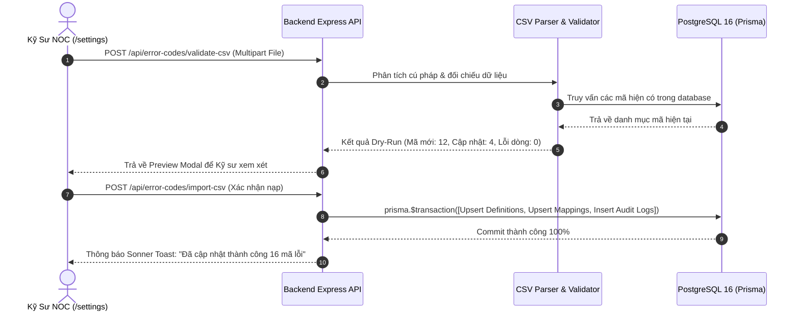

# TASK-BE-05: Error Code Standardization (6 Brands) & CSV Import/Export Engine

> **Phân hệ:** Backend / Diagnostics & Settings  
> **Mã nhiệm vụ:** TASK-BE-05  
> **Phiên bản:** 1.0.0 (Tối ưu hóa hạm đội ~100 máy in, Dry-Run 2 bước & Giao dịch nguyên tử)  
> **Trạng thái:** ✅ Hoàn thành 100% (SettingsController, ErrorDictionary routes, CSV export/import & AuditLog)  
> **Tài liệu liên quan:** [Kiến Trúc Hệ Thống](file:///f:/Code/Github/Monitoring/docs/Design/architecture.md), [Bản Ánh Xạ OIDs](file:///f:/Code/Github/Monitoring/docs/Design/frontend_mock_to_oid_mapping.md)

---

## 1. Mục Tiêu & Phạm Vi Kỹ Thuật

Module chịu trách nhiệm quản lý bộ từ điển mã lỗi phần cứng đa thương hiệu (Ricoh, HP, Canon, Epson, Brother, Xerox), ánh xạ toàn bộ mã lỗi kỹ thuật của hãng sang chuẩn nội bộ `FM-<SUBSYSTEM>-<INDEX>`:

1. **Chuẩn Hóa 10 Phân Hệ Cơ Điện Tử Lõi (Subsystems):**
   - `FUS`: Cụm sấy (Fuser) | `OPT`: Khối quang học / Laser Polygon Motor
   - `SCN`: Khối quét ảnh / ADF | `FED`: Cơ kéo giấy / Khay nạp / Cụm cuốn
   - `DRM`: Cụm trống hình (Drum) | `DEV`: Cụm từ (Developer Unit)
   - `TNR`: Hệ thống cấp mực / Bơm mực | `TRN`: Băng tải chuyển ảnh (Transfer Belt)
   - `PWR`: Khối nguồn & Cao áp | `NET`: Bo mạch điều khiển & Mạng
2. **Quy Trình Nạp CSV Kiểm Duyệt 2 Bước (Dry-Run & Atomic Commit):**
   - **Bước 1 (Dry-Run Validation):** Kiểm tra cấu trúc file CSV tải lên: Định dạng cột, phân hệ hợp lệ, danh sách các hãng trong hạm đội (Canon, Ricoh, Epson, HP, Brother, Toshiba, Olivetti), kiểm tra trùng lặp. Trả về bảng đối chiếu trước: Số mã thêm mới, số mã cập nhật, số cảnh báo.
   - **Bước 2 (Atomic Transaction Commit):** Khi người dùng xác nhận, toàn bộ dữ liệu được cập nhật trong một Database Transaction duy nhất, đồng thời ghi vết lịch sử vào `error_code_audit_logs`.
3. **Hàng Đợi Duyệt Mã Lỗi Chưa Ánh Xạ (Unmapped Errors Queue):**
   - Cung cấp API hiển thị các mã lỗi lạ mà Zabbix thu thập được từ máy in nhưng chưa có trong từ điển (gắn cờ `needs_mapping_review: true`), giúp Kỹ sư NOC bổ sung trực tiếp từ giao diện Cài đặt (`/settings`).

---

## 2. Thiết Kế Cơ Sở Dữ Liệu Prisma

```prisma
// backend/prisma/schema.prisma (Phần Chuẩn Hóa Mã Lỗi)

model InternalErrorDefinition {
  id              String               @id // FM-<SUBSYSTEM>-<INDEX> (VD: FM-FUS-01)
  subsystem       String               // FUS, OPT, SCN, FED, DRM, DEV, TNR, TRN, PWR, NET
  nameVi          String               @map("name_vi")
  rootCauseVi     String               @map("root_cause_vi")
  defaultSeverity String               @map("default_severity") // Critical, Warning, Info
  isActive        Boolean              @default(true) @map("is_active")
  createdAt       DateTime             @default(now()) @map("created_at")
  updatedAt       DateTime             @updatedAt @map("updated_at")

  mappings        VendorErrorMapping[]

  @@map("internal_error_definitions")
}

model VendorErrorMapping {
  id                  String                  @id @default(uuid())
  internalErrorId     String                  @map("internal_error_id")
  vendor              String                  // Ricoh, HP, Canon, Epson, Brother, Xerox
  vendorCode          String                  @map("vendor_code") // SC542, E000, 50.1, 010-327...
  modelPattern        String                  @default("*") @map("model_pattern")
  vendorDescription   String?                 @map("vendor_description")
  remedyStepsVi       String?                 @map("remedy_steps_vi")
  createdAt           DateTime                @default(now()) @map("created_at")
  updatedAt           DateTime                @updatedAt @map("updated_at")

  internalDefinition  InternalErrorDefinition @relation(fields: [internalErrorId], references: [id], onDelete: Cascade)

  @@unique([vendor, vendorCode, modelPattern])
  @@index([vendor, vendorCode])
  @@map("vendor_error_mappings")
}

model ErrorCodeAuditLog {
  id              String   @id @default(uuid())
  internalErrorId String   @map("internal_error_id")
  action          String   // IMPORT_CSV, CREATE, UPDATE, DELETE
  changedBy       String?  @map("changed_by")
  oldData         Json?    @map("old_data")
  newData         Json?    @map("new_data")
  changeReason    String?  @map("change_reason")
  createdAt       DateTime @default(now()) @map("created_at")

  @@map("error_code_audit_logs")
}
```

---

## 3. Quy Trình Xác Thực CSV & Atomic Commit



---

## 4. Danh Sách REST API Endpoints

| Endpoint | Method | Chức năng nghiệp vụ |
| :--- | :--- | :--- |
| `/api/error-codes/search` | `GET` | Tra cứu mã lỗi đa năng (theo mã FM, mã hãng gốc, từ khóa nguyên nhân) |
| `/api/error-codes/validate-csv` | `POST` | Nạp file CSV kiểm duyệt Dry-Run trước (không ghi database) |
| `/api/error-codes/import-csv` | `POST` | Thực thi commit dữ liệu CSV trong giao dịch nguyên tử |
| `/api/error-codes/export-csv` | `GET` | Xuất toàn bộ từ điển ra định dạng UTF-8 CSV mở bằng Excel |
| `/api/error-codes/unmapped-queue` | `GET` | Lấy danh sách sự cố mang mã `FM-UNK-01` đang chờ Kỹ sư NOC bổ sung ánh xạ |

---

## 5. Tiêu Chí Nghiệm Thu (Acceptance Criteria)

- [x] Nạp thành công file CSV từ điển mẫu cho 6 hãng (Ricoh, Canon, HP, Brother, Epson, Xerox).
- [x] Chức năng Dry-Run phát hiện chính xác các lỗi cú pháp (sai tên cột, sai phân hệ subsystem, bỏ trống mã hãng).
- [x] Giao dịch Import sử dụng Prisma `$transaction`: Nếu 1 dòng lỗi cú pháp, rollback toàn bộ, không để lại dữ liệu rác.
- [x] Xuất file CSV hỗ trợ chuẩn UTF-8 with BOM, hiển thị tiếng Việt có dấu chuẩn xác trong Microsoft Excel.
- [x] Mọi thay đổi qua CSV đều được ghi vết đầy đủ trong bảng `error_code_audit_logs`.

