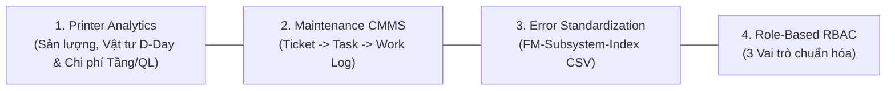

# FleetMonitor — Tổng Quan Dự Án & Sơ Đồ Hệ Thống (Project Overview & Master Index)

> **Dự án:** FleetMonitor — Hệ thống Giám sát & Quản trị Máy in Doanh nghiệp Tập trung  
> **Quy mô:** Hạm đội ~100 máy in đa thương hiệu (Ricoh, Canon, HP, Brother, Epson, Xerox) phân bổ trên 5 tầng/khu vực  
> **Phiên bản:** 2.6.0  
> **Trạng thái:** Master Architecture & Implementation Index (Mục lục tra cứu tài liệu kỹ thuật tối cao)

---

## 1. Tầm Nhìn, Lộ Trình Mở Rộng & 4 Trọng Tâm Nghiệp Vụ

**FleetMonitor** được định hướng phát triển từ bài toán thực tế của **hệ thống máy in doanh nghiệp (Giai đoạn 1)** làm nền tảng chuẩn hóa quy trình giám sát, kiểm kê, bảo trì và hạch toán chi phí, tiến tới **Hệ thống Quản trị Tài sản Doanh nghiệp & Đối chiếu Thừa/Thiếu gắn kết Chi phí – Doanh thu (Giai đoạn 2+)**:

### 1.1. Giai đoạn 1 (Hiện tại) — Giám sát & Quản trị Hạm đội Máy in Tập trung
Chuyển đổi từ mô hình bảo trì thụ động sang **Vận hành Chủ động & Dự báo Sớm**:



1. **Printer Analytics & Cost Control:**
   - Trực quan hóa 100% Pure React SVG (Biểu đồ Biến động sản lượng in, Bảng sản lượng theo thiết bị, Modal so sánh chi tiết thiết bị).
   - Dự báo cạn kiệt vật tư theo thời gian thực với huy hiệu đếm ngược **D-Day** (`[D-4]`, `[D-7]`, `[D-25]`) dựa trên tốc độ tiêu hao trượt 7 ngày.
   - Hạch toán **SLA & Chi phí** theo **Tầng & Người quản lý đại diện** (Donut Chart + Bảng khoản chi chi tiết gồm *Sửa chữa*, *Vật tư* và *Chi phí khác*), bảng *Máy in lỗi nhiều & Chi phí sửa chữa* và *Bảng mã lỗi lặp lại*.
2. **Maintenance CMMS Management:**
   - Quản lý khép kín vòng đời 3 tầng: `Ticket (Sự cố) -> Task (Lệnh bảo trì) -> Work Log (Nhật ký thực địa & Chi phí VNĐ)`.
   - Lưu trữ ảnh hiện trường và biên bản nghiệm thu trực tiếp lên MinIO S3 qua Presigned URLs.
3. **Error Code Standardization (6 Thương Hiệu):**
   - Chuẩn hóa toàn bộ mã lỗi đa hãng (Ricoh SC, Canon E-code, HP Numeric, Brother, Epson, Xerox) sang bộ mã chuẩn nội bộ `FM-<SUBSYSTEM>-<INDEX>`.
   - Quản lý từ điển qua tính năng Import/Export CSV kiểm duyệt Dry-Run 2 bước tại giao diện Cài đặt (`/settings/dictionary`).
4. **Multi-User RBAC (3 Vai Trò Chuẩn Hoá):**
   - Phân quyền 3 nhóm đối tượng: **1) Admin IT & NOC** (Toàn quyền), **2) Field Technician** (Kỹ thuật viên bảo trì hiện trường), **3) HR / Asset Inventory** (Quản trị tài sản & Chi phí). Nhân sự tác nghiệp không bị giới hạn xem theo chi nhánh.

### 1.2. Định hướng Mở rộng (Giai đoạn 2+) — Quản lý Tài sản Doanh nghiệp & Đối chiếu Thừa/Thiếu
Từ nền tảng giám sát, quản lý theo tầng/người đại diện và hạch toán chi phí của hạm đội máy in ở Giai đoạn 1, dự án mở rộng sang **Quản trị Toàn bộ Tài sản Công ty (TSCĐ, CCDC, thiết bị CNTT, tồn kho vật tư)** nhằm giải quyết triệt để **3 mục tiêu cốt lõi**:

1. **Mục tiêu 1 — Khớp 100% giữa Thực tế – Sổ tài sản – Sổ cái kế toán:**
   - *Vấn đề giải quyết:* Xóa bỏ tình trạng "3 nơi 3 số" giữa kiểm đếm thực tế, file quản lý riêng và sổ kế toán.
   - *Giải pháp xây dựng:*
     - **Kiểm kê thực tế (QR/Mã vạch) vs Sổ tài sản:** Gắn mã QR định danh duy nhất cho từng tài sản; tạo đợt kiểm kê định kỳ/đột xuất để quét và xuất tự động danh sách **Thiếu** (mất/thất lạc) và **Thừa** (chưa ghi sổ).
     - **Sổ tài sản vs Sổ cái kế toán:** Đối chiếu số dư, biến động tăng/giảm, khấu hao và chi phí trả trước (`242`) để phát hiện lệch số liệu do nhập tay hoặc điều chỉnh chưa đồng bộ.
2. **Mục tiêu 2 — Tối ưu hiệu suất sử dụng (Nhận diện Dư thừa & Thiếu hụt theo nhu cầu):**
   - *Vấn đề giải quyết:* Tránh tình trạng thiết bị nằm im gây chôn vốn ở nơi này trong khi nơi khác thiếu thiết bị hoặc phải mua mới lãng phí.
   - *Giải pháp xây dựng:*
     - Quản lý chặt vòng đời trạng thái: **`Đang dùng` – `Trong kho` – `Hư hỏng / Chờ thanh lý`**.
     - Cảnh báo tài sản nhàn rỗi quá hạn hoặc khu vực thiếu hụt định mức; đề xuất **Điều chuyển nội bộ** hoặc **Thanh lý** trước khi duyệt mua sắm mới.
3. **Mục tiêu 3 — Gắn kết trực tiếp Thừa/Thiếu với Chi phí & Doanh thu:**
   - *Tác động tới Chi phí:*
     - *Tài sản thừa/nhàn rỗi:* Đo lường chi phí đang phát sinh vô ích (khấu hao, lưu kho, bảo trì, bảo hiểm, thuê mặt bằng) để làm cơ sở thanh lý/điều chuyển.
     - *Tài sản thiếu/mất mát:* Gắn với **Người quản lý đại diện** và lịch sử bàn giao để làm rõ nguyên nhân (khách quan/chủ quan), quy trách nhiệm bồi thường và hạch toán chênh lệch minh bạch.
   - *Tác động tới Doanh thu:*
     - *Chống gián đoạn:* Cảnh báo thiếu thiết bị/tồn kho/công cụ kịp thời để không trễ đơn hàng, không giảm năng lực phục vụ.
     - *Cải thiện biên lợi nhuận:* Điều chuyển tài sản dư sang bộ phận tạo doanh thu hoặc thanh lý thu hồi vốn, giảm chi phí mua sắm mới.

---

## 2. Bản Đồ Thư Mục Tài Liệu Kỹ Thuật (Documentation Sitemap)

Hệ thống tài liệu FleetMonitor được tinh gọn tập trung tại `docs/`:

```text
docs/
├── README.md                    # Cổng thông tin tài liệu trung tâm
├── overview.md                  # Tổng quan dự án, lộ trình mở rộng & Compliance Matrix
├── business_requirements.md     # Yêu cầu nghiệp vụ, Đối chiếu thừa/thiếu & RBAC
├── architecture.md              # Kiến trúc kỹ thuật, PostgreSQL, MinIO S3 & Cache
├── api_contract.md              # Hợp đồng REST API chuẩn hóa giữa FE & BE
├── workflows.md                 # Luồng cảnh báo Zabbix & Vòng đời bảo trì CMMS
├── snmp_zabbix_guide.md         # Bản đồ đo lường SNMP, OIDs & Zabbix Template
├── roadmap_and_progress.md      # Tiến độ triển khai & Danh mục task
└── snmp-oids/
    ├── error_dictionary_import.csv
    ├── zabbix_template_fleetmonitor_snmp.yaml
    └── snmp_walk_probe.sh
```

---

## 3. Công Nghệ & Tuân Thủ Nguyên Tắc (Compliance Matrix)

| Hạng mục | Công nghệ được duyệt | Quy định bắt buộc trong AGENTS.md |
| :--- | :--- | :--- |
| **Frontend Framework** | React 18 + TypeScript + Vite | File length hard limit: $< 300\text{ LOC}$ (Rule 7.1) |
| **Data Visualization** | 100% Pure React SVG | Loại bỏ hoàn toàn ECharts/WebGL cồng kềnh, tối ưu Retina/HiDPI |
| **Biểu tượng (Icons)** | **FontAwesome duy nhất** (`@/shared/icons/`) | Nghiêm cấm sử dụng các thư viện icon khác (Rule 7.1) |
| **Backend & Poller** | Node.js / Express / TypeScript (ES Modules) | In-Process Singleton Poller (Fast 30s / Slow 1h) |
| **Bộ đệm In-Memory** | In-Memory Cache TTL 60s | Phản hồi UI $< 50\text{ms}$ (thực tế $< 5\text{ms}$), không cần Redis |
| **Cơ sở dữ liệu** | PostgreSQL 16 + Prisma ORM | Bảng Rollup tinh gọn ~36.5k rows/năm ($\approx 5\text{MB/năm}$) |
| **Lưu trữ tệp tin** | MinIO S3 Object Storage | Presigned Upload/Download URL có chữ ký bảo mật 15 phút |
| **Độ toàn vẹn dữ liệu** | `MetricValue = number | null` | Thiếu dữ liệu hiển thị `—`, tuyệt đối không thay bằng số 0 |
| **Trường cấm** | Không có trường `actionGuidance` | Tuân thủ 100% Rule 6 AGENTS.md |

