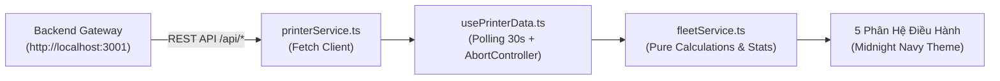

# Web Frontend — FleetMonitor

> **Giao Diện Điều Hành & Giám Sát Đội Máy In Mạng Tập Trung**  
> Xây dựng với React 18, Vite 5, Strict TypeScript, Chart.js và phong cách thiết kế hiện đại **Midnight Charcoal-Navy Dashboard**.

---

## 1. Tổng Quan Kiến Trúc Frontend

Frontend hoạt động như một ứng dụng Single Page Application (SPA), kết nối với **Backend API Gateway** để nhận dữ liệu máy in đã được chuẩn hóa từ Zabbix Web API:



### Phong Cách Giao Diện "Midnight Dashboard"
- **Nền tổng thể:** Tông xanh đen than chì sâu thẳm (`#080B14` đến `#0B1020`) với ánh sáng vi tế, không gây chói mắt khi vận hành 24/7.
- **Thẻ và bảng biểu:** Bề mặt tối than chì (`#0D111D` đến `#111827`) với viền siêu mỏng và độ tương phản thanh lịch.
- **Huy hiệu (Badges) & Nút lọc (Filter Pills):** Nền bán trong suốt (translucent) nhẹ nhàng, viền mờ mềm mại, phân định rõ ràng các trạng thái: `Online` (xanh ngọc), `Warning` (vàng hổ phách), `Critical` (đỏ cờ), `Offline` (than xám).
- **Điều khiển biểu mẫu (Inputs & Selects):** Đồng bộ hoàn toàn nền tối với chữ trắng sáng, triệt tiêu nền trắng chói.

---

## 2. 5 Phân Hệ Chức Năng Cốt Lõi

1. **Bảng Điều Khiển (Dashboard):**
   - 4 thẻ KPI chỉ số chính: Tổng số máy in, Tỷ lệ sẵn sàng (Availability %), Cảnh báo lỗi cần xử lý, Mức mực trung bình.
   - Biểu đồ phân bổ trạng thái hoạt động (Donut Chart) và phân bổ theo hãng sản xuất.
   - Danh sách "Máy in cần chú ý ngay" (Attention Required) hiển thị cảnh báo lỗi phần cứng và mức mực cạn.

2. **Danh Mục Máy In (Printers):**
   - Bảng danh bạ máy in mạng đa hãng với bộ lọc nhanh (Tất cả, Trực tuyến, Cảnh báo, Lỗi, Ngoại tuyến).
   - Ô tìm kiếm tức thì theo tên, địa chỉ IP, vị trí hoặc nhãn hiệu.
   - Xem chi tiết từng máy in với **Modal 5 phân vùng chuyên sâu**: Tổng quan, Mực in & Hộp thải, Khay nạp giấy, Lỗi phần cứng thời gian thực và Bộ đếm sản lượng.

3. **Vật Tư Tiêu Hao (Supplies):**
   - Giám sát mức mực 4 màu chuẩn (Black, Cyan, Magenta, Yellow) và trạng thái hộp mực thải (Waste Toner Box).
   - Biểu đồ phân bổ mức mực và bộ lọc chuyển đổi nhanh giữa các màu mực.
   - Danh sách máy in sắp hết mực (< 15%) hoặc hộp mực thải đầy (≥ 85%).

4. **Nhật Ký Sự Cố (Incidents):**
   - Quản lý vòng đời sự cố phần cứng theo mức độ ưu tiên: `Critical`, `Warning`, `Info`.
   - Phân loại lỗi chi tiết: Kẹt giấy, hết giấy, mở nắp, hỏng động cơ/scanner/ADF, lỗi mực thải.
   - Hỗ trợ thao tác tiếp nhận và đóng/giải quyết sự cố với Modal chi tiết sự cố.

5. **Thống Kê Sản Lượng & Phân Tích (Analytics):**
   - Biểu đồ sản lượng in ấn theo thời gian (Tuần, Tháng, Quý, Năm).
   - Bảng xếp hạng máy in có tần suất sử dụng cao nhất (Top Print Volume).
   - Tính năng trích xuất báo cáo dữ liệu định dạng CSV.

---

## 3. Cấu Trúc Mã Nguồn

```text
frontend/
├── src/
│   ├── index.css              # Hệ thống biến CSS Token, Midnight Dashboard theme, badges, inputs
│   ├── App.tsx                # Layout chính (Sidebar navigation, Dynamic Content View)
│   ├── main.tsx               # Điểm khởi chạy React 18 SPA bọc trong ErrorBoundary
│   ├── types/
│   │   └── printer.ts         # Contracts dữ liệu thống nhất (MetricValue = number | null)
│   ├── services/
│   │   ├── printerService.ts  # Tầng kết nối REST API tới Backend (/api/printers, /api/incidents)
│   │   └── fleetService.ts    # Logic tính toán thuần khiết: KPIs, thống kê hãng, máy cần chú ý
│   ├── hooks/
│   │   └── usePrinterData.ts  # Custom hook quản lý polling 30s, abort controller, loading/stale state
│   ├── diagnostics/           # Từ điển chẩn đoán mã lỗi giao diện (Vendor-specific SC & Alarm codes)
│   │   ├── index.ts           # Hàm resolveDiagnostic, trích xuất mã lỗi, phân hệ & mức độ
│   │   ├── types.ts           # Diagnostic interfaces cho UI
│   │   └── vendors/           # Từ điển mã lỗi Ricoh SC, Canon Alarm, RFC 3805
│   ├── components/
│   │   ├── ErrorBoundary.tsx  # Bắt lỗi runtime cấp ứng dụng và hiển thị màn hình fallback
│   │   ├── Sidebar.tsx        # Menu 5 phân hệ với badge đếm sự cố
│   │   ├── dashboard/         # Thẻ KPI, Donut Chart, Vendor Bar Chart, Bảng tóm tắt, Timeline
│   │   ├── printers/          # Header, Filter Pills, Search Bar, Bảng danh bạ máy in
│   │   ├── supplies/          # Alert Cards, Biểu đồ thanh 4 màu mực, Bảng vật tư tiêu hao
│   │   ├── incidents/         # KPI sự cố, Biểu đồ phân bổ mức độ nghiêm trọng, Bảng nhật ký sự cố
│   │   ├── analytics/         # Thống kê sản lượng in, Biểu đồ xếp hạng Top Volume, Biểu đồ xu hướng tải
│       └── modals/
│           ├── IncidentDetailModal.tsx # Modal chi tiết và xử lý sự cố phần cứng
│           └── PrinterDetailModal/     # Modal chi tiết máy in gồm 5 phân vùng chuyên sâu:
│               ├── PrinterModalHeader.tsx
│               ├── PrinterDiagnosticBanner.tsx
│               ├── PrinterGeneralInfoSection.tsx
│               ├── PrinterHealthSection.tsx
│               ├── PrinterSuppliesSection.tsx
│               ├── PrinterCountersSection.tsx
│               ├── PrinterIncidentsSection.tsx
│               └── PrinterDetailModal.tsx
│   ├── pages/
│   │   ├── Dashboard.tsx
│   │   ├── Printers.tsx
│   │   ├── Supplies.tsx
│   │   ├── Incidents.tsx
│   │   └── Analytics.tsx
│   └── __tests__/
│       ├── setup.ts           # Vitest environment setup
│       ├── fleetService.test.ts # 23 unit test cases kiểm thử logic tính toán
│       └── diagnostics.test.ts  # 16 unit test cases kiểm thử tra cứu chẩn đoán lỗi
├── package.json
├── tsconfig.json              # TypeScript strict mode
└── vite.config.ts             # Cấu hình Vite & Vitest
```

---

## 4. Hướng Dẫn Cài Đặt & Chạy

### 1. Cài đặt dependencies:
```bash
npm install
```

### 2. Khởi chạy môi trường phát triển:
```bash
npm run dev
```
Truy cập giao diện tại: `http://localhost:3000`.

### 3. Kiểm tra chất lượng mã nguồn:
```bash
npm run typecheck   # Kiểm tra nghiêm ngặt kiểu dữ liệu TypeScript (0 lỗi)
npm run test        # Chạy toàn bộ 39 unit test cases với Vitest (100% pass)
npm run build       # Biên dịch gói sản phẩm (Production build)
```

---

## 5. Quy Tắc Dữ Liệu & Trạng Thái

- Tuân thủ quy định tại [docs/AGENTS.md](file:///f:/Code/Github/Monitoring/docs/AGENTS.md).
- Khi Backend chưa chạy hoặc chưa có dữ liệu từ Zabbix, Frontend sẽ tự động hiển thị trạng thái **No Data / Pending State** trung thực, tuyệt đối không âm thầm sinh dữ liệu giả lập (mock data).
- Xử lý tường minh các trạng thái giá trị thiếu hụt (`null`) thông qua `MetricValue = number | null`, hiển thị `Chưa có dữ liệu` thay vì gán mặc định là 0.
